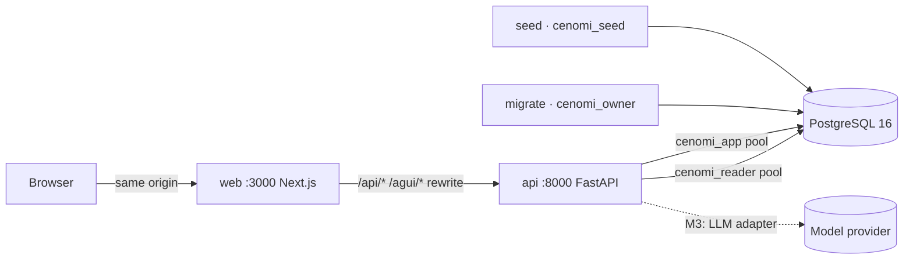
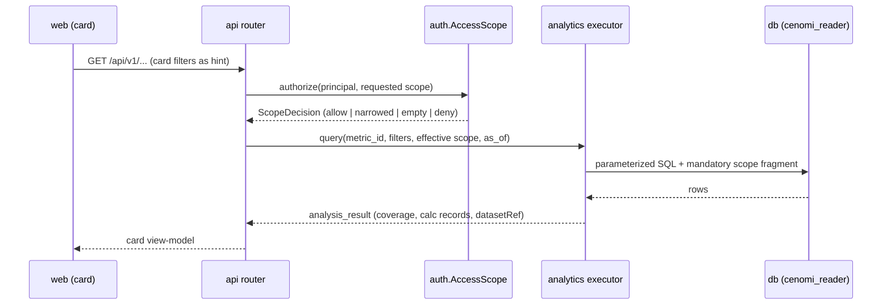
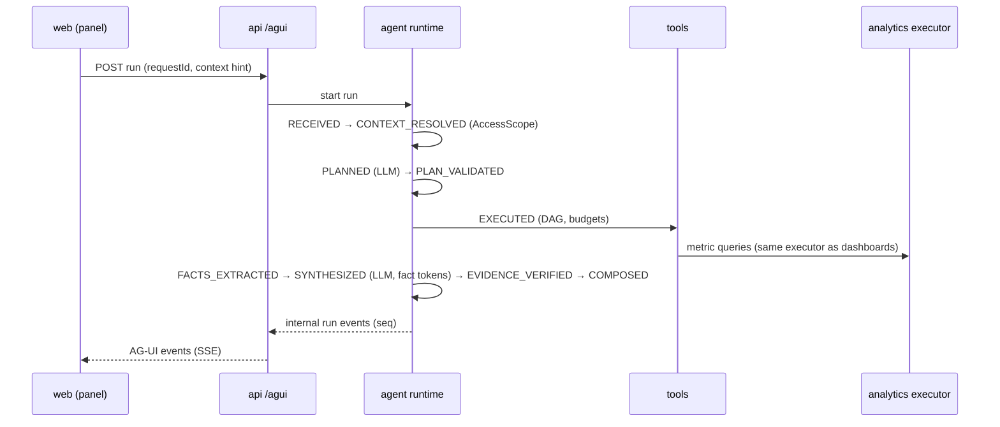

# ARCHITECTURE — system architecture and engineering seams

| | |
|---|---|
| Document code | ARCH (requirement IDs `ARCH-Rnnn`) |
| Version | 1.0 · 2026-10-22 · PR-M0 (CF-0) |
| Status | Proposed in PR-M0; normative when merged |
| Rests on | GD architecture tab (`docs/reference/final-design-gate/02_ARCHITECTURE_AND_INTERACTION_MODEL.md`); DR-013, 016, 019–021, 027–032, 037; DXD-05, 06, 12, 17, 19, 25–40, 46; ADR-0002 to ADR-0006, ADR-0015 |
| Later milestones extend | §5.1 rows (as modules are built), §8 (PR-M3, PR-M4), §9.4 (PR-M1, ADR-0008), §13.2 (PR-M3) |

**How to read this document.** Statements in bold with an `ARCH-Rnnn` ID are normative; everything else explains. Machine-readable contracts live in `specs/` and are cited by path, never copied. Decisions are cited by ID.

---

## 1. Scope

This document fixes the seams every later milestone plugs into:
- runtime processes and their boundaries;
- backend module boundaries and conventions;
- the web application structure;
- data ownership and migration rules;
- the agent, model-provider and AG-UI interface boundaries;
- the security model;
- the verification (testing) architecture;
- sources of truth;
- traceability;
- observability.

It deliberately does **not** fix:

| Not fixed here | Where it is fixed |
|---|---|
| Business tables | DATABASE_SCHEMA, PR-M1 |
| Metric definitions | Metric YAML and KPI_CATALOG, PR-M1 |
| Card designs | DESIGN_SYSTEM and card specs, PR-M2 |
| Agent internals | AGENT_ARCHITECTURE, PR-M3 |
| Event mapping details | AGUI_INTEGRATION, PR-M4 |
| Detector rules | PROACTIVE_INTELLIGENCE, PR-M6 |

---

## 2. Runtime processes

Docker Compose, local only (DR-037).

| Process | Port | Technology | Owns | Must never |
|---|---|---|---|---|
| `web` | 3000 | Next.js 16 on Node 22 | Rendering, routing, client state, chart primitives, GenUI renderers (M4), AG-UI client (M4); same-origin proxy of `/api/*` and `/agui/*` to `api` | Query the database, compute a metric, call an LLM, decide authorization, render model-written HTML or URLs, hold secrets |
| `api` | 8000 | FastAPI on uvicorn, Python 3.12 | REST, AG-UI SSE endpoint (M4), agent runtime in-process (M3), LLM adapter (M3), AccessScope, metric executor (M2), insight service (M6) | Let model output reach SQL; build SQL by string concatenation; serve UI; run migrations or seeds at start-up |
| `db` | 5432 | PostgreSQL 16 | Schemas `core`, `meta`, `snap`, `seed_meta`, `agent`, `insights` (ADR-0006) | Be reached by `web` |
| `migrate` | — | One-shot, `api` image, Compose profile `setup` | `alembic upgrade head` as `cenomi_owner` | Run implicitly |
| `seed` | — | One-shot, `api` image, profile `setup` (active from M1) | Deterministic data, snapshots, seed hash, verify, as `cenomi_seed` | Run against a database that is not a guarded local or test database (§7.3) |
| Insight replay | — | Command `cenomi insights replay` (M6) | Checkpoint replay up to `as_of` | Run as a background scheduler (DR-005) |

**ARCH-R001** `web` reaches `api` only through its server-side rewrite target `API_INTERNAL_URL`. The browser only ever talks to the `web` origin.

**ARCH-R002** `api` does not run migrations, seeds or replays during start-up. If the database is not at the expected migration head, `/api/v1/health` reports `fail` and the API still starts. This makes the failure visible instead of masking it.



---

## 3. Layers and their modules

The ten GD layers map onto backend modules as follows. Several layers live inside one module, and the layer boundary is then a sub-package boundary.

| GD layer | Responsibility | Module | Built in |
|---|---|---|---|
| State machine | Run lifecycle, budgets, recovery, cancellation | `cenomi.agent.runtime` | M3 |
| Task DAG | Bounded parallel execution, at most one re-plan | `cenomi.agent.dag` | M3 |
| Agent (planner, synthesizer) | Intent, plan, explanation; fact tokens only | `cenomi.agent.planner`, `.synthesis` | M3 |
| Semantic layer | Metric definitions, versions, kinds, relationships, unavailable concepts | `cenomi.semantic` | M2 (loader), M1 (YAML) |
| Analytics execution | Parameterized SQL with scope fragment; derivations; datasets | `cenomi.analytics` | M2 |
| Context and evidence | Analytical state, facts, envelopes, versions, run ledger | `cenomi.agent.state`, `.evidence` | M3 |
| Presentation | Policy, registry, validation, table fallback | `cenomi.presentation` | M4 |
| AG-UI | Transport | `cenomi.agui` | M4 |
| Proactive intelligence | Detectors, lifecycle, runner | `cenomi.insights` | M6 |
| Authorization | AccessScope on every read, resume, import, deep link and delivery | `cenomi.auth` | M0 (interface), M1 (model) |

---

## 4. Principal flows

These sequences are normative only for the ordering and the boundaries they show. Payload shapes belong to the owning contracts.

### 4.1 Dashboard read (from M2)



### 4.2 Agent run (M3 runtime, M4 transport)



### 4.3 Proactive replay (M6)

`cenomi insights replay` walks the checkpoint calendar (DXD-75) up to `as_of`. For each `run_key` (DXD-86) it evaluates detectors through the **same executor**, then stages, publishes atomically and writes outbox rows. Delivery re-checks AccessScope (DXD-65).

**ARCH-R003** Dashboards, agent tools and detectors obtain every business number from `cenomi.analytics`. No other module contains SQL that reads `core`, `meta` or `snap` (MET-01, DR-030).

---

## 5. Backend architecture

### 5.1 Package and module map

The package is `backend/src/cenomi/` (ADR-0005).

| Module | Responsibility | Public interface (the only importable surface) | Built in |
|---|---|---|---|
| `core` | Settings; logging; telemetry; error base classes; dataset clock; request references | `cenomi.core.settings.Settings`, `get_settings()`; `cenomi.core.logging.configure_logging()`; `cenomi.core.telemetry.configure_telemetry()`; `cenomi.core.errors.*` (§5.5); `cenomi.core.clock.DatasetClock`; `cenomi.core.ids.new_request_ref()` | M0 |
| `contracts` | Pydantic models of every `specs/contracts` schema | `cenomi.contracts.<name>` model classes | M0 (bootstrap), grows each milestone |
| `db` | Async engines and pools per role; table metadata; role and grant verification | `cenomi.db.engines.reader_engine()`, `app_engine()`; `cenomi.db.health.check_database()`; `cenomi.db.tables` (M1) | M0 |
| `auth` | Sessions; principal resolution; AccessScope; permission loader (M1) | `cenomi.auth.session.*`; `cenomi.auth.scope.AccessScope.authorize()`; FastAPI dependencies `current_principal`, `require_permission` (M1) | M0 |
| `semantic` | Metric registry loader and validator | `cenomi.semantic.registry.MetricRegistry` | M2 (empty package in M0) |
| `analytics` | Metric executor, SQL templates, scope fragment, derivations, dataset store | `cenomi.analytics.executor.MetricExecutor` | M2 (empty package in M0) |
| `presentation` | Composer, policy, validator | `cenomi.presentation.*` | M4 (empty package in M0) |
| `agent` | Runtime, planner, DAG, tools, facts, verifier, LLM adapter | `cenomi.agent.*` (§8) | M3 (empty package in M0) |
| `agui` | AG-UI endpoint, event mapping, state sync | `cenomi.agui.router` | M4 (empty package in M0) |
| `insights` | Detectors, runner, outbox, inbox service | `cenomi.insights.*` | M6 (empty package in M0) |
| `api` | FastAPI app factory and REST routers | `cenomi.api.app.create_app()` | M0 |
| `seed` | Generator, snapshots, verification; command line only | `cenomi.seed.cli` | M1 (empty package in M0) |

**ARCH-R004** Each module directory contains a `README.md`. It states the module's responsibility, its public interface, its allowed imports and the milestone that builds it. A module that is not yet built contains only `__init__.py` and that README.

**ARCH-R005** Only names re-exported from a module's top-level `__init__.py`, or listed as its public interface above, may be imported by other modules. Imports of underscore-prefixed sub-modules across module boundaries are forbidden.

### 5.2 Dependency rules (import-linter)

**ARCH-R006** Allowed imports between `cenomi` modules are exactly these; everything else is forbidden.

| Module | May import |
|---|---|
| `core` | — (no `cenomi` module) |
| `contracts` | — (no `cenomi` module) |
| `db` | `core`, `contracts` |
| `auth` | `core`, `contracts`, `db` |
| `semantic` | `core`, `contracts` |
| `analytics` | `core`, `contracts`, `db`, `auth`, `semantic` |
| `presentation` | `core`, `contracts`, `auth`, `semantic`, `analytics` |
| `agent` | `core`, `contracts`, `db`, `auth`, `semantic`, `analytics`, `presentation` |
| `agui` | `core`, `contracts`, `auth`, `agent`, `presentation` |
| `insights` | `core`, `contracts`, `db`, `auth`, `semantic`, `analytics`, `presentation`, and `agent.evidence` only (OQ-ARCH-01) |
| `seed` | `core`, `contracts`, `db`, `semantic`, `analytics` |
| `api` | Every module except `seed` |

**ARCH-R007** No module imports `api` or `seed`. `analytics` never imports `agent`, `presentation`, `agui`, `insights` or `api`.

The contracts are expressed in `backend/.importlinter`, and `make backend-lint` runs them. AT-M0-T03-04 includes a negative test: a temporary forbidden import must make the check fail.

### 5.3 FastAPI application conventions

**ARCH-R008** The app is built by `create_app(settings)`. There are no module-level app singletons other than the ASGI entrypoint `cenomi.api.main:app`. A `lifespan` handler:
- configures logging and telemetry;
- creates the reader and app engines;
- disposes them on shutdown.

**ARCH-R009** Routers live in `cenomi.api.routers.<area>` (M0: `health`, `session`, `dataset`). Each router module declares, for every route:
- its contract models (request and response classes from `cenomi.contracts`);
- its authentication requirement;
- from M1, its permission.

A route registry test, active from M1, asserts that every route declares a permission or is explicitly public.

**ARCH-R010** Handlers contain no business logic. They validate input, call one service function in the owning module, and map the result to a contract model.

**ARCH-R011** All I/O is async. The database is reached through SQLAlchemy Core 2.0 async engines with psycopg 3. A CPU-bound step uses `asyncio.to_thread`.

### 5.4 API conventions

| # | Convention | Rule |
|---|---|---|
| **ARCH-R012** | Paths | REST is under `/api/v1/`. AG-UI is under `/agui/v1/` (M4). Resource names are kebab-case plural nouns. Breaking changes create `/api/v2` routes under a CR (ADR-0004 §5) |
| **ARCH-R013** | Wire format | JSON, camelCase field names, RFC 3339 UTC timestamps, Asia/Riyadh calendar dates, decimal-string money (ADR-0004 §4). Responses set `Cache-Control: no-store` |
| **ARCH-R014** | Request validation | Bodies and query parameters are validated against the contract models. **Unknown query parameters and unknown body fields are rejected** with `400 VALIDATION_ERROR`; the TA §7.1 rule is to reject unsupported filters. Validation errors are returned as `400`, not FastAPI's default `422`. Details name the path and rule, **never echo submitted values** |
| **ARCH-R015** | Errors | Every non-2xx response body is an `error_envelope.v1` (`specs/contracts/error_envelope.v1.schema.json`). Its `code` is in `specs/contracts/error_codes.v1.yaml` |
| **ARCH-R016** | Uniform refusal | A request for a resource by identifier that is unauthorized **or** does not exist returns `404 NOT_AVAILABLE` with an identical body apart from `requestRef` (DXD-85, SEC-03). A route whose permission the principal lacks also returns `404 NOT_AVAILABLE`. The API never distinguishes "forbidden" from "absent" |
| **ARCH-R017** | Empty scope | A query whose effective scope is empty returns `200` with an empty result and coverage `scope_empty`. Never global data, never an error (DR-020, SEC-02). Active from M2 |
| **ARCH-R018** | Pagination | List endpoints are cursor-paginated: query `limit` (default 50, maximum 200) and `cursor` (opaque, bound to principal, scope fingerprint and dataset ID). The response carries `page: {nextCursor, limit}`. Offset pagination is not used |
| **ARCH-R019** | Idempotency | Any request that creates server state carries a client-generated `requestId` (UUID v4) in its body. Repeating the same `requestId` for the same principal returns the original result and creates nothing (DXD-40). Sign-in and sign-out are naturally idempotent and exempt |
| **ARCH-R020** | Request reference | The API assigns every HTTP request a `requestRef` (`req_` + 16 lowercase hex characters). It is returned in the `X-Request-Ref` response header and in every error envelope, and logged on every line written while handling the request (§13). The client-generated `requestId` of ARCH-R019 is a different identifier and the two are never conflated |
| **ARCH-R021** | Tracing | W3C `traceparent` is accepted and propagated. When absent, the API starts a new trace |

**Route ownership.** `docs/contracts/API_CONTRACTS.md` (PR-M2) becomes the index of all routes. Until then the M0 routes are:

| Method and path | Auth | Request | Response | Card |
|---|---|---|---|---|
| `GET /api/v1/health/live` | Public | — | `health_report.v1`; only the `process` check | M0-T03 |
| `GET /api/v1/health` | Public | — | `health_report.v1`; `200` when `ok` or `degraded`, `503` when `fail` | M0-T03 |
| `GET /api/v1/dataset` | Public | — | `dataset_descriptor.v1` | M0-T03 |
| `GET /api/v1/me` | Session | — | `principal.v1`; `401 UNAUTHENTICATED` without a valid session | M0-T06 |
| `GET /api/v1/auth/dev/principals` | Public, only when `AUTH_MODE=dev_fixture` | — | List of `{principalId, displayName, persona, role}` | M0-T06 (ED-07) |
| `POST /api/v1/auth/dev/sign-in` | Public, only when `AUTH_MODE=dev_fixture` | `{principalId}` | `principal.v1`; sets the session cookie | M0-T06 (ED-07) |
| `POST /api/v1/auth/sign-out` | Session | — | `204`; clears the cookie | M0-T06 |

When `AUTH_MODE` is not `dev_fixture`, the dev routes are **not mounted**, so they return `404`.

### 5.5 Error handling

**ARCH-R022** Errors raised inside the backend derive from `cenomi.core.errors.CenomiError`, which carries a registry `code`. One exception handler maps every `CenomiError` to the code's HTTP status and an `error_envelope.v1`.

**ARCH-R023** Any other exception becomes `500 INTERNAL`. The envelope message is generic ("Something went wrong."). The stack trace is logged with the `requestRef` and never returned.

**ARCH-R024** A database connection failure becomes `503 DEPENDENCY_UNAVAILABLE` with `retryable: true`.

The M0 exception classes and their codes are:

| Class | Code |
|---|---|
| `ValidationFailed` | `VALIDATION_ERROR` |
| `Unauthenticated` | `UNAUTHENTICATED` |
| `NotAvailable` | `NOT_AVAILABLE` |
| `Conflict` | `CONFLICT` |
| `DependencyUnavailable` | `DEPENDENCY_UNAVAILABLE` |
| `Internal` | `INTERNAL` |

Later milestones add classes for the codes reserved in `error_codes.v1.yaml`.

**ARCH-R025** Error messages shown to users are plain language and contain no SQL, stack traces, identifiers of out-of-scope entities, or secrets. This follows the DX2 States board, state 5: a plain message, a reference and Retry.

### 5.6 Configuration and environment

**ARCH-R026** Configuration is a single `pydantic-settings` class, `cenomi.core.settings.Settings`, read from environment variables, with an optional untracked `.env` for local development. Every variable is listed in `.env.example` and in DEVELOPMENT_ENVIRONMENT §4.

The application refuses to start (exits with a clear message and a non-zero status) when:

| # | Condition |
|---|---|
| a | A required variable is missing |
| b | `CENOMI_ENV` is not one of `dev`, `test`, `ci` |
| c | `CENOMI_AS_OF` does not parse as a date |
| d | `LLM_MODE=live` and `LLM_API_KEY` is empty (active from M3) |
| e | `AUTH_MODE=dev_fixture` while `CENOMI_ENV` is not `dev`, `test` or `ci`. This POC has no other environment; the check protects against misuse |
| f | `SESSION_SECRET` is shorter than 32 bytes |

**ARCH-R027** Secrets are typed `SecretStr`. They are never logged, never placed in error envelopes or AG-UI events, and never exposed to `web`. The only configuration `web` reads is `API_INTERNAL_URL` (server-side). No `NEXT_PUBLIC_*` variable carries a secret.

**ARCH-R028** Dataset identity (`CENOMI_DATASET_ID`, `CENOMI_AS_OF`, `CENOMI_TZ`) is configuration in M0. From M1, `meta` is authoritative: the API compares configuration with `meta` at start-up and `/api/v1/health` reports a mismatch as `fail`.

**ARCH-R029** No business code reads the wall clock for business logic. "Now" in business terms is `DatasetClock.as_of`. Metric SQL never calls `NOW()` (DR-003). Wall-clock time is used only for logs, session expiry and timings.

### 5.7 Logging and health checks

**ARCH-R030** Logs are JSON lines on stdout, one object per event, with the fields in §13.1. The format is identical locally and in CI. Python's standard `logging` is used with a JSON formatter in `cenomi.core.logging`; no logging framework dependency is added.

**ARCH-R031** `/api/v1/health` runs the checks below and returns `health_report.v1`. Status rules:
- `ok` when all required checks pass;
- `degraded` when only non-required checks fail;
- `fail` (HTTP 503) when any required check fails.

Checks are bounded by a 2-second total timeout. A check that times out fails.

| Check | Required | Passes when |
|---|---|---|
| `process` | yes | Always (the process answered) |
| `db_reader` | yes | Connects as `cenomi_reader`; `SHOW transaction_read_only` = `on` |
| `db_app` | yes | Connects as `cenomi_app` |
| `schemas_present` | yes | All six schemas of ADR-0006 exist |
| `role_isolation` | yes | Through `has_schema_privilege` / `has_table_privilege` only, with no write attempted: `cenomi_reader` has no CREATE or write on any schema and no USAGE on `seed_meta`, `agent`, `insights`; `cenomi_app` has no USAGE on `core`, `meta`, `snap`, `seed_meta` |
| `migrations_at_head` | yes | `public.alembic_version` equals the head revision bundled with the build |
| `dataset` | no in M0; yes from M1 | M0: reports `skipped` with detail "dataset not seeded until M1". M1+: `meta` matches configuration (ARCH-R028) |

### 5.8 PostgreSQL connection architecture

**ARCH-R032** The `api` process holds exactly two pools.

| Pool | Role | Sizing | Session settings | Used by |
|---|---|---|---|---|
| Reader | `cenomi_reader` | `DB_READER_POOL_SIZE` (default 10) | Read-only transactions; `statement_timeout` from `DB_READER_STATEMENT_TIMEOUT_MS` (default 5000, never above the role default) | The metric executor and health checks only |
| App | `cenomi_app` | `DB_APP_POOL_SIZE` (default 5) | — | Agent and insight state |

`cenomi_owner` and `cenomi_seed` credentials are never loaded by the `api` process. Only `migrate`, `seed` and test fixtures use them.

**ARCH-R033** All SQL is parameterized through SQLAlchemy Core constructs or bound `text()` parameters. String formatting or concatenation of SQL is forbidden. `make backend-lint` enforces this with a ruff rule set (`S608`) plus a custom check for f-strings passed to `text()`.

### 5.9 Command-line entrypoint

**ARCH-R034** One console script, `cenomi`, built on standard-library `argparse`, exposes sub-commands. The Makefile calls these; no Make target embeds Python logic.

| Sub-command | Available from |
|---|---|
| `cenomi db verify-roles` | M0 |
| `cenomi seed run` | M1 |
| `cenomi seed verify` | M1 |
| `cenomi seed hash` | M1 |
| `cenomi insights replay` | M6 |
| `cenomi eval run` | M5 |

---

## 6. Web application architecture (gap G-3)

### 6.1 Packages and boundaries

```text
apps/web/src/
  app/          Next.js App Router routes and layouts (thin; compose features)
  features/     dashboard · agent-panel · workspace · inbox · inspector · shell · auth
  genui/        component registry and renderers (M4)
  agui/         AG-UI client hooks and the run reducer (M4); the only importer of @ag-ui/*
  lib/api/      the only code that performs fetch; TanStack Query hooks and the query-key factory
  lib/state/    domain reducers and contexts (§6.5)
  lib/format/   the one formatting module (DXD-44), from M2
  styles/       global CSS and the generated token CSS (ED-09)
packages/viz/           chart primitives; the only importer of echarts (M2)
packages/contracts-ts/  generated types and zod schemas (ADR-0004)
```

**ARCH-R035** These boundaries are enforced by ESLint with a boundaries plugin; violations fail `make frontend-lint`.

| Rule | Detail |
|---|---|
| a | `app/` imports only `features/` and `lib/` |
| b | `features/` may import `genui/`, `agui/`, `lib/`, `packages/viz`, `packages/contracts-ts` |
| c | `genui/` may import `packages/viz`, `packages/contracts-ts`, `lib/format` |
| d | Only `lib/api/` calls `fetch` or `EventSource` (AG-UI transport in `agui/` uses the `lib/api/` transport helper) |
| e | Only `packages/viz` imports `echarts` |
| f | Only `agui/` imports `@ag-ui/*` |
| g | Nothing imports from `app/` |

### 6.2 Routes and layouts

**ARCH-R036** The route map is fixed. Routes for later milestones exist from M0 as shell placeholders: an empty state naming the milestone that delivers them. They gain content in their milestone and are never renamed.

| Path | Route group / file | Screen (DX1, GD) | Persona | Delivered | M0 content |
|---|---|---|---|---|---|
| `/sign-in` | `app/(auth)/sign-in/page.tsx` | Dev fixture principal picker (ED-07) | Signed-out | M0 | Functional |
| `/` | `app/(app)/page.tsx` | Redirect: admin persona → `/admin`, tenant persona → `/tenant` | All | M0 | Functional |
| `/admin` | `app/(app)/admin/page.tsx` | Admin dashboard | Admin roles | M2 | Shell placeholder |
| `/tenant` | `app/(app)/tenant/page.tsx` | Tenant dashboard | Tenant roles | M2 | Shell placeholder |
| `/workspace` | `app/(app)/workspace/page.tsx` | Analytical workspace, new investigation | All | M4 | Shell placeholder |
| `/workspace/[threadId]` | `app/(app)/workspace/[threadId]/page.tsx` | Analytical workspace, existing thread | Thread owner only (DXD-83) | M4 | Placeholder |
| `/insights` | `app/(app)/insights/page.tsx` | Insight Inbox; `?view=new` is the bell target (GDQ-08) | Admin roles; tenant own-lease (DXD-79) | M6 | Placeholder |
| `/insights/[insightId]` | `app/(app)/insights/[insightId]/page.tsx` | Insight detail | Per instance audience (DXD-65) | M6 | Placeholder |

**Layouts.**
- `app/(app)/layout.tsx` renders the shell: rail, top bar with persona and bell (bell disabled until M6), and the synthetic-data banner with the as-of date from `GET /api/v1/dataset` (DXD-09). It mounts the agent panel slot (empty until M4).
- `app/(auth)/layout.tsx` renders the banner only.
- **Overlays are not routes.** Card focus, the inspector and the filter-change confirmation are overlays on the current route, addressed by search parameters (§6.8) so that browser Back closes them and scroll and state are preserved (DXD-17).

**ARCH-R037** Server Components render the shell only. **All data is fetched client-side** through `lib/api` over the same-origin `/api` rewrite with the session cookie. No Server Component calls the API with credentials, and no data passes through Next.js server caches. Consequence: `web` never holds a session secret, and caching is explicit in TanStack Query.

### 6.3 Navigation and shell

| # | Rule |
|---|---|
| **ARCH-R038** | Rail items are Dashboard, Workspace and Insights (DX1). Below 820 px the rail becomes a bottom tab bar (DXD-19). Visibility follows the principal's persona and, from M1, its permissions as returned by `/api/v1/me`. Hiding is presentation only; the API enforces access |
| **ARCH-R039** | The synthetic-data banner and the as-of date are visible on every screen, signed in or not (DXD-09, DATA-07) |
| **ARCH-R040** | The demo persona switch (DX1 Inventory) exists only when `/api/v1/auth/dev/principals` is available. It performs sign-out then sign-in, which clears all client state (§6.5) |

### 6.4 Data fetching

| # | Rule |
|---|---|
| **ARCH-R041** | `lib/api/client.ts` is the single HTTP client. Every response is parsed with the generated zod schema of its contract. A parse failure is treated as `INTERNAL` and logged to the console with the `requestRef`. Unparsed data is never rendered |
| **ARCH-R042** | TanStack Query keys start with `[principalId, datasetId, ...]`. Sign-out, persona switch or a dataset change clears the whole query cache |
| **ARCH-R043** | `401 UNAUTHENTICATED` from any request redirects to `/sign-in`. `404 NOT_AVAILABLE` renders the uniform "This isn't available" state (DX2 States 7 wording for scope; uniform wording for identifiers). `503` and `500` render the error state with the `requestRef` and Retry (DX2 States 5) |

### 6.5 Client state ownership

**ARCH-R044** Client state has exactly the owners below. No global state library is introduced: each domain is a React context with a `useReducer` reducer in `lib/state/<domain>`. Reducers are pure and unit-tested.

| State | Owner | Persistence | Scope | Built in |
|---|---|---|---|---|
| Server data (cards, metrics, threads, insights, principal) | TanStack Query cache | Memory | Per principal and dataset (ARCH-R042) | M0 (principal, dataset), later others |
| Card filters, per card (V2 parity: no global filter bar) | `DashboardState` | `sessionStorage` key `cenomi:v1:<principalId>:<dashboard>:filters` | Per dashboard, per card | M2 |
| Dashboard selection: one active selection plus per-card last selection (DXD-12, kept part) | `DashboardState` | `sessionStorage` (same key family) | Per dashboard | M2 |
| Analytical context per investigation: active, kept and pinned selections; scope chips (DXD-32, DX4-Spec) | `ThreadState` keyed by `threadId` | Memory; the server is authoritative for history | Per thread; imports only by explicit action | M4 |
| Run state reduced from AG-UI events by `(runId, seq)` (DX4-AGUI) | `RunStore` | Memory | Per run | M4 |
| Filter proposals (`propose_dashboard_filters`) | `RunStore.proposals`; applying writes `DashboardState` | Memory; the applied change is flagged on the card with Undo | Per proposal | M4 |
| Overlay state (card focus, inspector) | URL search parameters (§6.8) | URL | Per route | M2, M4 |
| Panel open or closed, panel width, last tab | `ShellState` | `sessionStorage` | Per browser tab | M0 (state exists), M4 (panel content) |

Never held by the client as authority:
- scope or grants (the client only displays the Boundaries row of DXD-15);
- tokens and secrets;
- result rows beyond what is rendered;
- any model output that has not passed validation.

### 6.6 Authentication boundary

| # | Rule |
|---|---|
| **ARCH-R045** | The session is an httpOnly, `SameSite=Lax`, `Path=/` cookie issued by `api` through the same-origin rewrite (ED-07 A, approved 2026-10-22; ADR-0016). `Secure` is set when the request is HTTPS. The web code never reads the cookie; it learns the principal only from `GET /api/v1/me` |
| **ARCH-R046** | `web` makes no authorization decision. Route guards in `(app)/layout.tsx` only redirect unauthenticated users to `/sign-in` |

Per ED-07 A (ADR-0016) the cookie carries identity only; role, grants and scope are resolved on the server for every request. Outside `dev`, `test` and `ci` the API refuses to start (ARCH-R026 cases b and e).

### 6.7 Dashboard selections and thread-local agent context

**ARCH-R047** Selections follow DXD-25 to DXD-32 and DX4-Spec "Selection semantics":
- Every selectable element emits `selection_ref.v1` (CF-2).
- The dashboard keeps its own selection state.
- An investigation receives a selection **only by explicit import** ("Ask about this" or "Import a selection…"). The import is labelled with its source and visible in the composer before sending.
- Kept selections and other investigations are never sent automatically.
- Imports and resumes are re-validated by the server against current scope and dataset version.

The visual states are:

| State | Visual |
|---|---|
| Active | Solid outline, "Selected", `aria-pressed` |
| Kept | Dashed outline |
| Pinned | Dark chip, "Pinned" |

Colour is never the only signal.

**ARCH-R048** The agent panel always shows three separate rows: dashboard filters, agent query scope, and authorization boundaries (DXD-05, DXD-15). Boundaries can be neither removed nor widened in the UI.

### 6.8 Deep links and contextual navigation

**ARCH-R049** Deep links carry **identifiers only**: never values, filters, scope, dataset references or result rows. On load, every deep link is resolved by the API under the current principal. A failed resolution renders the uniform "This isn't available" state (ARCH-R016). A deep link never widens scope.

| ID | Link | Opens | Re-checked by | Delivered |
|---|---|---|---|---|
| DL-01 | `/insights?view=new` | Inbox filtered to new (the bell, GDQ-08) | Inbox API under the principal's audience | M6 |
| DL-02 | `/insights/{insightId}` | Insight detail | Instance audience (DXD-65) | M6 |
| DL-03 | `/workspace/{threadId}` | Resume a thread exactly as generated (DXD-33) | Thread owner only (DXD-83); dataset version shown | M4 |
| DL-04 | `/admin?focus={cardId}&tab={chart\|table\|records\|definition}` | Card focus overlay | Card permission | M2 |
| DL-05 | `/tenant?lease={leaseKey}&focus={cardGroupId}&tab=…` | Tenant dashboard for a permitted lease | Lease grant (DXD-93) | M2 |
| DL-06 | `…&inspect={targetKind}:{targetId}&itab={evidence\|definition\|records\|execution}` on any screen | Inspector overlay over the current screen | Target's own authorization | M4 |

`targetKind` is one of `metric`, `result`, `statement`, `component`, `insight`. Its exact identifier formats are fixed in PR-M4.

**ARCH-R050** Unknown search parameters are ignored and removed from the URL on first render. Parameters whose identifier fails resolution are removed after the "not available" notice is shown.

**ARCH-R051** "Open in workspace" from a card or the panel keeps the thread, selection, filters and active tab (DXD-06, DXD-10). It does this through client state handover, not through URL parameters.

### 6.9 Inspector and overlays

**ARCH-R052** There is one inspector component for metrics, generated components and insights (DXD-04), with the tabs Evidence, Definition, Records and Execution. It opens over any screen and closes back to it with scroll, filters, selection and tab unchanged (DXD-17).

It reuses the shared EvidencePanel, StatementList and RecordsTable components (GD consolidation). The tab contents are delivered in M4; M0 fixes only the overlay mechanism (DL-06) and the focus management requirement:
- focus moves to the inspector heading on open;
- focus returns to the invoking control on close;
- Escape closes the inspector (DXD-39).

### 6.10 Responsive structure

**ARCH-R053** Breakpoints and size classes come from DX2 Responsive and DXD-46.

| Width | Layout | Agent panel | Inspector | Filters |
|---|---|---|---|---|
| ≥ 1280 px (desktop) | Rail, content, docked panel | Docked, 420 px | 480 px overlay | On the card |
| 820–1279 px (tablet) | Rail, cards in two columns; wide visuals take a full row | Overlay sheet with scrim (DXD-07) | Overlay | On the card |
| < 820 px (phone) | Bottom tab bar (DXD-19), one column | Full screen | Full screen | Bottom sheet, 44 px targets |

Component size classes (DXD-46): workspace 760, panel 420, canvas 360, phone 358, expanded 1000. Responsive E2E runs at 1440 × 900, 1024 × 768 and 390 × 844 (E2E-RESP-01…03).

### 6.11 Rendering safety

| # | Rule |
|---|---|
| **ARCH-R054** | `dangerouslySetInnerHTML` is forbidden (ESLint rule `react/no-danger` as an error). No string from an API response is rendered as HTML, used as a URL, `href`, `src` or style value, or evaluated (SEC-05, DXD-42) |
| **ARCH-R055** | M0 sets the response headers `X-Content-Type-Options: nosniff`, `Referrer-Policy: same-origin` and `Content-Security-Policy: frame-ancestors 'none'` through `next.config`. A full script CSP with nonces is OQ-ARCH-02, decided in PR-M4 |

---

## 7. Data architecture and migration rules

### 7.1 Ownership

Schemas, roles, grants and table-ownership sequencing are fixed by **ADR-0006**. This section adds the engineering rules.

**ARCH-R056** Business data (`core`, `meta`, `snap`) is written only by the seed (DR-013). The API never writes it. The app role cannot reach it (ADR-0006 §3).

### 7.2 Migration framework

| # | Rule |
|---|---|
| **ARCH-R057** | Alembic lives in `backend/migrations/` with one linear history. The version table is `public.alembic_version`, owned by `cenomi_owner`, with SELECT granted to `cenomi_reader` for the health check. Revision files are named `NNNN_m<milestone>_<slug>.py` (for example `0001_m0_schemas_and_grants.py`), and `NNNN` increases by one |
| **ARCH-R058** | Migrations are generated from `cenomi.db.tables` metadata and then reviewed by hand. `make db-check` (`alembic check`) must report no pending changes after `make db-upgrade` |
| **ARCH-R059** | A merged migration is never edited. A correction is a new revision |
| **ARCH-R060** | Every revision implements `downgrade()`. Downgrades are exercised only by the `milestone-gate.yml` workflow (upgrade → downgrade to base → upgrade) on an ephemeral database. `make ci` never runs a downgrade |
| **ARCH-R061** | Migrations contain DDL and grants only, never business data (the seed owns data). A migration that drops or rewrites a populated table must say so in its PR under "API/schema/migration impact" (DEVENV §8.2, field 11) |
| **ARCH-R062** | The first revision (`0001_m0_schemas_and_grants`) creates the six schemas, the grants and the default privileges of ADR-0006 §3. It also grants `cenomi_reader` USAGE on schema `public` and SELECT on `public.alembic_version` (for the health check), and nothing else in `public`. It creates no tables |
| **ARCH-R063** | Recovery strategy for the POC: forward-fix with a new revision. Local and test databases are rebuilt with `make seed-reset`. No shared or production database exists; if one is ever added, these rules are revisited by ADR first |

### 7.3 Database safety guards

**ARCH-R064** Every command that drops, recreates, truncates, seeds or downgrades a database checks **all** of the following and refuses otherwise. The refusal exits with status 2 and a message naming the failed guard.

| Guard | Passes when |
|---|---|
| DG-1 | The target host is one of `localhost`, `127.0.0.1`, `::1`, `db`, `postgres` |
| DG-2 | The database name matches `^cenomi_(dev\|test)(_[a-z0-9]+)?$` |
| DG-3 | `CENOMI_ENV` is `dev`, `test` or `ci` |
| DG-4 | `CONFIRM=yes` is set, or the command runs in a terminal and the user types the database name |
| DG-5 | The connection uses a role intended for the operation: superuser only for `db-init` and `seed-reset`'s drop or create, owner for migrations, seed for seeding |

The guards are implemented once, in `cenomi.db.guards`, and called by the CLI. The Makefile only passes variables through.

**ARCH-R065** Tests use a database named `cenomi_test` (or `cenomi_test_<worker>` under pytest-xdist). They never use `cenomi_dev`. Test sessions that write state run inside a transaction rolled back at teardown, or truncate only `agent` and `insights` tables through the app role.

---

## 8. Agent, model-provider and AG-UI seams

M0 implements none of this. It fixes the boundaries so PR-M3 and PR-M4 specify inside them.

### 8.1 Agent runtime interface boundaries

**ARCH-R066** The run lifecycle states are exactly those of DR-032 as designed in DX4-Spec:
- RECEIVED, CONTEXT_RESOLVED, PLANNED, PLAN_VALIDATED, EXECUTED, FACTS_EXTRACTED, SYNTHESIZED, EVIDENCE_VERIFIED, COMPOSED, COMPLETE;
- the terminal CLARIFICATION_REQUIRED (choosing an option starts a new run);
- ERROR and CANCELLED, reachable from any state.

Coverage is an outcome attribute, not a state: `supported`, `derived`, `partial`, `related_only`, `unavailable`, `error`, plus `needs_input` and `cancelled` as UI outcomes from DX4-Spec. The transition table, budgets and deadlines are fixed in AGENT_ARCHITECTURE (PR-M3).

**ARCH-R067** Run identity follows DX4-AGUI and DXD-40:

| Field | Meaning |
|---|---|
| `threadId` | Investigation |
| `runId` | Server-assigned |
| `requestId` | Client UUID, the idempotency key |
| `seq` | Strictly increasing per run; persisted in the `agent` run-event ledger |
| `version` / `revises` | Answer lineage |

These identifiers are separate from the evaluation `run_key` of DXD-86.

**ARCH-R068** The agent receives business data only through tools that call `cenomi.analytics` under the run's AccessScope decision. It holds no database connection to `core`, `meta` or `snap`.

**ARCH-R069** The model never produces SQL, arithmetic results, HTML, URLs or code that is executed or rendered (DR-031, SEC-05). Every narrative number is a fact token filled by the server and checked by the verifier.

### 8.2 Model-provider abstraction

**ARCH-R070** `cenomi.agent.llm` defines one provider protocol. The concrete method signatures are fixed in ADR-0009 (PR-M3); M0 fixes the shape:

| Element | Fixed in M0 |
|---|---|
| Input | A typed request: model role (`planner`, `synthesizer`, `fast`, per DR-015), prompt template ID and version, structured-output schema ID, messages, tool list, limits |
| Output | A typed response: structured output, usage (input and output tokens), latency, provider and model name, finish reason |

**ARCH-R071** Provider kinds:

| Kind | Purpose | Allowed in | Requires |
|---|---|---|---|
| `mock` | Scripted responses declared inside a test; asserts the requests it receives | Unit tests (`make agent-test-mock`), always | Nothing |
| `replay` | Recorded live responses keyed by a hash of the normalized request; a miss is an error, never a live call | Replay and golden evaluations, E2E, CI | ED-08 A (approved 2026-10-22; ADR-0017) |
| `live` | The configured provider and models (GDQ-12) | `make agent-test-live`, `eval-live.yml`, manual runs | GDQ-12 configuration; the key as a secret |

The approved testing requirements (approval Part 7 E–G) already require mock and replay tests that do not depend on live APIs, and live tests that are opt-in only; this is the substance of ED-08 A, approved 2026-10-22 and recorded in ADR-0017. A replay miss fails and never falls back to a live call.

**ARCH-R072** Fallback rule: a fallback model is used only after the primary returns a provider error or times out. Never because an answer failed verification; verification failure follows DR-031. Every response records which model answered.

**ARCH-R073** Prompts and model outputs are not logged in full. Logs record the template ID and version, a SHA-256 of the rendered prompt, token counts and latency (§13).

### 8.3 Tool contract conventions

**ARCH-R074** Tool contracts follow these rules; the catalogue is fixed in AGENT_TOOLS (PR-M3).

| # | Rule |
|---|---|
| a | Names are `snake_case` verb phrases (DX4 names: `describe_metric`, `get_metric`, `compare`, `get_underlying_records`, `derive`, …) |
| b | Each tool has a Pydantic input model and output model exported to `specs/contracts/tools/<tool>.v<n>.schema.json` |
| c | Every tool calls the metric executor and never contains SQL |
| d | Every tool returns either a result referencing an `analysis_result` (`resultRef`) or a typed error from the registry. TA §7.2 codes are reserved in `error_codes.v1.yaml` |
| e | Every tool provides a sanitized summary for AG-UI `TOOL_CALL_*` events: metric ID, filters, row count, `resultRef`. Never rows or SQL (AGUI-02) |
| f | Every tool has one golden example in `tests/fixtures/tools/` |

### 8.4 AG-UI protocol verification approach (spike, M0-T09)

**ARCH-R075** The spike is throwaway code on branch `spike/m0-t09-agui-spike`; it is never merged. Its only deliverable is `docs/architecture/spikes/AGUI_SPIKE_REPORT.md`, merged through a documentation PR. The spike targets AG-UI 1.0.x (ED-10 Proposed) on both the Python server SDK and the TS client.

It verifies the DX4-AGUI assumptions A1–A8 unchanged, plus A9–A14:

| ID | Question | Why |
|---|---|---|
| A1 | Event types RUN_*, STEP_*, STATE_*, TOOL_CALL_*, TEXT_MESSAGE_*, CUSTOM exist with the names used | DX4-AGUI |
| A2 | ACTIVITY_SNAPSHOT/DELTA are available for the plan | DX4-AGUI |
| A3 | TOOL_CALL_RESULT is emitted for backend tools | DX4-AGUI |
| A4 | Resume and replay are not part of AG-UI, and nothing in the SDK conflicts with our own replay endpoint | DX4-AGUI |
| A5 | Per-event id on SSE; `seq` carried in the payload | DX4-AGUI; see A10 |
| A6 | CUSTOM payload ≤ 64 KB and tables ≤ 200 rows are accepted | DX4-AGUI |
| A7 | Events within a run arrive in order on one stream | DX4-AGUI |
| A8 | A frontend tool call can wait for user confirmation without timing out the run | DX4-AGUI; see A12 |
| A9 | `protocolVersion` negotiation: client sends 1.0; server and client agree | AG-UI 1.0 (ADR-0003 §3) |
| A10 | Custom per-event fields are stripped in 1.0. Confirm `seq` and our identifiers survive under `metadata` on every event type we use | AG-UI 1.0 |
| A11 | Cancellation: client abort plus server `RUN_ERROR` with code `CANCELLED` is valid. Record that 1.0 has no `cancelled` outcome | ROADMAP A-13 |
| A12 | Interrupt outcome (`RUN_FINISHED.outcome.type = interrupt`, reason `tool_call`) as the carrier for `propose_dashboard_filters`, compared with the DX4 A8 fallback (end the run with the proposal; confirmation starts a new run). Also whether clarification maps to reason `input_required` | AG-UI 1.0; DR-025 |
| A13 | `@ag-ui/core`'s zod peer range accepts the project's zod 4 line | CA-03 |
| A14 | SSE streams through the Next.js `/agui/*` rewrite without buffering; time to first event | CA-04 |
| L1 | One model latency sample through a minimal provider call. Recorded as "not measured" if GDQ-12 configuration is absent | GDQ-11 |

**ARCH-R076** The report has these sections:
- versions tested;
- one result row per item (pass, fail or adjusted, with evidence: recorded event stream excerpt, test output);
- deviations from DX4-AGUI and the recommended mapping for each;
- a recommendation on ED-10;
- open risks for PR-M4.

A failed item does not fail the M0 gate. It must be reported, with a mapping recommendation, so that PR-M4 starts from verified facts.

**ARCH-R108** The spike gates the freeze of every contract that depends on it. No CF-3 or CF-4 contract element whose shape depends on an item A1–A14 is frozen until both hold:
- the spike report is merged and reviewed;
- the element follows the spike-verified SDK behaviour.

Affected elements include the run identity carriage, the event mapping, interrupt and resume, the cancellation signal and the replay endpoint. Where the spike contradicts the provisional representation in §8.6, PR-M4 adopts the verified mapping and records the deviation from DX4-AGUI in ADR-0010. The application semantics of §8.6 do not change.

### 8.5 Server and client state ownership for agent features

| State | Authoritative owner | Client role |
|---|---|---|
| Threads, runs, run events, answers and versions, facts, datasets | Server, `agent` schema (M3) | Displays; reduces events by `(runId, seq)` |
| Analytical state per thread (focus entities, metrics, dataset refs, decisions) | Server (M3) | Displays; sends imports as explicit requests |
| Selections inside a thread | Client `ThreadState`; sent with each run as a hint and re-validated by the server | Owns presentation |
| Insight instances, versions, triage | Server, `insights` schema (M6) | Displays; actions carry `requestId` |

### 8.6 Run outcomes versus transport events

Two layers are kept separate.

| Layer | Owner | Holds |
|---|---|---|
| **Application lifecycle** | `cenomi.agent.runtime`, M3 | The run's state (§8.1), its outcome, retries and answer versions. Persisted in the `agent` run ledger, whether or not a client is connected |
| **Transport** | `cenomi.agui` and web `agui/`, M4 | The SSE connection, AG-UI events, `seq`, and the replay endpoint. It carries lifecycle facts to the client but never decides them |

**ARCH-R106** The application lifecycle is authoritative. Lifecycle state and outcome are application fields written by the runtime, carried to the client in Cenomi payloads (STATE_* or `metadata`, per the spike), and reduced by the client from them. A client never infers a lifecycle state from transport behaviour such as the stream ending, a timeout or a missing event.

**ARCH-R107** A transport condition never changes lifecycle state. A disconnected, slow or reconnecting client does not cancel, fail, retry or complete a run. The only client actions that change a run are explicit requests: cancel, retry this step, run again, a decision on a pending proposal or clarification, and re-run with current data.

**Normative semantics.** The "Transport representation" column is **provisional**. It is the DX4-AGUI design with the AG-UI 1.0 candidates, confirmed or replaced by the spike items named, and frozen in CF-4 only under ARCH-R108.

| Situation | Application lifecycle (normative) | Persisted | Transport representation (provisional) | Spike |
|---|---|---|---|---|
| Normal completion | COMPLETE. Outcome is the coverage class (`supported`, `derived`, `partial`, `related_only`, `unavailable`) | Run complete; immutable answer version | `RUN_FINISHED` (1.0 outcome type `success`) | A1 |
| User cancellation (Stop) | CANCELLED, terminal, outcome `cancelled`. Completed tool results are kept; no partial narrative is shown. Run again is a new run | Run cancelled | Client aborts the stream and calls the idempotent `POST …/runs/{runId}/cancel`; server emits `RUN_ERROR` with code `CANCELLED` (DX4-AGUI). It is not an error to the user | A11 |
| Awaiting approval: dashboard filter proposal (DR-025) | The analysis is already complete and is not changed by the decision. The proposal is pending until Apply or Dismiss; applying it changes only dashboard filters, with Undo on the card. Not an error, not a cancellation | Proposal record, `pending` → `applied` / `dismissed` | DX4: frontend tool call awaiting confirmation (A8), or the fallback "end the run with the proposal; confirmation starts a new run". 1.0 candidate: `RUN_FINISHED` outcome `interrupt` (reason `tool_call`), with the decision sent as a resume run | A8, A12 |
| Awaiting input: clarification | CLARIFICATION_REQUIRED, terminal. Choosing an option starts a new run (DX4-Spec) | Run terminal with options | CUSTOM (choice) + `RUN_FINISHED` (DX4). 1.0 candidate: `interrupt` with reason `input_required` | A12 |
| Transport disconnection | **No lifecycle change.** The run continues on the server and nothing is re-executed | Events persisted by `(runId, seq)` | The client reconnects with backoff and calls `GET …/runs/{runId}/events?after=lastSeq` (our endpoint, not AG-UI); duplicates are dropped by `(runId, seq)` | A4, A5, A7, A10 |
| Tool failure | Automatic retry once for a timeout, inside the same run. If the node still fails it is marked Failed, the run continues, and it completes with a `partial` outcome plus an Unavailable statement for what is missing. Only a failure that prevents any answer ends the run as ERROR, code `TOOL` | Node attempts and errors | `TOOL_CALL_RESULT` carrying the error; `RUN_ERROR` code `TOOL` only for a run-ending failure | A3 |
| Run failure | ERROR, codes `BUDGET` or `INTERNAL`. Output produced earlier stays visible. A verifier failure does not end the run: after one retry a deterministic template answer is used (DR-031) | Run error | `RUN_ERROR` with the code | A1 |
| Retry: automatic tool retry | Same run, attempt counter | Node attempts | `TOOL_CALL_*` with the attempt shown | — |
| Retry: retry this step | New run with `retryOf {runId, nodeId}`; only that node executes; `version = previous + 1`, `revises = previous runId`; v1 unchanged | New run, new answer version | New `RUN_STARTED` | — |
| Retry: run again (after Stop or error) | New run, new `requestId`, same question and context snapshot | New run | New `RUN_STARTED` | — |
| Resubmit (double-click, network retry) | Same `requestId` returns the existing run; nothing new is created (ARCH-R019) | — | Same `runId` | — |
| Resume — three distinct meanings, never conflated | (a) **Thread resume**: opening history shows stored answers exactly as generated, with the dataset version; nothing executes; re-run with current data is an explicit new run (DXD-33). (b) **Decision resume**: continuing after a pending proposal or clarification is a new run carrying the decision. (c) **Stream reconnection**: see Transport disconnection | (a) Read only; (b) New run | (a) REST thread API (PR-M3); (b) a new AG-UI run (1.0 `resume` array if A12 confirms); (c) the replay endpoint | A12 |

---

## 9. Security model

### 9.1 Principals and roles

**ARCH-R077** A principal is described by `specs/contracts/principal.v1.schema.json`. Roles are the seven fixture roles of the approved G0 access model:

| Role | Scope kind |
|---|---|
| `PORTFOLIO_ADMIN` | ALL |
| `REGIONAL_ADMIN` | REGIONS |
| `MALL_MANAGER` | MALLS |
| `LEASING_MANAGER` | MALLS or REGIONS |
| `FITOUT_MANAGER` | MALLS |
| `TENANT_COMPANY_ADMIN` | TENANT |
| `TENANT_LEASE_CONTACT` | TENANT_LEASES |

DR-019 sets the final role list in M0. Permissions per role, and card and endpoint mapping, are fixed in `specs/authorization/permissions.yaml` (PR-M1, ADR-0008).

### 9.2 Fixture principals (M0)

**ARCH-R078** `tests/fixtures/principals.yaml` (M0-T06) defines at least the principals below. Business keys are provisional until CF-1 confirms them against the seed.

| `principalId` | Role | Grant | Purpose |
|---|---|---|---|
| `p_portfolio_admin` | PORTFOLIO_ADMIN | ALL | Design fixture "Portfolio admin" |
| `p_central_manager` | REGIONAL_ADMIN | REGIONS [`central`] | Design fixture "Central regional manager" |
| `p_tenant_t31206` | TENANT_LEASE_CONTACT | TENANT_LEASES [`T-31206`] | Design fixture tenant user on lease T-31206 |
| `p_tenant_company_lumen` | TENANT_COMPANY_ADMIN | TENANT [`lumen-retail-co`] | Design fixture tenant company user |
| `p_no_grants` | REGIONAL_ADMIN | none | Deny-by-default test |

From M1, at least two cross-tenant adversarial pairs are added (PA v0.3 §7.7).

### 9.3 AccessScope interface (CF-0)

**ARCH-R079** `AccessScope.authorize(principal, requested_scope | None) -> ScopeDecision`, where `ScopeDecision` is `specs/contracts/scope_decision.v1.schema.json`.

| Outcome | Meaning |
|---|---|
| `allow` | The requested scope is inside the grants; effective = requested. With no request, effective = the full grant |
| `narrowed` | Part of the request lies outside the grants; effective = intersection, which is non-empty |
| `empty` | The intersection is empty, or the principal has no grants. **Never** widened to anything |
| `deny` | The principal lacks the permission for the resource (from M1) |

The fingerprint is `sfp_` followed by the first 32 hex characters of SHA-256 over the canonical JSON of the effective scope (keys sorted, arrays sorted, no whitespace).

**ARCH-R080** `ALL` is granted only by an explicit grant of kind `ALL`. It is never inferred from an empty list (SEC-02). The client can only narrow (DR-020).

**ARCH-R081** In M0, `authorize` supports `ALL` and same-kind intersections. A request whose kind differs from the grant's kind (for example a mall inside a region grant) returns `empty` with reason `hierarchy_unresolved`. M1 replaces that branch with the location hierarchy resolver (ADR-0008); no caller changes.

### 9.4 Enforcement points

**ARCH-R082** AccessScope is evaluated on every read, resume, import, deep link and delivery (GD consolidation). Each later milestone lists its enforcement points in its specification. References (dataset refs, result refs, cursors) are bound to principal, scope fingerprint and dataset ID (DR-020) and are refused uniformly on mismatch.

### 9.5 Other controls

| Control | Rule | Active from |
|---|---|---|
| Read-only business data | ADR-0006 roles | M0 |
| Parameterized SQL only | ARCH-R033 | M0 |
| No model-authored SQL, HTML, URLs or code | ARCH-R069, ARCH-R054 | M0 (lint), M3/M4 (runtime) |
| Prompt injection | Free text from records (notifications, documents, SR descriptions) is passed to the model only as quoted data inside a data section of the prompt, never as instructions; tested by prompt-injection-as-data fixtures (SEC-04) | M3 |
| Secrets | Never in logs, envelopes, events or `web` (ARCH-R027); gitleaks in CI; log and event secret scan test (OI-10) | M0 (CI), M3 (scan test) |
| Reference defects | Never reproduced (SEC-07, DR-001) | M2 |

---

## 10. Verification architecture (testing strategy)

### 10.1 Principles

| # | Principle |
|---|---|
| **ARCH-R083** | Every task card's acceptance criteria are automated tests carrying AT IDs (§12). A criterion that cannot be automated is marked *manual* with a reason. Its result is recorded in `plans/gates/M<n>-manual-results.json` (schema `manualResults`, CR-001) through a documentation PR and copied into the gate report. `trace-report` excludes manual ATs from `CARD` checks and, in `GATE` mode, fails while any manual AT of the milestone has no recorded result (HC-9) |
| **ARCH-R084** | **Expected values come from an independent source**: hand-computed micro fixtures (tier T0), or the canonical figures and reference hashes produced by the design-time reference models in `docs/design/baseline/reference-models/` (tier T1). Expected values are stored only in `tests/fixtures/golden/` or `tests/fixtures/metrics/`. A test never computes its expected value with the code under test. Reviewers reject such tests (PR checklist item) |
| **ARCH-R085** | Tests are deterministic: frozen `as_of`; fixed seeds for any randomness (Hypothesis uses a derandomized profile in CI); `TZ=UTC` in CI with explicit Asia/Riyadh assertions where bucketing is tested; no network except the local stack; no live model in any ordinary test |
| **ARCH-R086** | Tests are isolated: unit tests use no database or network; integration tests use `cenomi_test` with ARCH-R065 cleanup; E2E runs against a freshly migrated (and from M1 seeded) stack |

### 10.2 Test areas, tools and ownership

| Area | Test types | Tools | Location | Make target | CI job | Active from | Detailed in |
|---|---|---|---|---|---|---|---|
| A Backend | Unit; API contract (request and response validation against schemas); authentication and authorization; error handling and envelope; integration; DB transaction behaviour; pagination and filter; concurrency and idempotency (`requestId`); recovery | pytest, pytest-asyncio, httpx ASGI client, hypothesis, pytest-xdist | `backend/tests/unit/<module>/`, `backend/tests/integration/<module>/`, `tests/contract/`, `tests/security/` | `backend-test`, `integration-test` | `ci/backend`, `ci/integration` | M0 | This section; per-card ATs |
| B Database and KPI | Fresh migration; schema integrity; FK and constraints; deterministic seed (same hash twice); seed idempotency; snapshot reconciliation; KPI parity; golden values; timezone and frozen clock; zero denominator; partial data; tenant isolation; dataset-version consistency | pytest against PostgreSQL 16 | `backend/tests/integration/db/`, `backend/tests/integration/analytics/`, `tests/fixtures/{golden,metrics}/` | `db-check`, `seed-verify`, `backend-test` | `ci/database` | M0 (migrations, grants); M1 (seed); M2 (KPI) | DATABASE_SCHEMA, SYNTHETIC_DATA_STRATEGY, KPI_CATALOG |
| C Frontend | Unit; component; rendering states (loading, zero, empty, unavailable, error, outside_access, partial, undefined_ratio — DXD-16); chart interaction; table and pagination; filter sync; context preservation; type check; lint; build; accessibility (axe in component tests where possible); responsive; generated-UI schema validation; permission-based visibility | Vitest, Testing Library, jsdom, tsc, ESLint, `next build` | `apps/web/src/**/*.test.tsx`, `packages/*/src/**/*.test.ts` | `frontend-lint`, `frontend-typecheck`, `frontend-test`, `frontend-build` | `ci/frontend` | M0 | DESIGN_SYSTEM, GENERATIVE_UI |
| D Playwright E2E | The 17 journey families of approval Part 7 D, mapped in §10.3 | Playwright, `@axe-core/playwright` | `tests/e2e/<area>/*.spec.ts` | `e2e` | `ci/e2e` | M0 (shell) | Per-milestone plans |
| E Agent, mock | Intent, tool selection, transitions, plans, tool failure, retries, timeouts, cancellation, context, scope, evidence validation, missing data, invalid model responses, unsupported questions, budget exhaustion, prompt injection | pytest with the `mock` provider | `backend/tests/unit/agent/` | `agent-test-mock` | `ci/agent` | M3 | AGENT_ARCHITECTURE |
| F Agent, replay and golden | Direct, derived, comparison, trend, ranking, cross-KPI, partial, unavailable, denial, grounding and provenance, numeric accuracy, calculation use, evidence inheritance into GenUI | Evaluation harness with the `replay` provider | `tests/agent-evals/{slice,benchmark}/` | `agent-test-replay` | `ci/agent` | M3 (20 slice cases); M5 (≥ 150) | EVALUATION_PLAN (scoring) |
| G Agent, live | Tool-selection correctness, grounded quality, multi-step behaviour, structured-output validity, recovery, latency, tokens, estimated cost, repeat consistency, error rate | Harness with the `live` provider | `tests/agent-evals/` | `agent-test-live` | `eval-live.yml` only | M3 (usable), M5 (reported) | §10.5; EVALUATION_PLAN |
| H AG-UI and GenUI | Protocol contract; ordering; lifecycle; state updates; interruption; reconnect; duplicates; presentation schema; registry allowlist; verified result references; evidence inheritance; unauthorized-data prevention; fallback; accessibility of generated components | pytest (server), Vitest (reducer, renderers), Playwright | `tests/contract/agui/`, `apps/web/src/agui/**`, `apps/web/src/genui/**`, `tests/e2e/agent/` | `integration-test`, `frontend-test`, `e2e` | `ci/integration`, `ci/frontend`, `ci/e2e` | M4 | AGUI_INTEGRATION, GENERATIVE_UI |
| I Proactive | Thresholds; checkpoint replay; S1–S9 fire; N1–N11 quiet; duplicate suppression; concurrent evaluation; idempotent publish; lifecycle; tenant authorization; private threads; evidence-version change; stale; feedback | pytest, replay golden, Playwright K journeys | `backend/tests/unit/insights/`, `backend/tests/integration/insights/`, `tests/fixtures/insights/`, `tests/e2e/insights/` | `backend-test`, `integration-test`, `e2e`, `replay` | `ci/backend`, `ci/integration`, `ci/e2e` | M6 (slice part first) | PROACTIVE_INTELLIGENCE |

### 10.3 Playwright journey coverage (approval Part 7 D)

| # | Journey family | Suites | Milestone |
|---|---|---|---|
| 1 | Admin dashboard rendering | E2E-CARD-* (12) | M2 |
| 2 | Tenant dashboard rendering | E2E-TCARD-* | M2 |
| 3 | Card filters | E2E-CARD-* filter cases | M2 |
| 4 | Chart selection and drilldowns | E2E-CARD-* selection/records cases; DX4-J1 | M2, M4 |
| 5 | Dashboard → agent context | DX4-J1, E2E-S1 | M4 |
| 6 | Multi-turn conversation | DX4-J2, DX4-J7 | M4 |
| 7 | AG-UI streaming and interruption | DX4-J9 | M4 |
| 8 | GenUI rendering | E2E-DX5-CAT, E2E-DX5-VAL | M4 |
| 9 | Chart ↔ table switching | E2E-DX5-VIEWAS | M4 |
| 10 | Evidence inspection | DX4-J1 (inspector), DX6-K3 | M4, M6 |
| 11 | Cross-KPI investigation | DX4-J2; PRD-J3 (GDQ-09) | M4 |
| 12 | Missing data | DX4-J4, DX4-J5 | M4 |
| 13 | Insight Inbox and notifications | DX6-K1…K12, E2E-S2 | M6 |
| 14 | Authorization and tenant isolation | DX4-J8, DX4-J10, DX6-K7, DX6-K11, E2E-S3 | M2, M4, M6 |
| 15 | Retry and recovery | DX4-J6, DX4-J9, DX6-K12 | M4, M6 |
| 16 | Navigation and context preservation | E2E-NAV-01…, E2E-DX5-CONT | M0 (shell), M2, M4 |
| 17 | Responsive | E2E-RESP-01…03 | M0 (shell), M2, M4 |

**ARCH-R087** E2E runs against the Compose stack with a real PostgreSQL. From M1 this uses the seeded dataset; from M3 the `replay` model provider. Backend API contracts additionally have independent tests (area A); Playwright never replaces them. On failure, Playwright keeps traces, screenshots and the network log (DEVENV §7.6).

### 10.4 Flaky tests

**ARCH-R088** A flaky test is never treated as passing and never silently skipped. Quarantine requires all of:

| # | Requirement |
|---|---|
| 1 | A `DEF-nnnn` issue labelled `triage:flaky` |
| 2 | The marker `@pytest.mark.quarantine(defect="DEF-nnnn", expires="YYYY-MM-DD")` (Vitest/Playwright: the `[QUARANTINE DEF-nnnn until YYYY-MM-DD]` title prefix) |
| 3 | An expiry at most 7 days out |
| 4 | The owner's approval in the PR that adds it |

Quarantined tests still run in the non-blocking job `ci/quarantine` and are listed in the CI summary. An expired quarantine fails `ci/static`. A milestone gate cannot pass while any of its acceptance tests is quarantined.

### 10.5 Live-model tests

**ARCH-R089** Live tests run only through `make agent-test-live` (refuses unless `LLM_MODE=live`, `CENOMI_ENV` is `dev` or `ci`, and budget variables are set) or `eval-live.yml`. Both enforce:

| Control | Mechanism |
|---|---|
| Separate credentials | `LIVE_EVAL_LLM_API_KEY`, distinct from any development key |
| Limits | `LIVE_EVAL_MAX_CASES`, `LIVE_EVAL_MAX_TOKENS`, `LIVE_EVAL_MAX_COST_USD`; the harness stops before exceeding any limit and reports the stop |
| Data | Synthetic data only |
| Metadata | Run metadata recorded: commit SHA, dataset ID, spec-set version, provider, model names, prompt template versions, case IDs, seed |
| Trigger | Manual only; never a required check |

### 10.6 Accessibility

**ARCH-R090** Every Playwright journey runs an axe-core scan of each screen state it visits; `serious` or `critical` violations fail. At the M2 and M4 gates, a manual keyboard and screen-reader pass is recorded in the gate report. Screen reader and browser: NVDA with Firefox, or VoiceOver with Safari. Critical interactions: card selection, card focus tabs, agent submit, inspector, filter proposal (DXD-24, DXD-39, GUI-06, NFR-02).

### 10.7 Coverage

**ARCH-R091** Line coverage is measured and reported (pytest-cov, Vitest coverage) but is **not** a gate. The acceptance signal is AT traceability (UG-17) plus the golden suites. A percentage threshold would reward superficial tests and is not justified by any approved requirement. A milestone specification may introduce a per-module threshold with a stated reason.

### 10.8 Result vocabulary and applicability

**ARCH-R101** Every test, Make target, CI job and gate check reports exactly one of five results. No other word (such as "N/A", "ok" or "ignored") is used in reports.

| Result | Meaning | Counts as success? |
|---|---|---|
| `PASSED` | Executed, and every assertion or check passed | Yes. The only success |
| `FAILED` | Executed and failed, errored, crashed or timed out; **or** a required report is missing or unparseable | No. Always blocking |
| `NOT_APPLICABLE` | Not required, **by an explicit rule** named in the record: (1) **milestone rule**: the item's `active_from` milestone is later than `active_milestone` in `specs/engineering/spec_set.yaml`; (2) **change rule**: on a pull request, the CI job's `runs_when` is false for the changed files (`ci_checks.yaml`, fail-closed per DEVENV §7.3); (3) **gate rule**: ROADMAP §7.2 marks the universal criterion "—" for the milestone | Neutral: neither pass nor fail. Never allowed for an item a rule makes applicable |
| `NOT_IMPLEMENTED` | Required by the current scope, but the target is still a stub or the test does not exist. **A required acceptance test that has no executed test is NOT_IMPLEMENTED, never PASSED** | No. Blocking, except during the build window of ARCH-R103 |
| `SKIPPED` | The test exists but did not execute: a pytest `skip`/`skipif`, a quarantined test deselected, a Vitest or Playwright `skip`/`fixme`, or a CI job that did not run | No. Never counts as success; see ARCH-R104 |

**ARCH-R102** Recording:
- Every Make target appends one JSON object per run to `tests/reports/status.jsonl`, with the fields `{"item", "kind": "target", "result", "rule", "reason", "milestone", "durationMs"}`.
- Test results come from JUnit: pass → `PASSED`; failure or error → `FAILED`; skipped → `SKIPPED`.
- `make trace-report` derives each acceptance test's result from these sources. An AT ID with no executed test is `NOT_IMPLEMENTED`.
- A Make target returning `NOT_APPLICABLE` never satisfies an acceptance test.
- Only the three rules of ARCH-R101 can make anything `NOT_APPLICABLE`. In particular, a skip marker in a test cannot.

**ARCH-R103** The build window for `NOT_IMPLEMENTED`:
- `active_milestone` is the milestone currently being built. It is advanced to M<n> in the commit that records the owner's build authorization for M<n>; it is M0 until then.
- In ordinary PR and `main` CI, `NOT_IMPLEMENTED` is tolerated and reported only for items whose `active_from` equals `active_milestone`, so that milestone's cards can land one at a time.
- It is blocking for any item whose `active_from` is earlier than `active_milestone`.
- It is always blocking in gate mode.
- A card's own acceptance tests are never in the window. Its PR must show all of them `PASSED` (ARCH-R105).

**ARCH-R104** `SKIPPED` in ordinary CI is allowed only with a recorded reason: a quarantine record (ARCH-R088), or a job not applicable under the change rule. It is listed in the CI summary. In gate mode, any `SKIPPED` acceptance test of the gated scope fails the gate.

**ARCH-R105** Completion rules:

| Scope | Rule |
|---|---|
| **Card** | A card is complete only when `make trace-report CARD=<card-id>` shows every one of its AT IDs `PASSED` on the PR's CI run. `ci/summary` enforces this for branches named after a card |
| **Milestone gate** (`GATE=M<n>`) | The gate enforces everything applicable to the completed scope, including regression. That is: every AT ID of every card of M0…M<n>, every Make target with `active_from ≤ M<n>`, and every universal criterion applicable under ROADMAP §7.2 must be `PASSED`. Any `FAILED`, `NOT_IMPLEMENTED`, `SKIPPED` or quarantined item among them fails the gate. `NOT_APPLICABLE` is accepted only where the gate rule marks it |

---

## 11. Sources of truth and contract compatibility

**ARCH-R092** Each concern has exactly one canonical source.

| Concern | Canonical source | Derived (committed, GENERATED) | CI guard |
|---|---|---|---|
| Database schema | `backend/src/cenomi/db/tables.py` (DATABASE_SCHEMA.md is normative until M1 is built); roles and schemas: ADR-0006 + `0001` migration | Alembic revisions (reviewed); `docs/architecture/generated/schema.md` | `alembic check`; migrate-from-empty |
| Metric meaning | `specs/metrics/<metric_id>.yaml` | KPI_CATALOG tables; tool catalogue metric list | YAML schema; every metric has SQL and a micro fixture |
| Metric calculation | `backend/src/cenomi/analytics/queries/<metric_id>.sql` via the executor only | — | Golden tests; scope-fragment lint; no-SQL-elsewhere lint |
| Expected values | `tests/fixtures/golden/`, `tests/fixtures/metrics/` | — | Tests read files; no expected literal in test code |
| Contract shapes | Pydantic in `cenomi.contracts` (hand-written schema until built, ADR-0004) | `specs/contracts/*.schema.json`; `packages/contracts-ts` | `make contracts-check` |
| Error codes | `specs/contracts/error_codes.v1.yaml` | — | Every raised code is registered (AT-M0-T05-05) |
| Tool schemas | Pydantic tool models | `specs/contracts/tools/*` | Drift; golden example per tool |
| AG-UI events | Pinned SDK types; Cenomi payloads in Pydantic | Payload schemas; `tests/fixtures/agui/*.jsonl` | Streams validate against both SDKs |
| GenUI payloads | Pydantic presentation union; `specs/genui/registry.yaml`, `composition_policy.yaml` | Per-kind schemas and zod | Registry ↔ union test |
| Authorization | `specs/authorization/permissions.yaml`; `tests/fixtures/principals.yaml` | Permission table in this document (from M1) | Route-permission test; isolation suite |
| Detector configuration | `specs/detectors/detectors-1.1.yaml` | Thresholds quoted in evidence | Replay hash changes only with a new config version |
| Scenarios | `specs/scenarios/` | Seed manifest report | Scenario assertions |
| Design tokens | `specs/design/tokens.json` | CSS variables, TS constants | Token drift |
| Make targets | `specs/engineering/make_targets.yaml` | DEVENV §5.2 table; `make help` output | `specs-check` compares `make help` with the YAML (AT-M0-T01-03) |
| CI checks | `specs/engineering/ci_checks.yaml` | DEVENV §7.2 table | `specs-check` compares workflow job names with the YAML |
| Identifiers | `specs/traceability/id_conventions.yaml` | — | `specs-check`, `trace-report` |
| Decisions | `docs/adr/`, `docs/design/DECISION_REGISTER.md` | ADR index | `specs-check` |
| Progress | `plans/STATUS.md` | — | Review |

**ARCH-R093** Contract compatibility:
- Metric definitions carry a version. A semantic change creates a new version, and evidence records the version that produced each number.
- Schemas follow ADR-0004 §5.
- AG-UI and GenUI payloads are versioned by name (`cenomi.presentation.v1`).
- **Any change under a shared-contract path runs every consumer suite** (DEVENV §7.3). Path filtering never skips a consumer of a changed contract.

---

## 12. Traceability

**ARCH-R094** The chain is **requirement → specification → feature → test → pull request → milestone gate**. Identifiers follow `specs/traceability/id_conventions.yaml`; existing IDs are preserved.

| Link | Mechanism |
|---|---|
| Requirement → specification | Spec requirements (`XXX-Rnnn`) cite product requirement and decision IDs in their sentence or section header |
| Specification → feature | Task card field 2 lists the spec requirement IDs it implements |
| Feature → test | Task card field 15 lists `AT-` IDs. Each automated test carries its AT ID(s) and the spec requirement IDs it verifies: pytest `@pytest.mark.trace("AT-M0-T03-02", reqs=["ARCH-R031"])`; Vitest and Playwright test titles start with `[AT-M0-T04-01]`, and requirement IDs go in a `trace` annotation |
| Test → PR | The PR template names the card ID and pastes the trace report excerpt (DEVENV §8.2) |
| PR → gate | The gate report lists every card, its PR number and merge SHA, and the trace report for the milestone |

**ARCH-R095** `make trace-report` (M0-T10) parses:
- the milestone plans (task cards and AT IDs);
- `specs/traceability/id_conventions.yaml`;
- JUnit reports and test annotations.

It writes `tests/reports/trace/trace.json` and a Markdown summary, recording each AT ID's result in the vocabulary of §10.8. It has three modes, and in every mode it fails when a test cites an unknown ID or an ID matches no family:

| Mode | Fails when |
|---|---|
| Default | Only the ID checks above |
| `CARD=<card-id>` | Any AT ID of that card is not `PASSED` |
| `GATE=M<n>` | Any AT ID of the cards of M0…M<n> is not `PASSED` (ARCH-R105) |

---

## 13. Observability

### 13.1 Structured log fields

**ARCH-R096** Every backend log line is a JSON object with:
- `ts` (RFC 3339 UTC), `level`, `logger`, `event` (a stable snake_case event name), `msg`;
- `service` (`api`, `migrate`, `seed`, `cli`), `env`;
- `requestRef` and `traceId`/`spanId` when inside a request.

These are added when known:

| Group | Fields |
|---|---|
| Request | `principalId`, `route`, `method`, `status`, `durationMs`, `errorCode`, `errorClass` (triage class, DEVENV §9) |
| Agent and AG-UI (M3, M4) | `threadId`, `runId`, `requestId`, `seq`, `state`, `tool`, `toolCallId`, `metricId`, `metricVersion`, `datasetId`, `scopeFingerprint`, `outcome`, `promptTemplate`, `promptSha256`, `tokensIn`, `tokensOut`, `model` |
| Insights (M6) | `runKey`, `detector`, `insightId`, `version` |

**ARCH-R097** Never logged: cookies, `Authorization` headers, session tokens, any `SecretStr`, full prompts, model completions, result rows, SQL text with bound values, free-text record content. A unit test asserts the JSON formatter redacts known secret fields (M0); a log-and-event secret scan runs from M3 (OI-10).

### 13.2 Correlation and journey tracing

**ARCH-R098** A failed dashboard-to-agent journey must be traceable across layers.

| Layer | How it is correlated |
|---|---|
| Browser | Playwright records the trace, the network log (with `X-Request-Ref` response headers) and console output |
| `web` | Forwards `traceparent` when present. It logs only server errors, with the upstream `requestRef` |
| `api` | Logs each request with `requestRef` and `traceId`. Agent runs add `threadId`, `runId` and `seq` (M3+). The agent run ledger persists events by `(runId, seq)` |
| Database | Slow statements are identified by `metricId` and `requestRef`, passed as `application_name` or a SQL comment set by the executor (M2); never bound values |
| CI | On failure, the E2E job uploads Playwright artefacts and `docker compose logs api` as JSON lines. The CI summary lists the `requestRef`s seen in failing tests |

**ARCH-R099** OpenTelemetry traces are exported to the console by default (`OTEL_EXPORTER=console`). An optional Compose profile `observability` adds a local trace viewer. CI uses `none`.

---

## 14. Performance budgets

NFR-01 targets (to be measured in M5):

| Workload | Target |
|---|---|
| Cached single metric | < 2 s p95 |
| Common question | < 10 s p95 |
| Heavy investigation | < 20 s p95, with progress events |

**ARCH-R100** Budgets per lifecycle state and tool are fixed in AGENT_ARCHITECTURE (PR-M3). The executor caches results by `(metric_id, metric_version, filters, scope fingerprint, dataset ID)` (NFR-04) from M2. CI time budgets are in DEVENV §7.5.

---

## 15. Open questions (non-blocking)

| ID | Question | Default until decided | Decide in | Owner |
|---|---|---|---|---|
| OQ-ARCH-01 | Should evidence-envelope building and the fact-token verifier move from `cenomi.agent.evidence` to a separate module, so that `insights` does not depend on `agent`? | `insights` may import `cenomi.agent.evidence` only (ARCH-R006) | PR-M3 | Architect |
| OQ-ARCH-02 | Full script Content-Security-Policy with nonces for the Next.js App Router | Baseline headers only (ARCH-R055) | PR-M4 | Architect |
| OQ-ARCH-03 | Spike outcome A12: AG-UI interrupt outcome versus the DX4 A8 fallback for `propose_dashboard_filters` and clarification | DX4-AGUI design stands | PR-M4 | Architect, after the spike |

---

## 16. Acceptance mapping (M0)

The acceptance tests are defined in `plans/M0_FOUNDATION.md`.

| Requirements | Verified by |
|---|---|
| ARCH-R001, 037, 041–043, 045, 046 | M0-T04, M0-T06 |
| ARCH-R002, 008–011, 012–016, 019–031, 034 | M0-T03, M0-T05, M0-T06 |
| ARCH-R004–007 | M0-T03 |
| ARCH-R032, 033, 056–065 | M0-T02, M0-T03 |
| ARCH-R035, 036, 038–040, 044, 053–055 | M0-T04 |
| ARCH-R075, 076 | M0-T09 |
| ARCH-R077–081 | M0-T06 |
| ARCH-R083–091, 094, 095, 101–105 | M0-T07, M0-T10, M0-T11 |
| ARCH-R092, 093 | M0-T05, M0-T07, M0-T10 |
| ARCH-R096–099 | M0-T03, M0-T07, M0-T11 |

ARCH-R003, 017, 018, 047–052, 066–074, 082, 100 and 106–107 are verified in their delivering milestones (M2–M6). ARCH-R108 is verified at the PR-M3 and PR-M4 reviews, which check that the spike report is merged before CF-3 and CF-4 freeze.
