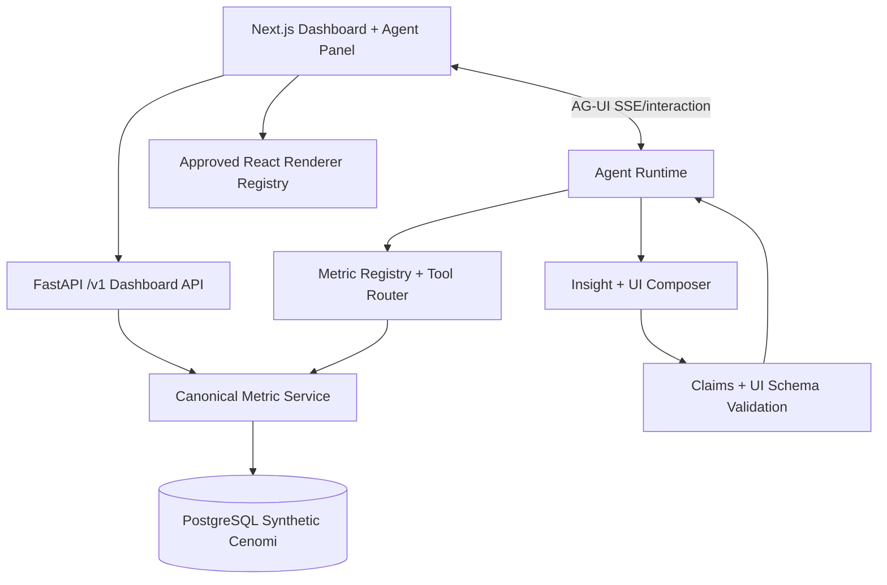

# Cenomi Dashboard Intelligence Agent — Technical Architecture & Implementation Plan

**Version:** 1.0 · **Date:** 21 October 2026 · **Status:** Build specification · **Companion:** `Cenomi_Dashboard_Intelligence_Agent_PRD.md`

## 1. Architecture decisions

1. **Canonical PostgreSQL fact model and shared metric service.** Charts and agent tools call the same registered calculations with identical filter/permission semantics.
2. **Custom bounded analytics agent.** LLM selects metric tools and analytical investigations; SQL calculations, validation, authorization, rankings, ratios and statistics run deterministically.
3. **AG-UI for bidirectional frontend events.** Stream text, tool progress and shared state; deliver schema-validated declarative analytics components through supported application-level payloads.
4. **Safe component registry.** React renders only predefined, typed components; the model cannot emit executable HTML/JavaScript or direct database queries.
5. **Synthetic scenario-driven seed data.** Deterministic generator with golden truth fixtures and source-status parity.
6. **Admin first, Tenant second.** Reuse components and metrics, but enforce tenant scope at every backend query.

## 2. System topology



Recommended stack: Next.js/React/TypeScript; FastAPI/Pydantic; PostgreSQL + SQLAlchemy Core/parameterized SQL; Python data generator and pytest; AG-UI server/client libraries pinned to a verified compatible version; model API supporting structured output and tool invocation. Select chart library based on parity needs (Recharts plus custom funnel/heatmap as necessary); do not bind business logic to chart components. Use a vendor-neutral LLM adapter; model version and pricing are deployment configuration.

## 3. Logical components and ownership

| Component | Ownership | Interface |
|---|---|---|
| Synthetic seed generator | Backend/data | CLI + versioned scenario manifest |
| Canonical database | Data | PostgreSQL views/tables/indexes |
| Metric registry | Analytics | Versioned YAML/JSON definitions |
| Metric executor | Analytics | `query(metric_id, filters, dimensions, period)` |
| Dashboard API | Backend | Read-only `/api/dashboard/*` |
| Analytics tools | Agent/backend | Typed server-side tool functions |
| Agent planner | Agent | Conversation + dashboard context → tool plan |
| Evidence verifier | Agent/backend | Value/claim provenance validation |
| UI response composer | Agent/backend | Analytics result → declarative components |
| AG-UI adapter | Realtime | Run, message, tool, state and app UI events |
| Component registry | Frontend | Validated response → React cards/charts/tables |
| Evaluator | QA | Golden data, benchmark prompts, expected SQL results |

## 4. Relational schema and data grain

Use the reference names wherever practical. POC tables (simplified fields below; include timestamps, `created_by`, source keys and indexes as needed):

| Table | Primary key / essential foreign keys | Required measures and attributes |
|---|---|---|
| `unique_properties` | `unique_property_id` | region, mall/name, group, visibility |
| `properties` | `property_id`, `unique_property_id` | address, region, GLA, source property code |
| `units` | `unit_id`, `property_id` | type, unit code, GLA, visibility |
| `tenant_profiles` | `tenant_profile_id` | company and profile attributes |
| `brands` | `brand_id`, `tenant_profile_id` | brand name, PMS code |
| `leases` | `lease_id`, `tenant_profile_id`, `property_id`, `brand_id` | dates, status, code |
| `leased_units` | `leased_unit_id`, `lease_id`, `unit_id` | unit allocation and effective dates |
| `leased_units_amendments` | `amendment_id`, `lease_id` | type, status, start/end, sequence |
| `lead_enquiries` | `lead_enquiry_id`, optional tenant/property | source, unit type, status, dates |
| `proposals` | `proposal_id`, `lead_enquiry_id`, optional lease | status, signature state, dates |
| `service_request` | `service_request_id`, tenant/property/lease | category, subcategory, status, timestamps, deletion |
| `service_request_operations` | `operation_id`, `service_request_id` | team, state, owner, timestamps |
| `service_request_sla` | `service_request_id` | target, due time, SLA state, actual resolution |
| `sales_data` | `sales_data_id`, tenant/lease | period dates, frequency, amount SAR, status |
| `draft_documents` | `request_id`, tenant/lease | document type, grade/status, dates |
| `company_documents` | `document_id`, tenant/enquiry | type, approval status |
| `notifications` | `notification_id`, user/tenant/object | action-required, read time, type |
| `unit_discrepancy_reports` | `report_id`, property/unit, month | match/mismatch and reason |
| `tenant_contacts` / `access_grants` | user, tenant, region, property, lease | effective roles, scope/override |
| `announcements_events` | `event_id` | dates, visibility, category |

Retain application-level IDs to link enquiry → proposal → lease, unit → inspection SR → drawing → handover, and SR → operations/SLA. These lineage keys support legitimate cross-KPI investigation; do not infer joins merely from matching names.

### 4.1 Physical design

- PostgreSQL constraints: unique source keys, FK integrity, nonnegative GLA/sales amount when appropriate, valid date intervals and enum/check constraints where practical.
- Indexes: `(property_id, date)`, `(tenant_profile_id, status, updated_at)`, `(lease_id, period_start)`, `(service_category, sub_category, status)`, `(amendment_type, amendment_start)`; verify using `EXPLAIN ANALYZE` after seeding.
- Canonical timestamps UTC; provide local `Asia/Riyadh` calendar grouping explicitly. Use date boundaries consistently across SQL and frontend.
- Implement access scope in a shared backend predicate/repository service, ideally with PostgreSQL row-level security for hard isolation in later stages.
- Store `seed_run_id`/`data_version` for provenance, but do not leak generator scenario labels into agent-visible records.

## 5. Seed generation strategy

### 5.1 Deterministic baseline

Configuration default: 25 malls; 3 years; around 8,000 units, 6,000 leases, 60,000 requests, 120,000 sales records, plus coherent upstream/downstream events. Use realistic but synthetic Saudi mall/region conventions. Each run stores seed, generator version, counts and relational validation report.

### 5.2 Generation order

1. Regions, malls, properties, units and GLA distributions.
2. Tenant profiles, brands, access grants.
3. Leases and leased-unit occupancy timeline, renewal/termination/holdover amendments.
4. Lead enquiries, proposals and linked contract progression; additional unconverted records.
5. Service requests, operations, SLA clocks, approvals and notifications.
6. Fit-out drawings, inspections, grades, handovers and unit discrepancies.
7. Monthly/quarterly sales submissions, missing periods, approvals/reuploads, seasonality.
8. Announcements/events and synthetic user sessions.
9. Scenario-specific perturbations and golden expected-query results.

### 5.3 Scenarios

Define fixtures `approval_backlog_mall_a`, `high_volume_fast_resolution_mall_b`, `sales_seasonality`, `fitout_handover_delay`, `occupancy_drop`, `missing_sales_report`, `unit_mismatch_cluster`, `incomplete_funnel_status`, `sparse_period`, `tenant_scope_boundary`, `future_dated_amendment`. Fixtures declare generation controls and independent expected metrics, never user-facing insight wording.

Validate referential integrity, nonnegative counts, date coherence, entity cardinalities, expected monthly totals and test access users.

## 6. KPI semantic layer

### 6.1 Metric definition shape

```yaml
metric_id: pending_approvals
version: 1
business_name: Pending Approvals
grain: approval_item
source_entities: [proposals, leases]
measure: pending_count
dimensions: [region, mall, approval_type, delay_band]
filter_schema: [region, mall, as_of_date]
time_basis: as_of_date
timezone: Asia/Riyadh
query_template_id: pending_approval_summary_v1
unit: count
allowed_aggregations: [sum, breakdown, trend, rank]
drilldown_query_id: pending_approval_items_v1
caveats:
  - Aging bands do not necessarily represent SLA breaches.
authorization_scope: property_access
```

The registry is executable metadata validated at startup; it cannot contain free-form SQL generated by the LLM. Each query template is parameterized and identified by version. Metric responses always include `metric_id`, version, filters, date interval, timezone, value/rows, denominator where relevant, row/sample count, `query_id`, `dataset_ref`, generated timestamp and coverage warnings.

### 6.2 Existing chart parity and SQL tests

Implement one metric contract per referenced card and auxiliary status breakdown. For each: fixture records → parameterized SQL → typed result → API response → chart mapping → exact expected count. Record intentional parity differences separately from corrected metrics. Particular regression cases: active leases including grace periods, competing pending-sales status lists, null/unknown funnel statuses, SR treemap excluding pending/closed, fit-out denominator, A/B/C/D grade mapping, approval vs amendment delay boundaries, property scopes and date zone differences.

### 6.3 Derived metrics

Provide formally defined derived metrics only where source data support them: `unit_occupancy_pct`, `gla_occupancy_pct`, `approval_over_30d_share`, `period_over_period_delta`, `sales_yoy_growth`, `service_request_status_share`, `unit_mismatch_rate`. Do not calculate cohort conversion without linked entities. Denominator-zero and low-sample cases return null/qualification, not 0% automatically.

## 7. APIs and analytics tools

### 7.1 Dashboard API

`GET /api/dashboard/admin/{cardId}?filters…` and `GET /api/dashboard/tenant/{cardId}?filters…`, returning parity-shaped payloads with authoritative meta (metric version, scope, UTC generated time, synthetic marker). Add `GET /api/metrics/catalog`, `POST /api/metrics/query`, `POST /api/metrics/breakdown`, `POST /api/metrics/trend`, `POST /api/metrics/compare`, `POST /api/metrics/drilldown` (cursor pagination). Reject unsupported filters and IDs; never silently broaden empty permission scopes.

### 7.2 Agent tool contracts

| Tool | Inputs | Outputs |
|---|---|---|
| `discover_metrics` | semantic search / intent | Registered relevant metric IDs |
| `describe_metric` | metric ID | business definition, grain, formula, caveats |
| `get_metric` | ID, filters, as-of/period | Scalar + provenance |
| `get_breakdown` | ID, dimension, filters, top-k | Bounded categorized rows |
| `get_trend` | ID, grain, period, filters | Time series, coverage |
| `compare_metrics` | Compatible metric IDs/scopes | Comparison with compatibility validation |
| `get_underlying_records` | approved query ID, cursor, filters | Scoped bounded records |
| `get_related_metrics` | ID | Relationship metadata, join validity |
| `get_data_coverage` | dataset/metric, filters | Missingness, periods, row counts |

Tool errors are typed: `UNAUTHORIZED`, `UNSUPPORTED_METRIC`, `INCOMPATIBLE_GRAINS`, `INSUFFICIENT_DATA`, `QUERY_TIMEOUT`, `INVALID_FILTER`, `PARTIAL_COVERAGE`. The agent uses these to produce accurate limitations.

## 8. Agent runtime, state and safety

### 8.1 Controlled lifecycle

`RECEIVED → CONTEXT_RESOLVED → METRIC_MATCHED → PLAN_VALIDATED → TOOLS_EXECUTED → EVIDENCE_VALIDATED → COMPOSED → UI_VALIDATED → COMPLETE`; exceptions transition to `CLARIFICATION_REQUIRED`, `PARTIAL`, `UNAVAILABLE` or `ERROR`. Hard budgets: configurable 6 tool calls per turn, 2 investigative iterations, bounded total rows, 20-second execution deadline for standard POC path. Tool orchestration can form a small DAG for independent requests, but agent selection is bounded by registered tools.

### 8.2 Context payload

```json
{"dashboard":"admin","active_card":"pendingAmendments","filters":{"year":2026,"month":"Oct","region":"Central","mall_id":null},"selection":{"amendment_type":"Renewal","delay_band":"four_week_plus_delay"},"conversation_id":"opaque-id"}
```

The UI state is a hint, not authorization or evidence. Server rechecks identity, valid mall/property access and filter combinations on every tool call. Persist compact conversation history, selected metric IDs, scoped result handles and explicit user decisions. Avoid sending entire table schemas, huge tool outputs or raw protected records to the model.

### 8.3 Evidence and reasoning rules

- All numeric statements must reference deterministic tool fields; verify numbers in rendered cards/charts/tables against the same datasets.
- Observation ≠ explanation ≠ causal claim. Mark correlations as hypotheses unless justified by experimental/causal evidence.
- A proxy metric must be explicitly named as a proxy; unsupported asks never become invented estimates.
- Agent does not change business records. It may suggest navigation, filtered inspection or follow-up analysis only.
- Prevent prompt injection from synthetic/free-text document and notification fields by treating retrieved content as data, not instructions.
- No model-authored raw SQL, arbitrary frontend code, external URLs, or unrestricted markdown HTML.

## 9. Generative UI and AG-UI transport

### 9.1 Strict analytics presentation schema

```json
{
  "response_id":"analysis_001",
  "coverage":"derived",
  "answer":{"summary":"Mall A has the largest overdue backlog.","limitations":[]},
  "scope":{"dashboard":"admin","month":"2026-10","region":"Central"},
  "components":[
    {"id":"overview","type":"metric_group","items":[{"label":"Pending","value":225,"unit":"count"}]},
    {"id":"ranking","type":"data_table","dataset_ref":"ds_001","columns":[{"key":"mall","label":"Mall"},{"key":"pending","label":"Pending"}]},
    {"id":"priority","type":"insight_card","severity":"warning","title":"Investigate Mall A","evidence_refs":["q_001"]}
  ],
  "evidence":[{"metric_id":"pending_approvals","metric_version":1,"query_id":"q_001","dataset_ref":"ds_001"}]
}
```

The server constructs/validates `value` fields from trusted query output rather than trusting model text. Dataset refs are short-lived opaque identifiers bound to request identity, data version and filter scope. Maximum component count and maximum dataset display rows are configurable. All chart types have fallback accessible table/text variants.

### 9.2 AG-UI event sequence

1. Frontend opens an authenticated AG-UI run with prompt and scoped dashboard context.
2. Backend emits run start and text/tool progress events.
3. Tool events expose safe names/status (no credentials, unauthorized rows or raw SQL).
4. Agent uses metric tools and receives structured evidence.
5. UI composer selects components; server checks schema, refs, numeric consistency and permission scope.
6. Application-specific structured payload is delivered using the integration-supported AG-UI mechanism (e.g. custom event or shared state) and rendered by the React registry.
7. Run completion carries text answer, data freshness, coverage status and evidence links.
8. UI click/filter interaction updates client context and initiates a scoped follow-up run.

Use actual AG-UI SDK event types and event metadata from the pinned installed version; never assume the proposed analytics JSON is itself an AG-UI standard event. A2UI could later replace the custom presentation schema while AG-UI remains the transport.

### 9.3 Interaction contract

`onChartSelect({componentId, seriesKey, dimensionValue, datasetRef})` and `onTableRowSelect({componentId, rowKey, datasetRef})` use data references that the backend validates before resolving. Suggested follow-up prompts are human-triggered. Frontend visualization switching operates on compatible, already-validated dataset shapes. Pagination/sorting requery the backend under original scope.

## 10. Security and governance

For the POC: authenticated role fixtures, explicit tenant/property/lease scope evaluation on every query, default deny, least-privilege tools, all metrics read-only, parameterized SQL, controlled statement timeout, maximum query cardinality, prepared filters and row limits. Tenant sessions cannot change tenant IDs or access another tenant's data via selected chart context. Admin all-properties sentinel must be treated explicitly rather than as an empty list (empty list must not mean global access). Validate metric-driven URL navigation and prevent notification content injection. No secrets in AG-UI events/logs.

The supplied reference flags higher-risk existing behaviours (status-string SQL construction, skipped permissions, property filter broadening and unscoped fit-out endpoints). The POC must implement safe equivalents rather than copying these defects, while separately preserving the metric semantics necessary for chart parity.

## 11. Proposed repository structure

```text
apps/web/
  dashboard/admin/ dashboard/tenant/ components/analytics/
  components/generative-ui/ ag-ui-client/
services/api/
  routes/dashboard/ routes/metrics/ auth/ db/
services/agent/
  runtime/ tools/ planner/ evidence/ presentation/ agui/
packages/metrics/
  definitions/ queries/ schemas/ validators/
packages/ui-contracts/
  analytics-response.schema.json component-types/
data/
  migrations/ seed/ scenarios/ golden/
tests/
  metric-contract/ api/ agent-evals/ ui/ security/ performance/
docs/
  KPI_CATALOG.md SCHEMA.md AGENT_TOOLS.md AGUI_EVENTS.md
  EVALUATION_PLAN.md STATUS.md
plans/
  M0_contracts.md M1_data.md M2_dashboard.md M3_agent.md
  M4_genui.md M5_evaluation.md
```

## 12. Detailed delivery workstreams

### M0 — Discovery and metric contracts

**Work:** Extract all reference metrics and status enum sets; draft mapping `card → response fields → metric IDs → SQL/query → table/column → drilldown`. Define data grain, timezone, filters, parity vs corrected interpretations, role access and explicit gaps. Validate against the supplied reference, not presumed production database state.

**Exit:** Approved KPI catalog; traceability matrix; initial architecture decisions and test fixtures; known semantic discrepancies documented.

### M1 — Schema, migrations and synthetic data

**Work:** Implement tables, FKs and indexes; deterministic generator with scenario overlays; access fixture users and roles; date/time semantics; golden SQL assertions; seed summaries. Avoid synthetic values that are independent when relationships should exist.

**Exit:** One-command schema+seed reset on disposable POC DB, repeatable record counts, all fixture validity tests passing, scenario expected values reproducible.

### M2 — Metrics API and dashboard parity

**Work:** Implement registered parameterized queries; count and list endpoints; typed filters; admin/tenant view models; dashboard React cards matching visual families; drilldowns and empty states. Reconcile page totals, chart segment totals and detail rows for identical metric populations; document exceptions.

**Exit:** 12 admin cards and planned tenant groups functional; contract tests; no dashboard mocks; scoped API checks; visual Playwright smoke suite.

### M3 — Analytical tools and agent

**Work:** Metric search/description; approved retrieval and breakdowns; trend, compare, coverage; bounded planning, evidence verification and missing-data response classes; conversation context management and business explanations.

**Exit:** Golden test prompts for direct/derived/comparative/cross-KPI queries; zero uncontrolled SQL; all numerical responses grounded.

### M4 — AG-UI and generative UI

**Work:** Implement AG-UI adapter and client; stream answer and tool progress; schemas for metric cards, tables, charts, heatmaps, insights/limitations; server validator; React registry; selected chart/table context; follow-up actions; error and partial-data rendering.

**Exit:** At least one working interaction for each supported component type; context-preserving drilldown and table/chart switch; unsafe component injection rejected.

### M5 — Evaluation, optimization and demo

**Work:** 150–200 benchmark questions; deterministic expected calculations; evaluation of relevance, grounding, missingness, context, no-causality, access boundaries; query profiling and latency; demo scripts for 6 PRD journeys.

**Exit:** All golden numeric and permission tests pass; documented qualitative rubric, known limitations, reproducible demo environment and deployment instructions.

## 13. Test and observability matrix

| Test class | Checks |
|---|---|
| Schema and seed | Reproducibility, FKs, time coherence, scenario truth |
| Metric contract | Known input rows → exact value, rounding, null/zero handling |
| API | Filters, pagination, timezone, missing/unauthorized scopes |
| Chart | Same metric/dataset as API, units, legend, zero states |
| Agent tools | Valid tool args, bounded results, error classes, no SQL generation |
| Grounding | Every numeric answer and UI value matches evidence |
| Cross-KPI | Compatible joins and periods; no false causation |
| Unavailable data | Footfall/payment/unknown-field refusal; related proxy labelled |
| AG-UI | Streaming order, reconnect/error recovery, state sync, selection |
| UI safety | Schema reject unknown components, disallow executable payloads |
| Security | Tenant isolation, override denial, injection and access regression |
| Performance | p50/p95 query/turn timing, tool count, database query plans |

Instrument `request_id`, run/session ID, tool call duration, metric ID/version, query ID, data version, result cardinality, generated UI component IDs, scope fingerprint, outcome category and validation failures. Log safely without copying unrestricted result rows.

## 14. Acceptance demonstrations

1. **Backlog priority:** “Which mall needs attention?” → grounded ranked table, KPI cards and actionable hypothesis.
2. **Funnel:** “Where are opportunities dropping?” → stage flow and caveat about cohort conversion.
3. **Fit-out:** “Are inspections delaying handover?” → linked analysis or qualified insufficient-evidence response.
4. **Context:** select a cell, ask “Why this?” → correct filter and selected type carried through AG-UI.
5. **Format adaptation:** “Show me the underlying records / switch to table” → validated data table and cursor pagination.
6. **Unknown data:** “Yesterday's footfall?” → no fabricated answer, clear limitation and optional relevant alternatives.
7. **Tenant scope:** Tenant A cannot access Tenant B via prompt, filter, dataset handle or chart selection.

## 15. Delivery risks and mitigations

| Risk | Mitigation |
|---|---|
| Synthetic patterns are too trivial | Scenario overlays plus realistic noise and counterexamples |
| Agent contradicts charts | Single metric service; evidence-backed UI payloads |
| Dashboard-parity semantics are misleading | Explicit labels, versioned corrected metric alternatives |
| Excessive SQL/LLM latency | Typed query templates, indexes, row caps, result cache by scope/data version |
| Over-flexible generated UI | Component allowlist, schema validation and strict dataset bindings |
| Scope leakage | Backend authorization per query; opaque expiring data refs |
| Unsupported questions cause hallucination | Coverage-aware tool responses and tested refusal/partial answers |
| Frontend protocol drift | Pin and test AG-UI client/server versions, protocol contract tests |

## 16. Immediate build sequence and handoff

1. Freeze admin/tenant KPI inventory and status semantics from the reference.
2. Write `KPI_CATALOG.md`, `SCHEMA.md`, `M0_contracts.md` and a metric-to-chart traceability matrix.
3. Implement PostgreSQL migrations, deterministic seeds and expected-query fixtures.
4. Build canonical metric queries and dashboard endpoints before agent prompts.
5. Add controlled tools and evidence verification; then integrate AG-UI and generative component schemas.
6. Evaluate numerical truth, missing-data honesty and interactive rendering before widening scope.

**Engineering decision:** avoid copying existing production security defects into the POC; preserve baseline chart meanings while documenting semantic bugs and exposing separately named corrected metrics. Keep agent autonomy within bounded read-only analysis. This gives a reusable analytics platform that can later swap synthetic datasets for authorized real sources without changing the core interaction model.

**Reference:** `ADMIN_TENANT_DASHBOARD_API_REFERENCE.md` (source code trace dated 13 October 2026), including Admin V2 and Tenant V2 card mappings, endpoints, SQL traces and consolidated discrepancies.
