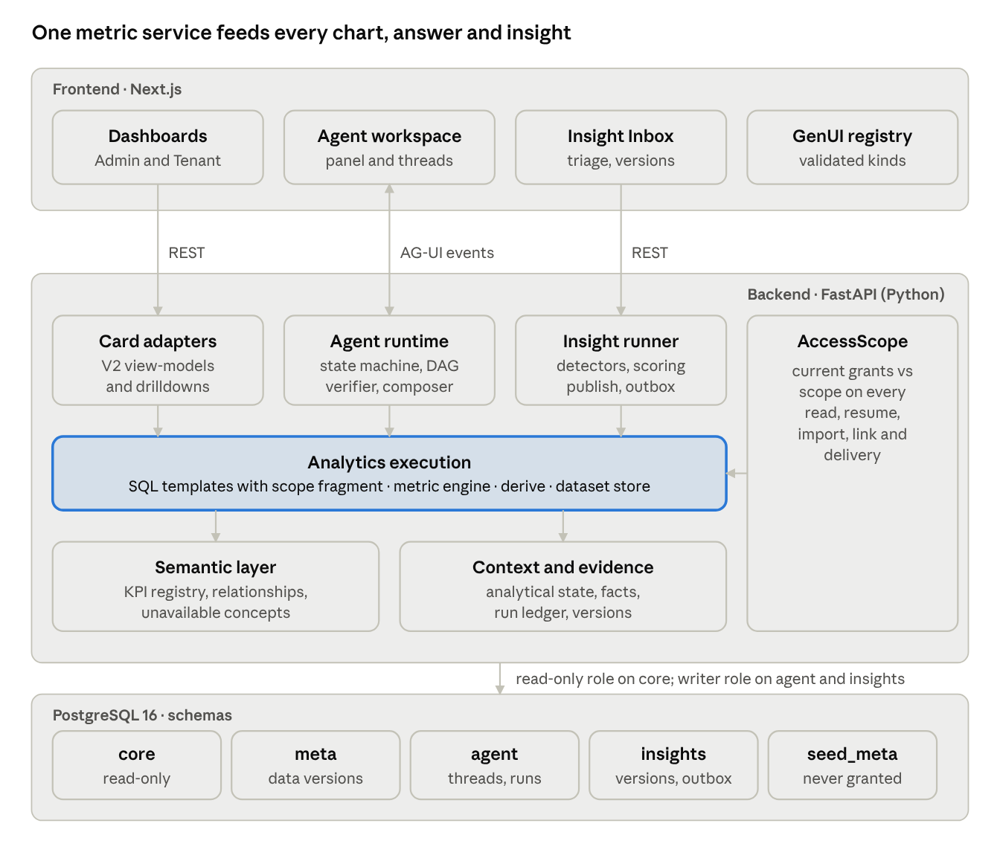

# Architecture and interaction model

## Consolidated architecture

The G0 architecture stands unchanged. DX1–DX6 added contracts at its seams, not new layers. Dashboards, the agent and the insight runner all read the same analytics execution layer, under one AccessScope check, so a number is the same wherever it appears.

*(Diagram exported from the Docs widget on 22 Oct 2026.)*

Charts, answers and insights share one metric service; the LLM plans and explains but never computes.

| Layer | Responsibility | Contracts it owns | Decisions |
| --- | --- | --- | --- |
| State machine | Agent lifecycle, budgets, recovery, cancellation; coverage class is an outcome, not a state | Agent run identity (threadId, runId, requestId, seq) | DR-032, DXD-37, 40 |
| Task DAG | Parallel, bounded tool execution; at most one re-plan | AnalysisPlan | DR-032 |
| Agent (planner, synthesizer) | Intent, plan, explanation; writes fact tokens, never numbers | AnswerDraft with statement labels | DR-031, DXD-08, 31 |
| Semantic layer | KPI definitions, versions, kinds (parity, corrected, derived, new), relationships, unavailable concepts | Metric YAML; unavailable-concepts catalogue | DR-030, 042; DXD-80 |
| Analytics execution | Parameterized SQL with a mandatory scope fragment; derivations; content-addressed datasets | analysis\_result.v1 with calc records | DXD-55, 59 |
| Context and evidence | Analytical state per thread, facts, envelopes, immutable versions, run ledger | Evidence envelope; selection\_ref.v1 | DXD-26, 32, 33, 36 |
| Presentation | Bounded representation policy, closed registry, server and client validation, deterministic table fallback | cenomi.presentation.v1 | DXD-41–62 |
| AG-UI | Transport of run, text, tool, state and CUSTOM presentation events; frontend tool for filter proposals | Event mapping | DR-016, 017, 025; DXD-40 |
| Proactive intelligence | Checkpoint replay, detectors-1.1, scoring, deduplication, atomic publish, outbox, inbox | insight.v1, evaluation run\_key | DXD-63–93 |
| Authorization | AccessScope on every read, resume, import, deep link and delivery; uniform refusals | Scope fingerprint | DR-019, 020; DXD-38, 56, 85 |

## Screens, navigation and interaction flows

The product has four screens, one docked agent panel and three overlays. The notifications overlay is dropped if GDQ-08 A is approved. Every surface reads the same authorized results, so a number never changes when it moves between surfaces.

| Surface | Kind | Who | Reached from | Main actions | Decisions |
| --- | --- | --- | --- | --- | --- |
| Admin dashboard | Screen | Admin roles by permission | Sign-in, rail | 12 cards, card filters, select a data point, Ask, Expand | DXD-02, 10–20 |
| Tenant dashboard | Screen | Tenant users (one lease or a company) | Sign-in, rail | Next actions, documents, requests, sales | DXD-02, 13, 16 |
| Analytical workspace | Screen | All | Open in workspace, Investigate, rail | Multi-step investigations, pins, history, private threads | DXD-03, 31–38, 83 |
| Insight Inbox | Screen | Admin, regional manager, tenant (own lease) | Bell, rail, card indicators | Triage, evidence, versions, investigate, dismiss | DXD-65–93 |
| Agent panel | Docked (overlay below desktop) | All | Ask on a card, a selection | Ask, follow up, confirm a filter proposal | DXD-03, 05, 07 |
| Card focus | Overlay | All | Expand | Chart, Table, Records, Definition tabs | DXD-10, 11, 27 |
| Inspector | Overlay | All | Evidence or Records on any answer, chart, card or insight | Evidence, Definition, Records, Execution tabs | DXD-04, 36, 39 |
| Filter-change confirmation | Inline | All | An answer that proposes a filter | Apply, dismiss, undo | DR-025, DXD-05 |

**Core interaction flows** (each designed and verified in a prototype journey):

1. **Ask from a selection** (DX4 J1). A card selection emits selection\_ref.v1. The panel shows card filters, the agent’s scope and the authorization boundaries as three separate rows. The answer inherits the card filters.
2. **Investigate** (DX4 J2, J6). A plan becomes a bounded DAG with at most one re-plan. Facts are extracted, the synthesizer writes text with fact tokens, the verifier checks every number, and the composer emits validated components.
3. **Change the dashboard** (DX4 J3). The agent proposes a filter change. It applies only after the user confirms, and it can be undone from the card.
4. **Partial and unavailable** (DX4 J4, J5). Coverage is a field of the result. Unavailable concepts return an Unavailable card, never an estimate.
5. **Re-present without re-query** (DX5 View as). The same resultRef is drawn as another allowed kind. An invalid payload falls back to a deterministic table only for presentation failures.
6. **History and resume** (DX4 J7). Stored answers are immutable. Resuming re-checks authorization; re-running creates a new version.
7. **Proactive loop** (DX6 K1–K12). A checkpoint or event run produces insights. The inbox and card indicators show them. Investigate opens a private thread with the insight imported, and the owner may share a summary.
8. **Isolation** (DX4 J8, J10; DX6 K7, K11). Every read re-checks the viewer’s current grants against the scope. Refusals look the same whether or not the item exists.

## Consolidation: duplicated capabilities and complexity removed

Six capabilities were designed separately in different phases. Each becomes one shared component or service, so Cursor builds it once.

| Capability | Designed in | Becomes |
| --- | --- | --- |
| Evidence and calculation display | DX4 inspector, DX5 evidence kind, DX6 insight detail | One EvidencePanel (envelope, facts with calc records, sources), used by all three |
| Drilldown records | DX2 Records tab, DX4 inspector, DX5 records kind | One RecordsTable over get\_underlying\_records with cursor pagination |
| Labelled statements | DX4 answers, DX5 text and insight kinds, DX6 statements | One StatementList (Observed, Derived, Hypothesis, Recommendation, Unavailable) |
| Authorization re-checks | DXD-38, 56, 65, 83, 85 | One AccessScope service: authorize(principal, scope) on every read, resume, import, deep link and delivery |
| Immutable versions | DXD-33, 37 (answers), DXD-87 (insights) | One append-only pattern: version tables keyed (id, version) with dataset and configuration recorded |
| Stale evidence | DX5 stale class, DX6 stale label | One freshness rule: evidence dataset version ≠ latest → stale, shown the same way everywhere |

Two terms must stay separate: an **agent run** (threadId, runId, requestId, seq; DXD-40) and an **evaluation run** (run\_key; DXD-86).

**Complexity removed or made optional** (subject to your decisions):

- Treemaps use the custom squarified component instead of the ECharts treemap (GDQ-07).
- The separate notifications overlay is dropped (GDQ-08).
- As-of history is a seeded snapshot table, not generic as-of SQL (GDQ-03).
- “Scheduled” evaluations are a replay command over the checkpoint calendar, not a live scheduler (DR-005, DXD-75).
- The five specialized GenUI kinds, shared summaries, snooze, digest scheduling and feedback analytics stay in scope but outside the first five days (DXD-62, DXD-92).
