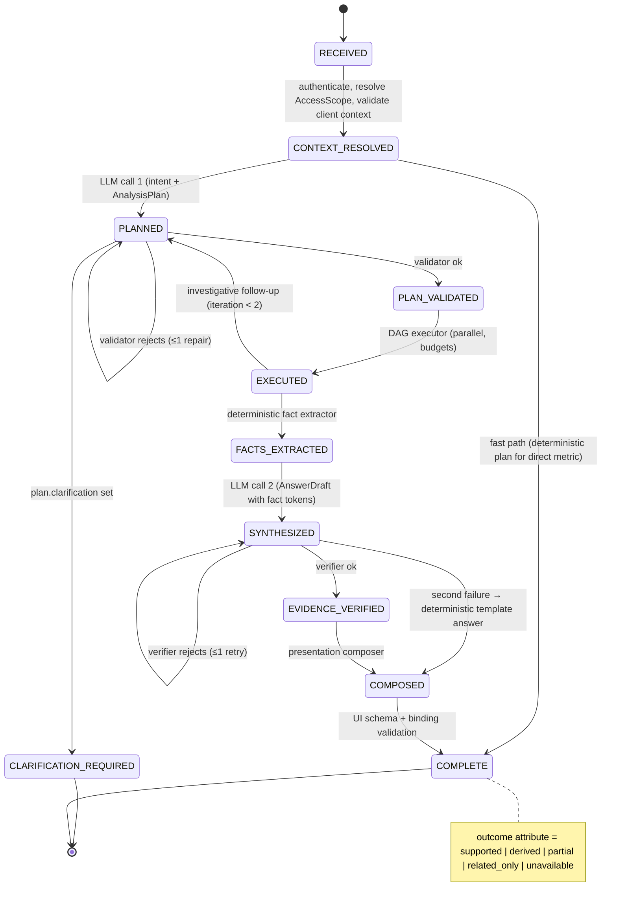
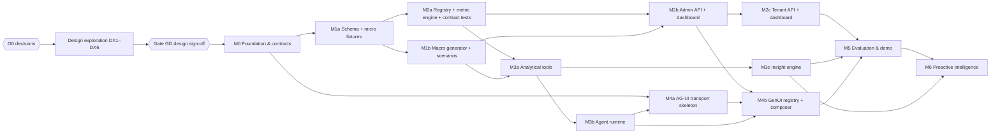

# Cenomi Dashboard Intelligence Agent — Planning Assessment, Architecture Review & Specification Strategy

| | |
|---|---|
| Version | 0.2 — G0 decisions incorporated; remaining G0 blockers listed in §9.2 |
| Date | 21 October 2026 (v0.1 initial; v0.2 after your G0 review) |
| Inputs | PRD v1.0 · Technical Architecture & Implementation Plan v1.0 (TA) · Admin & Tenant Dashboard API Reference (code trace, 13 Oct 2026) (REF) · repo `swa01wk/cenomi-dashboard-agent` @ `5bbd62a` |
| Purpose | Unified product understanding, traceability, architecture review, gap register, specification inventory, milestone plan, detailed M0 proposal, decisions required |
| Status of code | **Planning only. No code, migrations or dependencies have been created.** |

**Legend.** **[F]** confirmed from the source documents · **[R]** my recommendation · **[D]** decision required from you (listed in §9) · `PRD §x` / `TA §x` / `REF §x` point to the source.

---

## Changes in v0.2

- §9 is now the complete **Decision Register** (48 entries) with status, freeze tier and recommended defaults. §9.2 lists the remaining G0 blockers; §9.3 the freeze schedule. Questions Q1–Q10 from v0.1 are superseded.
- Your G0 decisions are recorded: frozen configurable `as_of` (DR-003), ECharts approved on condition (DR-007), Level 5 expanded to discovery, monitoring, notifications and feedback after the core agent (DR-009), provider-agnostic configurable LLM (DR-014), plain `@ag-ui/client` (DR-016), funnel snapshot table (DR-018), simplified backend-enforced authorization (DR-019), lineage including drawings (DR-022), English-first with confirmed filter changes (DR-024, DR-025), design exploration before detailed specs (DR-041).
- Consequences those decisions raise, now in the register: read-only boundary (DR-013), monitoring under a frozen clock (DR-005), notification channel (DR-011), meaning of feedback (DR-012), a `fitout_projects` entity for unit lineage (DR-022).
- Plan changes: design phase DX1–DX6 and Gate GD inserted before M0 specifications (§8); new milestone M6 Proactive Intelligence (§6); Level 5 P2 moved into scope (§1.7, §2.3).
- New Appendix B: ECharts capability matrix for every V2 chart and interaction — the condition attached to DR-007.

---

## 0. Executive summary

**Verdict.** The three documents agree on product intent and the TA's core architectural choices are sound: one canonical metric service shared by charts and agent, deterministic computation, an allowlisted declarative UI, AG-UI as transport, read-only bounded tools, admin-first delivery. The repository is greenfield (a one-line README), so there are no existing conventions to reconcile.

**The documents are not yet implementable by Cursor without it making major decisions on its own.** The ten most consequential gaps:

1. **No frozen reference clock.** Most parity metrics are defined against `NOW()` (lease visibility grace windows, approval/amendment ageing, expiring-lease window, "today" events). With synthetic data, golden values would drift daily. A data-version-bound `as_of` date is required everywhere. *(ADR-002)*
2. **No parity-classification policy.** REF mixes business semantics (status sets, denominators, delay bands) with defects (SQL injection, scope leaks, nondeterminism, `omitempty` zeros). Every REF finding needs an explicit *preserve / fix / dual / normalize* ruling; I propose one in §3.4. *(ADR-001)*
3. **Data model is under-specified.** TA §4 lists ~20 simplified tables; REF implies ~35 entities including a status-mapping table, a property-group hierarchy, discrepancy rows, document types, batch snapshots and fit-out grades held inside JSON payloads. Cross-KPI lineage keys (enquiry → proposal → lease; unit → inspection → handover) do not exist in REF and must be designed.
4. **No POC access model.** REF's scope resolution is the source of most security defects (empty list = global, widget vs endpoint permission mismatch, unscoped endpoints). The POC needs its own roles, permissions and an explicit `AccessScope` algorithm.
5. **The tool set cannot meet AI-03/AI-05/Level 5 deterministically.** TA §7.2 has no tools for derivations (delta, share, YoY), linked-cohort analysis, cross-KPI panels/correlation, anomaly detection, or reuse of an earlier dataset ("show that as a table"). Without them the LLM would do arithmetic.
6. **Narrative numbers are not grounded.** TA §9.1 has the server fill component values, but free-text sentences ("Mall A has 225 pending…") are model-authored. A fact-token mechanism is needed so every number in text is substituted from verified datasets. *(ADR-009)*
7. **The lifecycle is linear.** TA §8.1's state machine mixes lifecycle states with outcome classes (`PARTIAL`, `UNAVAILABLE`) and has no bounded re-plan loop or DAG executor, both of which Level 4 investigation requires.
8. **Level 5 has no architecture.** PRD App. C marks anomaly detection, insight discovery, prioritization and recommendations as P1 "Implement", but nothing in TA supports them inside a 20-second turn budget. I recommend a deterministic offline insight engine the agent can query. *(ADR-010)*
9. **AG-UI mapping is undefined.** Which events carry the plan, tool progress, the validated presentation payload and shared dashboard context is left open, as is the client library (raw `@ag-ui/client` vs CopilotKit).
10. **Evaluation fixtures risk circularity.** If golden values are computed by the same SQL that is under test, the tests prove nothing. Metric truth needs hand-verified micro-fixtures, separate from the large scenario seed used for analytics evaluation.

**Recommended next step (v0.2).** Resolve the remaining G0 blockers in §9.2, then run the visual design exploration and Gate GD before the detailed M0 engineering specifications (§8).

---

## 1. Product understanding

### 1.1 Vision and promise [F]

A self-contained POC that (a) recreates the Cenomi Admin and Tenant **V2** dashboards on a realistic synthetic PostgreSQL dataset and (b) adds a conversational analytics agent that answers business questions with verified numbers, explains KPI meaning and caveats, investigates across related KPIs, and returns the most useful presentation (cards, tables, charts, heatmaps, limitations, drilldowns) through AG-UI. Principles (PRD §1): shared metric definitions; deterministic computation; no invented data; observation ≠ hypothesis ≠ causation; useful absence-of-data answers; secure boundaries; interactive follow-up context.

### 1.2 Scope boundaries (my reading) [F + R]

| In scope | Out of scope / deferred |
|---|---|
| Admin V2 dashboard (12 cards), non-Customer-Relations admin users | Contact-centre dashboard (REF §1.1, not covered by REF) |
| Tenant V2 dashboard, non-prospective tenants | Legacy (non-V2) card forms and legacy-only features: unit filter, custom date range, unit fit-out view, spiral/bubble charts |
| Prospective-tenant journey "where feasible" (PRD §4.2) → **[R] stretch, not baseline** | RDD dashboard, survey banner, promotional popups (not mounted in REF) |
| Synthetic PostgreSQL, seed generator, scenarios, golden fixtures | Production DB, Yardi/SAP/Appian, writes, approvals, payments data |
| Metric registry, metric API, dashboard API, agent, AG-UI, GenUI, evaluation | Mobile-native, production multi-tenancy, infra SLOs, causal inference guarantees |
| Payments shown as an explicit *unavailable* placeholder | Mall maps (Mappedin iframe), document signed URLs, file uploads |

### 1.3 Personas and the metrics that serve them

| Persona (PRD §3) | Core question | Primary metric families |
|---|---|---|
| Portfolio administrator | Rising vacancy / expiring leases? | Occupancy (units, GLA), expiring/active leases, lease exposure trend |
| Leasing manager | Where are leads/proposals stalling? | Funnel stages, signed/unsigned splits, approval ageing, lease requests by source/unit type |
| Operations / service manager | Which categories accumulate backlog? | SR status breakdown, open backlog, ageing, mall ranking |
| Fit-out manager | Which units/malls behind on inspection, drawings, handover? | Inspection progress, drawing progress, A/B/C/D grades, pending handovers, inspection→handover lag |
| Tenant | What do I need to do next? | Pending documents, open SRs, pending sales submissions, action-required notifications |
| Analyst / executive | What changed, what deserves investigation? | Period deltas, peer outliers, insights, evidence-backed priorities |

### 1.4 Admin V2 card inventory — parity baseline

| # | Card (`id`) | V2 visual | Card filters | REF data sources | Population and key semantics [F] | Parity hazards [F] |
|---|---|---|---|---|---|---|
| A1 | `properties` | 3 stat tiles + unit occupancy meter | none | `unique-properties/details` | Eligible = primary, tenant-visible malls. Units live: occupied/vacant via "best current lease per unit" with amendment priority (termination, holdover, assignment…). GLA from mall-level *synced* columns. `percentOf = round(p/t*1000)/10` | Unit occupancy and GLA occupancy come from different sources; super-admin gets empty result (B3); hard-coded mall-ID joins |
| A2 | `kpis` | 3 stat tiles | none | `contracts?is_expiring`, `contracts?status=ACTIVATED`, `sales-data?status=…` | Expiring: `end_date ∈ [now−3m, now+9m+7d]`, status ∈ {Activated, Superseded}, latest amendment not Termination/Renewal Activated, plus 30-day grace visibility. Active: Activated **or Expired or Superseded** within grace (D7). Pending sales: {PENDING, NEED_REUPLOAD, NEED_UPLOAD_SUPPORTING_DOCUMENT, NEED_UPLOAD_AUDITED_SALES} | Active/expiring overlap; pending-sales set differs from tenant summary (D6); unit-type permission gate → 500 |
| A3 | `leaseRequests` | Donut with unit-type / source switch; top 4 + "Other" | year | `lease-requests-summary` ×2 | `lead_enquiries` by year of `created_at` (Riyadh); source variant excludes NULL source; no status/deletion filter | Legacy % bug; random unit-type lock (B2); `last_synced_at` = request time |
| A4 | `salesFunnel` | 4-stage flow; proposal & contract signed/unsigned | year, month, region, mall | live `lead-enquiries`, `proposals`, `contracts` (+ `sales-funnel` only for `last_synced_at`) | Requests = enquiries created in period; Leads = status mapped to `LEAD_APPROVED` via `inquiry_status_mapping`; Proposals/contracts = records with `pms_created_at` in period; `all_counts` = `COUNT(admin_display_status)`; signed/unsigned from fixed status lists | Live vs batch sources (D1); signed+unsigned ≠ all (D2); tz differs per source (D8); region = enquirer region for enquiries (D9); scope union/drop bugs (S4) |
| A5 | `actionRequired` | List (first 3 unread) + badge | none | `notifications?is_action_required=true` | Unread, action-required, not `ACTION_DONE`, de-duplicated by `group_id`, targeted to user/role/permission | Arbitrary row per group (B11); content leak between rows |
| A6 | `pendingApprovals` | Half gauge per type (proposal, contract, lease); value = share in "1 month plus" | region, mall | `pending-approval` | Proposal = admin status `Pending Proposal` aged from `pms_created_at`; contract = `Contract Sent`, lease = `Contract Signed` aged from `pms_last_modified_at`; bands 0–6, 7–13, 14–20, 21–30, ≥31 days; future/NULL dropped; lease visibility rule | Bands differ from amendments (D5); rows per mall not aggregated; empty scope → 500; red banner rule (≥90% older than a month) |
| A7 | `pendingAmendments` | Heatmap: amendment type × delay week | year, month, region, mall | `pending-amendments-summary` | Status ∈ {Ready, In Process}; aged from `pms_created_at`; bands 0–6, 7–13, 14–20, 21–27, ≥28; **future-dated → "4 week+"**; year/month filter on amendment creation (Riyadh) | Future-date handling (D5); year list in UTC |
| A8 | `serviceRequests` | Treemap (Inquiry / Work permits / Complaints) + permit strip | year, month, region, mall | `service-request-summary` (+ `service-requests` drilldown) | Buckets: approved {APPROVED, ACTIVE}; in_process {IN_PROCESS, IN_PROGRESS, ACTION_REQUIRED, SUBMITTED, RE_SUBMITTED, REVIEWED_WITH_COMMENTS}; pending; rejected; closed {CLOSED, EXPIRED, COMPLETED, CANCELLED}. **Tile size = approved + in_process + rejected** (pending, closed excluded). Year/month on `created_at` Riyadh | Summary vs list scoping differs (D3); unbucketed statuses counted nowhere; lease-less SRs dropped; case-sensitive region |
| A9 | `fitoutHandover` | 4 progress rings + pending-handover callout | year, month, region, mall | `fitout-summary` | Category `FIT_OUT_AND_HANDOVER`, 4 inspection sub-categories; received = SUBMITTED; reviewed = APPROVED/REJECTED/COMPLETED; remaining = everything else except DRAFT; **ring = reviewed / (received + remaining + reviewed)**; callout = `HANDOVER.remaining` | Counts soft-deleted rows; ACTIVE bucketed differently in list (D4); "reviewed" includes REJECTED |
| A10 | `fitoutDrawings` | Horizontal stacked bars per discipline (Submitted / Pending / Approved) | year, month, region, mall | `fitout-summary` (2nd call) | Category `FIT_OUT_DRAWING`, sub-categories MEP / ARCHITECTURAL / ELECTRICAL; same three buckets ("Approved" = reviewed, includes REJECTED) | Same as A9 |
| A11 | `documentStatus` | Stacked columns by mall (A/B/C/D) + table toggle; discipline switch; drilldown by document type | year, region, discipline | `fitout-drawing-document-status-summary/by-mall`, `/by-document-type` | Count of distinct (SR, canonical document type) pairs whose **latest** grade ∈ {A,B,C,D}, parsed from SR payload JSON; sub-properties rolled up to primary mall; hot + archive SR tables | Different mall attribution from A9/A10; Riyadh tz; `last_synced_at` = request time |
| A12 | `unitDiscrepancy` | Diverging bars: mall-wise (month) or month-wise (mall) | year, month, mall-wise/month-wise | `discrepancy/monthly-graph` (+ mismatch-units drilldown) | Only the **latest** discrepancy SR per mall per month counts; mismatch if status = mismatch or any flag (store_closed, wrong_location, open_without_contract, brand_changed); pending counts only toward total; **UTC** month windows | UTC vs Riyadh (D8); N+1 drilldown |

### 1.5 Tenant V2 card inventory

| # | Card | Visual | Data and semantics [F] | Parity hazards [F] |
|---|---|---|---|---|
| T1 | KPI tiles (7) | Stat tiles | Leases (Activated + grace rule, permitted leases) · units · brands · pending documents (operations drafts + inquiry docs + fit-out drawing drafts) · open SRs (client-side count over ≤200 rows) · sales pending/approved for selected year (period **overlap**) · lease requests pending/approved · profile (brands) · payments `—` | Open-SR count truncated at 200 rows (T3); tile count vs summary pending-sales sets (D6); lease-level contacts see whole company's sales (S6); payments always 0 (B8) |
| T2 | Action required | List | As A5, targeted at TENANT | Ignores active profile (spans all companies) |
| T3 | Reported sales | Columns by month; year + lease selects; footer total SAR | Rows with status SUBMITTED or APPROVED, bucketed by month of `sales_period_end`, summed `sales_amt` | "Reported" ≠ realized revenue; quarterly/half-yearly frequencies |
| T4 | Service requests | Donut (by status) / treemap (by category); mall select | Status ordering and "Other" fold; tenant category exclusions (HSE, DISCREPANCY, Soft FM, checklists, fit-out-internal); 90-day archive hiding | Same truncation as T1 |
| T5 | Documents to upload | Linked list + total band | Three pending-document sources; deep link only when count = 1 | Deep-link subquery drops some filters |
| T6 | Announcements & events | Merged feed (announcement / today / upcoming) | Targeted by lease, mall, store type, role; today = running on as-of date; upcoming = `end_date > today` | Upcoming overlaps today (deduped client-side) |
| T7 | Leasing opportunities | Mall grid with available units | Public, unscoped list of malls with available-unit counts | `mallmapid` row leak (B4) — maps out of scope |
| T8 | Greeting / lease list | (no card) | Company name, mall options, lease options from tenant's contracts | Global tenant-profile list leak (S8) |
| T9 | Prospective journey | Legacy only | Lead-enquiry status for a prospective tenant | Public details endpoint (S3) |

### 1.6 Reconstructed domain model (logical) [F → R]

REF implies the following entity set. Items marked **(new)** do not exist in REF and are needed for the POC's analytical goals or simplifications.

| Domain | Entities |
|---|---|
| Location | `regions` · `malls` (REF `unique_properties`, primary + tenant-visible) · `property_groups` **(new, explicit)** · `properties` (PMS property; `derived_unit_type` ∈ store/media/specialty) · `units` (code, type, GLA) · mall-level synced GLA and available-unit counts |
| Parties | `tenant_profiles` (companies) · `brands` · `app_users` · `roles` · `permissions` · `access_grants` (REF `tenant_contacts` + overrides, simplified) |
| Leasing | `leases` (lease code, contract/admin/tenant display status, type, dates, created/modified PMS timestamps, report frequency) · `leased_units` · `lease_amendments` (type, status, start/end, sequence, unit codes) |
| Funnel | `lead_enquiries` (source, unit type, enquirer region, approval status, share-contact status, mall) · `inquiry_status_mapping` · `proposals` (admin/tenant display status) · lineage FKs enquiry → proposal → lease **(new)** |
| Operations | `service_requests` (category, sub-category, status, lease, property, multi-property array, payload, timestamps, soft delete) · `service_request_operations` (workflow steps) · `service_request_sla` (snapshot) |
| Fit-out | Inspection/handover/drawing SRs (subset of `service_requests`) · `fitout_projects` **(new: one per lease × unit fit-out, owning its inspection, drawing and handover SRs — DR-022)** · `fitout_drawing_documents` **(new: normalized from payload JSON)** |
| Documents | `document_types` (category, discipline) · `draft_documents` · `company_documents` · `documents` · required-documents config |
| Sales | `sales_submissions` (REF `sales_data`: lease, period start/end, amount SAR, status) |
| Discrepancy | Discrepancy SRs + `unit_discrepancy_items` (per unit, status, flags) |
| Engagement | `notifications` · `announcements_events` + targeting bridges (malls, leases, store types, roles) |
| Batch / meta | `sales_funnel_snapshot` **(DR-018; approvals snapshot not reproduced, DR-018b)** · `data_versions` / `sync_runs` · `seed_meta` (scenario manifests — not agent-visible) |
| Agent runtime | `conversations` · `runs` · `run_events` · `tool_calls` · `datasets` · `facts` · `insights` · `feedback` **(all new)** |

**Status vocabularies to freeze in M0** (each needs a canonical enum, display labels and bucket mappings): lease `contract_status`, lease `admin_display_status`, lease `tenant_display_status`, amendment type, amendment status, enquiry `approval_status` × `share_contact_status`, proposal display status, SR category, SR sub-category, SR status (≈25 values), sales submission status (9 values), draft/company document status, drawing grade, discrepancy status and flags, notification type/action state.

### 1.7 Agent capability understanding

| Level | What it means operationally for this POC |
|---|---|
| **L3 — intent-aware execution** (P0) | Resolve intent, KPI, entities (mall names, regions, categories, periods) and inherited dashboard filters → validated plan of registered tool calls → deterministic results → answer with provenance, coverage class and correct presentation. Graceful *unsupported* / *unavailable* answers. |
| **L4 — context-aware intelligence** (P0/P1) | Multi-step investigations over related KPIs with explicit relationship metadata; comparable windows/denominators; chart-selection and pronoun resolution; data-quality and coverage assessment; hypotheses with evidence and alternatives; business-impact framing; next-question suggestions; reuse of prior datasets. |
| **L5 — proactive intelligence** (P1 and P2 in scope per DR-009, delivered after the core agent) | Deterministic detection of baseline deviations, peer outliers, trend breaks and cross-KPI co-movement; impact-ranked insights with evidence; recommended *investigations* (never operational actions); checkpoint-based monitoring, in-app notifications, insight lifecycle and feedback-driven re-ranking (M6). |

Response coverage classes [F, PRD §6]: `supported`, `derived`, `partial`, `related_only`, `unavailable`, `error`.

### 1.8 Interaction model

- **Dashboard → agent:** active card, that card's filters, the user's selection (segment/cell/row), conversation id. Treated as a *hint*; the server re-resolves scope and validates every filter (TA §8.2).
- **Agent → user:** streamed progress (plan, tool activity), then a verified answer: text statements typed as observation / derived / hypothesis / recommendation / limitation, plus validated components bound to server datasets.
- **User → agent via UI:** click a segment or row, "ask about this", switch chart ↔ table, paginate/sort (re-query under original scope), approved follow-up prompts, optional "apply these filters to the dashboard" (agent → dashboard sync, confirmed by the user).

### 1.9 Interpretation principle I propose [R]

> **Parity means reproducing the business definitions and visual forms of the V2 dashboards — status sets, denominators, bands, attribution rules — not reproducing the reference implementation's defects.** Security defects are never reproduced. Nondeterminism and transport quirks are fixed. Where a quirk changes a business number, the POC keeps the parity metric *and* adds a separately named corrected metric, and the data contains rows that make the difference visible (PRD §5).

This principle is ADR-001; §3.4 applies it to every REF finding.

---

## 2. Requirements traceability matrix

ID scheme: `PAR` dashboard parity · `MET` metric truth · `DATA` synthetic data · `AI` agent (PRD §6 IDs kept) · `L3/L4/L5` capability levels · `GUI` generative UI · `AGUI` transport · `SEC` security · `NFR` non-functional · `EVAL` evaluation · `DEL` delivery. "Spec home" = document that will own the requirement (structure in §5). Issue refs point to §3.

### 2.1 Dashboard parity

| Req | Requirement (abridged) | Source | Spec home | MS | Verification | Issues |
|---|---|---|---|---|---|---|
| PAR-A01 | Properties card: property count, units, occupied/vacant units & GLA, occupancy meter | PRD §4.1; REF §3a.2 | KPI_CATALOG, M2 | M2 | Metric contract + card render test | G-03, P-B3 |
| PAR-A02 | KPI tiles: expiring, active, pending sales | PRD §4.1; REF §3a.4–5 | KPI_CATALOG | M2 | Contract tests incl. grace-period & overlap rows | P-D6, P-D7 |
| PAR-A03 | Lease requests donut (unit type / source), year | PRD §4.1; REF §3b.1 | KPI_CATALOG | M2 | Contract test; top-4 + Other fold | P-B2 |
| PAR-A04 | Sales funnel 4 stages + signed/unsigned; year/month/region/mall | PRD §4.1; REF §3a.5–8 | KPI_CATALOG | M2 | Contract tests incl. NULL status, out-of-list status | P-D1, P-D2, P-D8, P-D9 |
| PAR-A05 | Action-required list + unread badge | PRD §4.1; REF §3a.3 | KPI_CATALOG | M2 | Targeting & de-dup tests | P-B11 |
| PAR-A06 | Pending approvals half gauges by age band; region/mall | PRD §4.1; REF §3b.2 | KPI_CATALOG | M2 | Band boundary tests at 6/7, 30/31 days | P-D5, G-01 |
| PAR-A07 | Pending amendments heatmap type × week; year/month/region/mall | PRD §4.1; REF §3b.3 | KPI_CATALOG | M2 | Boundary tests at 27/28; future-dated row | P-D5, G-01 |
| PAR-A08 | SR treemap + permit strip; year/month/region/mall | PRD §4.1; REF §3b.4 | KPI_CATALOG | M2 | Treemap excludes pending/closed; unbucketed statuses | P-D3 |
| PAR-A09 | Fit-out rings + pending handover | PRD §4.1; REF §4.1 | KPI_CATALOG | M2 | Denominator test; soft-deleted rows | P-D4 |
| PAR-A10 | Fit-out drawings stacked bars | PRD §4.1; REF §4.2 | KPI_CATALOG | M2 | As A09 | P-D4 |
| PAR-A11 | Drawing grades A–D by mall/discipline + type drilldown | PRD §4.1; REF §4.3 | KPI_CATALOG, DATABASE_SCHEMA | M2 | Latest-grade de-dup test | G-07 |
| PAR-A12 | Unit discrepancy diverging bars mall-wise / month-wise | PRD §4.1; REF §4.4 | KPI_CATALOG | M2 | Latest-SR-per-mall-month test; pending excluded | P-D8 |
| PAR-T01 | Tenant tiles incl. payments placeholder (explicitly unavailable) | PRD §4.2; REF §5.1 | KPI_CATALOG | M2 | Tile contract tests; payments returns UNAVAILABLE | P-B8, P-T3 |
| PAR-T02 | Tenant action required | PRD §4.2; REF §5.5 | KPI_CATALOG | M2 | Active-profile scoping test | SEC fix |
| PAR-T03 | Monthly reported sales chart (SUBMITTED+APPROVED) | PRD §4.2, §5; REF §5.4 | KPI_CATALOG | M2 | Monthly/quarterly frequency rows | — |
| PAR-T04 | SR by status / category | PRD §4.2; REF §5.3 | KPI_CATALOG | M2 | Server-side count = rendered total | P-T3 |
| PAR-T05 | Pending documents (3 sources) | PRD §4.2; REF §5.2 | KPI_CATALOG | M2 | Sum test | — |
| PAR-T06 | Announcements & events | PRD §4.2; REF §5.6 | KPI_CATALOG | M2 | Targeting, today/upcoming dedup | — |
| PAR-T07 | Leasing opportunities | PRD §4.2; REF §5.8 | KPI_CATALOG | M2 | Available-units count | — |
| PAR-T08 | Prospective journey "where feasible" | PRD §4.2 | PRODUCT_SPEC | M5 stretch | Demo only | A-06 |
| PAR-X01 | Empty, loading, error states for every chart | PRD §4.2 | GENERATIVE_UI, M2 | M2 | Playwright states suite | — |
| PAR-X02 | Filters propagate to retrieval and agent context | PRD §4.2 | API_CONTRACTS, AGUI_INTEGRATION | M2/M4 | Filter-propagation tests | A-02 |
| PAR-X03 | Drilldown resolves same population or discloses difference | PRD §4.2, §11 | KPI_CATALOG | M2 | Reconciliation tests per card | P-D3, P-D4 |

### 2.2 Metric truth, data and delivery

| Req | Requirement | Source | Spec home | MS | Verification | Issues |
|---|---|---|---|---|---|---|
| MET-01 | Charts and agent share one metric definition and service | PRD §1; TA §1.1 | ARCHITECTURE, KPI_CATALOG | M2/M3 | Chart-vs-agent equality test per metric | — |
| MET-02 | Registry stores formula, grain, entities, filters, date dimension, tz, status sets, scope, unit, refresh, version, drilldown, caveats | PRD §5; TA §6.1 | KPI_CATALOG | M0/M2 | Schema validation at startup | G-02 |
| MET-03 | Parity vs derived/corrected metrics have distinct IDs and labels | PRD §5; TA §6.2 | KPI_CATALOG | M0 | Registry lint | — |
| MET-04 | Eight known caveats become contract tests and data contains exposing rows | PRD §5 | KPI_CATALOG, SYNTHETIC_DATA_STRATEGY, EVALUATION_PLAN | M1/M2 | One test per caveat | §3.4 |
| MET-05 | Deterministic precision; SAR; % units; tz; rounding | PRD §10 | KPI_CATALOG (numeric policy) | M0 | Rounding tests | G-12 |
| MET-06 | Derived metrics (occupancy %, >30d share, PoP delta, YoY, status share, mismatch rate); zero-denominator → null + qualification | TA §6.3 | KPI_CATALOG, AGENT_TOOLS | M2/M3 | Zero/low-n tests | G-05 |
| MET-07 | No cohort conversion without linked entities | TA §6.3; PRD §5 | KPI_CATALOG | M0 | Agent refusal test | DR-022, DR-023 |
| DATA-01 | Schema sufficient for all KPIs; FK integrity; constraints | PRD §2; TA §4.1 | DATABASE_SCHEMA | M1 | Integrity suite | G-03 |
| DATA-02 | ~25 malls, 3 years, ~8k units, 6k leases, 60k SRs, 120k sales + related | PRD §8; TA §5.1 | SYNTHETIC_DATA_STRATEGY | M1 | Cardinality report | — |
| DATA-03 | Deterministic seed (`seed_version`, `random_seed`) | PRD §8 | SYNTHETIC_DATA_STRATEGY | M1 | Regenerate → identical hashes | — |
| DATA-04 | Lifecycles, seasonality, conversions, turnaround, reporting frequency | PRD §8; TA §5.2 | SYNTHETIC_DATA_STRATEGY | M1 | Distribution checks | G-10 |
| DATA-05 | Named scenarios with truth fixtures (PRD §8 + TA §5.3, 11+ scenarios) | PRD §8; TA §5.3 | SYNTHETIC_DATA_STRATEGY | M0 list / M1 build | Scenario assertions | G-10 |
| DATA-06 | Scenario labels never visible to agent | PRD §8; TA §4.1 | DATABASE_SCHEMA (schema grants) | M1 | Grant test | — |
| DATA-07 | Everything labelled synthetic; no production identifiers | PRD §2, §10 | PRODUCT_SPEC | M1/M2 | UI banner + data lint | — |
| DATA-08 | One-command reset; validation report | TA §12 M1 | M1 plan | M1 | CI job | — |
| DEL-01 | Admin first, tenant second with permission-scoped reuse | PRD §12; TA §1.6 | plans/STATUS | — | Gate order | — |
| DEL-02 | Gates M0…M5; production requires separate approval | PRD §12 | plans/* | — | Gate reviews | — |

### 2.3 Agent and capability levels

| Req | Requirement | Source | Spec home | MS | Verification | Issues |
|---|---|---|---|---|---|---|
| AI-01 | Define/explain any KPI (formula, source, scope, caveat) | PRD §6 | AGENT_TOOLS (`describe_metric`) | M3 | Benchmark "explain" set | — |
| AI-02 | Retrieve metric with inherited filters; exact match | PRD §6 | AGENT_TOOLS, AGUI_INTEGRATION | M3 | Agent value == API value | A-02 |
| AI-03 | Rank, aggregate, %, deltas — deterministic | PRD §6 | AGENT_TOOLS (derivation tools) | M3 | Golden math | G-05 |
| AI-04 | Compare periods/malls/regions/categories with comparable windows and denominators | PRD §6 | AGENT_TOOLS (`compare`) | M3 | Comparability validator tests | G-05 |
| AI-05 | Cross-KPI investigation; no unverified causal claim | PRD §6 | AGENT_ARCHITECTURE, AGENT_TOOLS (relationships, linkage, panel) | M3 | Causal-language lint + scenario checks | G-05, G-06 |
| AI-06 | Pronouns and selected visual values | PRD §6 | AGENT_ARCHITECTURE (analytical state), AGUI_INTEGRATION | M3/M4 | Multi-turn context suite | G-08 |
| AI-07 | Facts vs hypotheses vs actions; recommendations trace to measurements | PRD §6 | AGENT_ARCHITECTURE (`AnswerDraft`) | M3 | Statement-type validation | — |
| AI-08 | Partial coverage / absent data stated exactly; proxies never passed off | PRD §6 | KPI_CATALOG (unavailable concepts), AGENT_TOOLS | M3 | Unavailable suite | G-09 |
| AI-09 | Inspectable provenance (metric IDs, time scope, filters, query/dataset ref) | PRD §6 | API_CONTRACTS (`MetricResult`) | M2/M4 | Provenance panel test | — |
| AI-10 | No cross-user / cross-tenant leakage | PRD §6 | ARCHITECTURE (security) | M2–M4 | Denied-request suite | G-04 |
| AI-11 | Six coverage classes | PRD §6 | AGENT_ARCHITECTURE | M3 | Class accuracy metric | G-11 |
| AI-12 | No fabricated confidence; report coverage, n, period, derivation | PRD §6 | AGENT_TOOLS (coverage) | M3 | Lint for % confidence claims | — |
| L3-* | 18 L3 items (intent, KPI discovery, entity resolution, planning, multi-metric, computation, PoP, follow-ups, filter awareness, state persistence, validation, recovery, RBAC, coverage, unsupported, provenance) | PRD App. A.1 | AGENT_ARCHITECTURE, AGENT_TOOLS | M3 | Maps to AI-01…AI-12 + EVAL | — |
| L4-CTX | Structured context assembly; multi-turn continuity; context-preserving follow-ups | PRD App. A.2 #1, 9, 18 | AGENT_ARCHITECTURE | M3 | Context suite | G-08 |
| L4-XKPI | Cross-KPI reasoning, relationship discovery, correlation | A.2 #2, 11 | KPI_CATALOG (relationship graph), AGENT_TOOLS | M3 | Scenario truth checks | G-06 |
| L4-INV | Multi-step investigation; root-cause *hypotheses*; alternatives | A.2 #3, 4, 17 | AGENT_ARCHITECTURE (bounded re-plan) | M3 | Investigation rubric | G-07 |
| L4-DQ | Data quality/consistency assessment; coverage awareness | A.2 #12, 13 | AGENT_TOOLS (`get_data_coverage`) | M3 | Sparse/missing scenarios | — |
| L4-BIZ | Business-context reasoning; impact assessment; role-aware explanations | A.2 #8, 15, 22 | AGENT_ARCHITECTURE (prompt policy), KPI_CATALOG (impact measures) | M3 | Rubric | — |
| L4-UX | GenUI composition, dynamic component choice, chart↔conversation sync, next questions | A.2 #19–21, 23 | GENERATIVE_UI, AGUI_INTEGRATION | M4 | UI suite | — |
| L4-REUSE | Result reuse and caching | A.2 #24 | API_CONTRACTS (dataset store) | M3 | "Show as table" no-requery test | — |
| L4-CLAR | Adaptive clarification | A.2 #7 | AGENT_ARCHITECTURE (clarification policy) | M3 | Ambiguity suite | — |
| L5-P1 | Anomaly detection, insight discovery, prioritization, recommendations, baseline deviation, peer comparison, narratives | A.3 #1–2, 4–15, 21–22; App. C | AGENT_ARCHITECTURE (insight engine) | M3c | Seeded anomaly recall/precision | G-13 |
| L5-P2 | Monitoring, in-app notifications, insight lifecycle, feedback-driven re-ranking — **in scope by your G0 decision**, after the core agent | A.3 #3, 16–20; DR-009 | AGENT_ARCHITECTURE §proactive | M6 | Checkpoint-replay tests; notification and lifecycle E2E; re-ranking tests | DR-005, DR-011, DR-012 |

### 2.4 Generative UI, transport, security, NFR, evaluation

| Req | Requirement | Source | Spec home | MS | Verification | Issues |
|---|---|---|---|---|---|---|
| GUI-01 | Allowlisted catalog of 15 component types | PRD §7 | GENERATIVE_UI | M4 | One render test per type | — |
| GUI-02 | Intent → default composition mapping (8 patterns) | PRD §7 | GENERATIVE_UI | M4 | Composition tests | — |
| GUI-03 | Interactions: select segment, ask about selection, row click, change dimension, chart↔table, approved actions | PRD §7; TA §9.3 | GENERATIVE_UI, AGUI_INTEGRATION | M4 | E2E per interaction | — |
| GUI-04 | Components bind to validated data / dataset refs, never model-authored numbers | PRD §7; TA §9.1 | GENERATIVE_UI | M4 | Value-provenance validator | G-06 |
| GUI-05 | Empty/unavailable states never force fabricated charts | PRD §7 | GENERATIVE_UI | M4 | Unavailable suite | — |
| GUI-06 | Accessible text/table alternative for every chart | PRD §10; TA §9.1 | GENERATIVE_UI | M2/M4 | axe + screen-reader checks | — |
| AGUI-01 | AG-UI bidirectional stream, pinned version | PRD §2, §7; TA §9.2 | AGUI_INTEGRATION | M4 | Protocol contract tests | G-09b |
| AGUI-02 | Safe tool progress (no SQL, credentials, unauthorized rows) | TA §9.2 | AGUI_INTEGRATION | M4 | Event-payload lint | — |
| AGUI-03 | Chart → agent and agent → dashboard filter sync | PRD App. B.3 #9–10 | AGUI_INTEGRATION | M4 | E2E | A-07 |
| AGUI-04 | Streaming order, reconnect, error recovery | TA §13 | AGUI_INTEGRATION | M4 | Fault-injection tests | — |
| SEC-01 | Authenticated, read-only on business data (application state isolated, DR-013), time-bounded, row-limited, audited, scoped | PRD §10; TA §10 | ARCHITECTURE (security) | M1–M3 | Security suite | G-04 |
| SEC-02 | Default deny; explicit all-properties sentinel; empty ≠ global | TA §10 | ARCHITECTURE (security) | M0/M2 | Empty-scope tests | G-04 |
| SEC-03 | Tenant cannot change tenant via context, selection, dataset ref | TA §10, §14 #7 | ARCHITECTURE (security) | M2–M4 | Adversarial suite | — |
| SEC-04 | Free text from records treated as data (prompt injection) | TA §8.3 | AGENT_ARCHITECTURE | M3 | Injection fixtures | — |
| SEC-05 | No model-authored SQL, HTML/JS, URLs | PRD §2; TA §8.3 | AGENT_TOOLS, GENERATIVE_UI | M3/M4 | Static + runtime checks | — |
| SEC-06 | No secrets in events/logs | TA §10 | ARCHITECTURE (observability) | M3/M4 | Log scan | — |
| SEC-07 | Do not copy reference security defects | TA §10, §16 | KPI_CATALOG (§3.4 ruling) | M0 | Review | — |
| NFR-01 | Latency: cached metric <2 s p95; common <10 s; heavy <20 s with progress | PRD §10 | ARCHITECTURE (performance) | M5 | Perf suite | G-14 |
| NFR-02 | Keyboard + screen reader; responsive desktop/tablet | PRD §10 | GENERATIVE_UI, M2 | M2/M4 | axe, keyboard E2E | — |
| NFR-03 | Request IDs, tool trace, metric/query version, error class, evidence logged safely | PRD §10; TA §13 | ARCHITECTURE (observability) | M3 | Trace assertions | — |
| NFR-04 | Result cache by scope + data version | TA §15 | API_CONTRACTS | M3 | Cache tests | — |
| EVAL-01 | ≥150 benchmark questions across 7 categories | PRD §11; TA §12 M5 | EVALUATION_PLAN | M5 | Suite run | G-11 |
| EVAL-02 | 100% deterministic numeric checks on goldens | PRD §11 | EVALUATION_PLAN | M2–M5 | CI | G-10 |
| EVAL-03 | All allowlisted component types render | PRD §11 | EVALUATION_PLAN | M4 | UI suite | — |
| EVAL-04 | Selection and follow-ups preserve context and access control | PRD §11 | EVALUATION_PLAN | M4/M5 | E2E | — |
| EVAL-05 | Seed regeneration reproduces expected outputs | PRD §11 | EVALUATION_PLAN | M1 | CI | G-01 |
| EVAL-06 | 6 PRD journeys + 7 TA demonstrations | PRD §9; TA §14 | EVALUATION_PLAN (demo scripts) | M5 | Scripted demo | — |

---

## 3. Issue register

### 3.1 Contradictions between documents

| ID | Contradiction | Sources | Impact | Proposed resolution |
|---|---|---|---|---|
| C-01 | Repo/planning file names differ: TA §11 (`SCHEMA.md`, `AGUI_EVENTS.md`, `plans/M0_contracts.md`…) vs project instructions §10 (`DATABASE_SCHEMA.md`, `AGUI_INTEGRATION.md`, `plans/M0_FOUNDATION.md`…) | TA §11; project instructions | Low | [R] Project-instruction names for `docs/` and `plans/` (higher in hierarchy); TA §11 layout for code directories. Final tree in §5.1. |
| C-02 | PRD App. C requires P1 Level-5 anomaly detection, insight discovery and recommendations; TA budgets one turn at ≤6 tools, 2 iterations, 20 s and has no L5 components | PRD App. C; TA §8.1 | High | **Resolved (DR-009, DR-010):** offline insight engine in M3c, proactive capabilities in M6, both after the core agent; per-turn budget unchanged. |
| C-03 | TA §8.1 lifecycle lists `PARTIAL` and `UNAVAILABLE` as states; PRD §6 defines them as response coverage classes | TA §8.1; PRD §6 | Medium | [R] Separate lifecycle (state machine) from outcome (coverage class attribute on `COMPLETE`). §4.3. |
| C-04 | API path: TA §7.1 `/api/dashboard/...`; TA §2 "FastAPI /v1"; REF `/v1/...` | TA §2, §7.1 | Low | [R] `/api/v1/dashboard/{audience}/{card_id}` and `/api/v1/metrics/*`; AG-UI at `/api/v1/agent/runs`. |
| C-05 | TA §6.1 example gives `pending_approvals` `filter_schema: [region, mall, as_of_date]` and `time_basis: as_of_date`; REF ages from `NOW()` with no date filter | TA §6.1; REF §3b.2 | High | [R] Every metric takes `as_of` (default = data version's reference date); ageing = `as_of − event timestamp`. ADR-002. |
| C-06 | TA §4 says fit-out grades live in `draft_documents` ("grade/status"); REF derives grades from SR payload JSON (`document_status_list`) | TA §4; REF §4.3 | Medium | [R] Normalize into `fitout_drawing_documents` child table keyed to the drawing SR (ADR-017). Keep `draft_documents` for tenant pending-document counts only. |
| C-07 | TA §4 asserts `proposals.lead_enquiry_id` FK; REF links proposals to leases only by `pms_tenant_code`, and has no enquiry link | TA §4; REF §3a | Medium | [R] Add lineage FKs as a POC design choice (ADR-018), documented as *not present in source*. Enables a new, separately labelled cohort metric. **Resolved: DR-022, DR-023.** |
| C-08 | REF §3 header says backend SQL is "pending"; §3a/§3b later provide it | REF §3 vs §3a–3b | Low | Treat §3a/§3b as authoritative. Note for reviewers. |
| C-09 | PRD/TA: timestamps canonical UTC, grouping Asia/Riyadh; REF parity sources use raw PMS timestamps, Riyadh conversion or UTC windows depending on endpoint | TA §4.1; REF D8 | High | [R] Normalize all calendar bucketing to Asia/Riyadh; document REF inconsistency; one contract test shows boundary effect. Pending DR-006. |
| C-10 | TA §12 M2 exit requires "12 admin cards **and** planned tenant groups"; PRD §12 says admin first, then tenant | TA §12; PRD §12 | Low | [R] Split M2 into M2b (admin) and M2c (tenant), with admin gate first. |

### 3.2 Ambiguities

| ID | Ambiguity | Impact | Proposed resolution |
|---|---|---|---|
| A-01 | "3 calendar years" — which years, and what is "today" in synthetic data? Year filters offer current year + 4 prior | High | **Mechanism approved (DR-003).** Default values pending DR-004: `as_of` 2026-10-20; transactional events 2024-01-01 → `as_of`; only contractual dates after it. 2022–2023 exercise empty states. |
| A-02 | V2 filters are per-card local state; TA §8.2 context has one `filters` object | Medium | [R] Context = `{active_card, card_filters: {card_id: filters}, selection}`. Agent inherits the active card's filters; other cards' filters available but not applied unless referenced. No global filter bar (parity). |
| A-03 | What "region" means: enquirer's free-text region (lead enquiries) vs mall region elsewhere | Medium | [R] Preserve per-source definition for parity funnel stage 1 with caveat; corrected funnel uses mall region. Canonical region codes, case-insensitive. |
| A-04 | Permission model: REF has ~40 permissions with widget vs endpoint mismatch | High | [R] Simplified roles and card-level permissions; same permission gates card and endpoint (§7.7). **Resolved: DR-019, DR-020.** |
| A-05 | Admin drafts: REF hides other users' DRAFT SRs from summaries | Low | [R] Exclude all DRAFT from every metric (no authoring users in POC). |
| A-06 | Prospective tenant journey "where feasible" | Low | [R] Stretch goal in M5; not in baseline acceptance. See DR-026. |
| A-07 | Agent → dashboard filter sync (PRD App. B.3 #10) could be read as agent mutating UI unilaterally | Medium | [R] Agent proposes; user confirms via an approved action (AG-UI frontend tool or action chip). Never automatic. **Resolved: DR-025.** |
| A-08 | "Reported sales" vs revenue; quarterly/half-yearly frequencies | Medium | [R] Keep "reported sales" naming everywhere; agent caveat; frequency drives expected-submission calendar for missing-month detection. |
| A-09 | Arabic content: REF carries `_ar` fields; PRD silent on Arabic/RTL | Low | [R] English UI; seed Arabic names for fidelity only; RTL out of scope. **Resolved: DR-024.** |
| A-10 | "Last synced" labels: unreliable in REF; meaning in a static synthetic dataset | Low | [R] Every response carries `data_version` and `data_as_of`; cards show "Data as of {date} (synthetic)". Batch snapshot tables carry their own `snapshot_at`. |

### 3.3 Missing specifications (gaps that would force Cursor to decide)

| ID | Gap | Why it matters | Owner doc | MS |
|---|---|---|---|---|
| G-01 | Reference clock, data versioning, `as_of` propagation | Golden stability; ageing metrics | ADR-002, KPI_CATALOG, API_CONTRACTS | M0 |
| G-02 | Full KPI catalog: every parity metric with exact SQL semantics, status sets, bands, time basis, drilldown, caveats, parity classification | Core of parity and agent grounding | KPI_CATALOG + YAML | M0 |
| G-03 | Physical schema: columns, types, enums, constraints, indexes, grain, hierarchy | M1 cannot start | DATABASE_SCHEMA | M0/M1 |
| G-04 | Access model: roles, permissions, `AccessScope` algorithm, fixture users, enforcement points, DB roles | Security, tenant isolation | ARCHITECTURE §security (or SECURITY_MODEL) | M0 |
| G-05 | Deterministic derivation/statistics toolkit (delta, share, YoY, rank, comparability rules, correlation, robust z) | AI-03/04/05, L5 | AGENT_TOOLS | M0 (contract) / M3 |
| G-06 | Numeric grounding of narrative (fact extraction + tokens + verifier) | Hallucination resistance | AGENT_ARCHITECTURE, GENERATIVE_UI | M0 (ADR) / M3 |
| G-07 | Investigation planner: plan schema, validator rules, DAG executor, re-plan policy, budgets | L4 investigation, latency | AGENT_ARCHITECTURE | M3 |
| G-08 | Conversation/analytical state schema (focus entities, last datasets, selections, decisions) and persistence | AI-06, follow-ups | AGENT_ARCHITECTURE | M3 |
| G-09 | Unavailable-concepts catalog (footfall, payments, rent collection, NOI…) and proxy policy | AI-08 | KPI_CATALOG | M0 |
| G-09b | AG-UI event mapping, client library, custom-event names, state shape, reconnect semantics | Protocol drift | AGUI_INTEGRATION | M0 (draft) / M4 |
| G-10 | Two-tier fixture strategy (micro hand-verified vs macro scenario seed); scenario assertion language | Non-circular evaluation | SYNTHETIC_DATA_STRATEGY, EVALUATION_PLAN | M0 |
| G-11 | Benchmark taxonomy, scoring rubric, judge policy, pass thresholds | EVAL-01 | EVALUATION_PLAN | M0 (v0) / M5 |
| G-12 | Numeric formatting policy (rounding, SAR, sqm, %, compact notation, null display) | Consistency chart ↔ agent | KPI_CATALOG §numeric policy | M0 |
| G-13 | L5 detector definitions (baselines, thresholds, min n, seasonality handling), insight schema, priority formula | L5 P1 | AGENT_ARCHITECTURE §insights | M3 |
| G-14 | Latency budget allocation (LLM calls per turn, fast path, caching) and model choice | NFR-01 | ARCHITECTURE §performance | M0 (ADR-014) / M5 |
| G-15 | Presentation schema per component (props, encodings, limits, a11y fallback) | GUI-01…06 | GENERATIVE_UI + JSON Schema | M0 skeleton / M4 |
| G-16 | Error taxonomy and API envelope (HTTP codes, typed errors) | Consistency | API_CONTRACTS | M0 |
| G-17 | Contract source-of-truth and codegen (Python ↔ TypeScript) | Drift between backend and frontend | ADR-013 | M0 |
| G-18 | Repo layout, tooling, local environment, CI, Cursor rules | Cursor working conventions | ARCHITECTURE §repo, `.cursor/rules` | M0 |
| G-19 | Card view-model shapes (parity payloads) mapped from metric results | Dashboard parity | API_CONTRACTS | M0/M2 |
| G-20 | Visual design system (palette, typography, chart tokens) — REF names V2 palettes (`categorical4`, `pipeline3`, `outcome4`, `heatSequential5`…) | Visual parity | GENERATIVE_UI §visual tokens | M2 |

### 3.4 Proposed parity classification of REF findings (ADR-001 draft)

Classes: **P** preserve (business definition, reproduced exactly) · **F** fix (defect, never reproduced) · **DUAL** parity metric reproduces it *and* a corrected metric exists · **N** normalize (replace with one consistent POC rule, document difference) · **X** not applicable (out-of-scope feature).

| Ref | Finding | Class | POC treatment |
|---|---|---|---|
| D1 | Funnel card uses live sources; batch `sales_funnel` disagrees; `last_synced_at` describes data not shown | P (live) + optional snapshot | Card uses live metrics. Per DR-018 (approved), seed a `sales_funnel_snapshot` taken at a sync time before `as_of`, with deliberate divergence; agent caveat explains. |
| D2 | Signed + unsigned ≠ all; NULL statuses; "Proposal Expired" never unsigned | P | Seed NULL and out-of-list statuses; expose derived `other_count = all − signed − unsigned` labelled. |
| D3 | SR summary vs list scoped differently; PENDING drilldown applies no filter | F (scope) / P (buckets) | One `AccessScope` for summary and drilldown; drilldown is the row-level form of the same population, so it reconciles by construction. Archive hiding removed. |
| D4 | Fit-out summary counts soft-deleted rows; ACTIVE bucketed differently in list | DUAL | Parity metric includes soft-deleted rows (flag visible in drilldown rows); corrected `…_active_only` excludes them. Pending confirmation in DR-002. |
| D5 | Approval bands [21,31) / ≥31 drop future rows; amendment bands [21,28) / ≥28 put future rows in "4 week+" | P + corrected | Each card keeps its bands; corrected `age_days` distribution metrics share one band scheme and flag future-dated rows as data-quality issues. |
| D6 | Pending sales status sets differ (summary vs dashboard) | DUAL | Two parity IDs (dashboard set, tenant-summary set) + corrected unified pending set. |
| D7 | "Active leases" includes Expired within grace and Superseded | P + corrected | Label "Active leases (dashboard definition)"; corrected `leases.in_force_count`. |
| D8 | Inconsistent time zones per source | N | All calendar bucketing in Asia/Riyadh; contract test demonstrates the boundary rows that REF would mis-bucket. (DR-006) |
| D9 | Region semantics differ; SR region match case-sensitive | P (definition) / F (case) | Enquiry region preserved for funnel stage 1; canonical case-insensitive codes. |
| B1 | Panic without year | X | — |
| B2 | Random unit-type lock | F | Deterministic. |
| B3 | Super-admin gets empty property summary | F | Explicit `ALL` scope. |
| B4 | `mallmapid` leak | X | Maps out of scope. |
| B5 | `omitempty` zeros vanish | F | Always explicit 0 or explicit null + reason. |
| B6 | `last_synced_at` unreliable | N | `data_as_of` everywhere. |
| B7 | Duplicate SR rows per year | F | Aggregate by requested dimensions. |
| B8 | Payments always 0 | N | Registered as unavailable; tile shows `—` + limitation. |
| B9 | `unit_id` ignored; string date compare | X | Legacy features out. |
| B10 | Pagination without ORDER BY | F | Deterministic order + cursor pagination. |
| B11 | `DISTINCT ON` arbitrary row | F | Deterministic "latest" ordering. |
| S1–S10 | SQL injection, skipped permission checks, public/unscoped endpoints, scope drop/union, global lists to tenants, 500 vs 403 | F | Never reproduced. Parameterized SQL only, default deny, typed 403/empty-scope responses. |
| T3 | Tenant open-SR count computed client-side from ≤200 rows | F | Server-side count over full population, same status set. |
| — | Proposals/contracts filtered by record creation (`pms_created_at`), not lease start | P | Caveat: funnel counts records created in period, not cohorts. |
| — | Expiring window includes leases expired up to 3 months ago | P | Caveat in label/description. |
| — | SR treemap excludes pending/closed; unbucketed statuses counted nowhere | P | Coverage note lists unbucketed counts; corrected backlog metric. |
| — | Fit-out ring denominator `reviewed/(received+remaining+reviewed)`; "reviewed" includes REJECTED | P | PRD §5 explicit; caveat "not approval rate". |
| — | Lead mapping with NULL `share_contact_status` never matches | F (with test) | Mapping table preserved; NULL handled correctly; seed NULL rows. |
| — | Document-status vs fit-out-summary mall attribution differ (roll-up vs raw) | N | Single mall hierarchy; no sub-property roll-up quirks. |
| — | Discrepancy counts only latest SR per mall per month | P | Preserved; tz normalized. |
| — | Sales period filter is overlap, not containment | P | Preserved for tile counts; caveat for cross-year periods. |
| — | Tenant notifications ignore active profile; lease-level contacts see company sales (S6) | F | Scoped to active tenant and permitted leases. |
| — | Announcement "upcoming" overlaps "today" | F | Server-side de-duplication. |

### 3.5 Risk register

| ID | Risk | L | I | Mitigation |
|---|---|---|---|---|
| R-01 | Synthetic data too regular → trivial or misleading insights | M | H | Process-based generator (entity lifecycles), noise, counterexamples, scenario overlays, red-team review of scenario set |
| R-02 | Circular goldens (same SQL generates and checks) | H | H | Two-tier fixtures (§4.4); micro fixtures hand-computed; macro checked by property assertions |
| R-03 | Latency targets unattainable with multi-roundtrip agent loops | H | M | Plan-then-execute (1 planning call, parallel DAG, 1 synthesis call); deterministic fast path; caching; model choice |
| R-04 | LLM writes numbers in text | H | H | Fact tokens + verifier + deterministic fallback |
| R-05 | AG-UI protocol/library drift | M | M | Pin versions, contract tests, thin adapter; spike in M0 if approved |
| R-06 | Scope leakage via dataset refs, selections, follow-ups | M | H | Refs bound to principal + scope fingerprint + data version; server re-resolution on every call; adversarial suite |
| R-07 | Parity ambiguity causes endless debate | M | M | ADR-001 classification table approved once; changes via decision log |
| R-08 | Cursor invents architecture where specs are thin | H | H | Contract-first artefacts, `.cursor/rules`, task cards with explicit files and acceptance tests |
| R-09 | L5 scope creep | M | M | Fixed detector list, offline engine, P2 explicitly out |
| R-10 | Prompt injection via notification/announcement/SR text | M | M | Data/instruction separation, field allowlist in context, injection fixtures |
| R-11 | Chart library cannot express V2 visuals (treemap, half gauge, stage flow, diverging bars) | M | M | ADR-012 decided with a capability matrix |

---

## 4. Technical architecture assessment

### 4.1 Overall verdict

The TA is a good *direction* document but a thin *build* document. Its six decisions (TA §1) are correct and I recommend keeping all of them. The weaknesses are in the seams between layers: how a metric result becomes evidence, how evidence becomes text and UI, how scope is resolved and carried, how the agent loops, and how time is frozen.

### 4.2 Area-by-area review

| Area | Strengths [F] | Gaps / risks | Recommendations [R] |
|---|---|---|---|
| **Frontend & backend topology** | Next.js + FastAPI; dashboard API and agent share metric service (TA §2) | No module boundaries; dashboard payload shapes and metric results conflated | Two-layer serving: **metric layer** returns canonical `MetricResult`; **card adapters** turn results into parity view-models. Agent consumes metric layer only. Module map in §4.5. |
| **PostgreSQL schema** | Reference names kept; lineage keys; UTC + Riyadh; indexes listed (TA §4) | ~15 missing entities; enums unspecified; hierarchy quirks; JSON-held facts | Full logical model (§1.6); normalized fit-out documents; explicit `property_groups`; enum/check constraints; separate schemas: `core` (business), `meta` (data versions), `seed_meta` (scenarios, not granted), `agent` (runtime). |
| **Semantic KPI layer** | YAML registry, validated at startup, versioned, parameterized templates (TA §6.1) | Field set incomplete (population, status sets, aggregation additivity, reconciliation rule, relationships, synonyms, audience, kind); no unavailable concepts | Extended metric schema (§7.4); relationship graph with typed edges; unavailable-concepts catalog; registry lint in CI. |
| **Query execution** | Parameterized SQL, row caps, timeouts (TA §7, §10) | No result frame spec; no dataset store; no derivation engine; scope injection unspecified | `MetricResult` frame; content-addressed dataset store (`dataset_ref` = hash of metric+version+params+scope+data version) doubling as cache and provenance; SQL templates as `.sql` files with one mandatory scope fragment, statically linted. |
| **Data generator** | Order of generation; scenarios; validation report (TA §5) | Independent random columns would break correlations; goldens circular; scenario assertion language missing | Process-based simulation (§4.4); micro + macro fixtures; scenario manifests with machine-checkable assertions. |
| **Agent runtime & state** | Bounded lifecycle, budgets, typed errors (TA §8) | Linear; outcome states mixed in; no DAG; no re-plan; no fast path | Plan → validate → execute DAG → (≤1 re-plan) → facts → synthesize → verify → compose (§4.3). |
| **Tool execution** | Read-only typed tools with error taxonomy (TA §7.2) | Missing derivation, comparison validation, linkage, panel/statistics, dataset reuse, insights tools | Extended tool catalog (§4.6). |
| **Context & memory** | Context payload; "UI state is a hint"; compact history (TA §8.2) | No analytical state schema; no persistence spec; no summarization policy | `AnalyticalState` (focus entities, active metrics, dataset refs, pending clarifications, user decisions), persisted per thread in `agent` schema; last N turns + state passed to LLM, never raw rows. |
| **Evidence grounding** | Numeric statements reference tool fields; server fills component values (TA §8.3, §9.1) | Narrative numbers unchecked; claim typing unspecified | Fact extraction (deterministic) → LLM references `{{fact:id}}` only → verifier rejects any digit not from a fact token → one retry → deterministic template fallback. Statement types enforced in schema. |
| **AG-UI integration** | Transport vs app payload separation; pin version (TA §9.2) | Event mapping, state shape, client library unspecified | Mapping in §4.7; client library resolved by DR-016 (plain `@ag-ui/client`); protocol contract tests. |
| **Declarative GenUI** | Allowlist; schema validation; dataset refs; fallbacks (TA §9.1, PRD §7) | Per-component schema missing; dashboard cards and agent components would be built twice | **Shared viz primitives** used by both dashboard cards and GenUI renderers; one JSON Schema per component; dashboard card = fixed composition of the same primitives. |
| **Authorization & isolation** | Default deny; explicit all sentinel; per-query recheck; RLS later (TA §10) | Role/permission model, scope algorithm, enforcement points unspecified | `AccessScope` resolved once per request (explicit kinds), injected via mandatory SQL fragment; read-only DB role with `statement_timeout`; RLS optional defence in depth (ADR-005). |
| **Observability & recovery** | Instrumentation fields listed (TA §13) | No tooling choice; no run ledger | OpenTelemetry traces + structured JSON logs; `agent.runs`/`run_events`/`tool_calls` tables as audit ledger and debugging source; replayable runs from stored plan + dataset refs. |
| **Testing & evaluation** | Test matrix; 150–200 benchmark questions (TA §13, PRD §11) | Fixture tiers, rubric, thresholds, judge policy missing | §4.4 fixtures; EVALUATION_PLAN v0 in M0. |

### 4.3 Refined agent lifecycle (proposal)



Any state → `ERROR` (typed) or `CANCELLED` (client abort / deadline). Budgets (configurable): ≤2 planning iterations, ≤8 tool nodes per iteration, ≤4 LLM calls per turn, total rows fetched ≤ 50k, wall-clock 20 s standard / 30 s investigative.

### 4.4 Synthetic data and fixture architecture [R]

- **Tier 1 — micro fixtures (metric truth).** Small hand-built datasets per metric (tens of rows) that hit every boundary: band edges, tz midnight, NULL statuses, soft-deleted rows, out-of-list statuses, overlap periods, empty scope. Expected values computed **by hand** and stored as JSON. Used by metric contract tests; independent of the generator.
- **Tier 2 — macro seed (analytics).** Process-based generator: each lease, enquiry, SR, fit-out project and sales stream is simulated as a state machine over calendar time with mall-level latent factors (traffic, operational efficiency, leasing demand) that induce realistic correlations. Scenario overlays perturb latent factors or inject events. Assertions are *properties* ("Mall X has the highest >30-day approval share in Central, ≥2× regional median"), checked post-seed.
- **Tier 3 — golden question set.** Benchmark questions whose expected answers reference metric queries plus scenario properties, never generator internals.

### 4.5 Proposed module map

| Layer | Backend package (Python) | Responsibility |
|---|---|---|
| Core | `cenomi_core` | settings, clock (`as_of`), data version, error taxonomy, logging/tracing |
| Auth | `cenomi_auth` | dev identity (JWT), roles/permissions, `AccessScope` resolver |
| Semantic | `cenomi_semantic` | registry loader/validator, relationship graph, dimensions, unavailable concepts, synonyms |
| Analytics | `cenomi_analytics` | SQL template store, executor, `MetricResult` builder, derivation & statistics engine, dataset store/cache |
| API | `cenomi_api` | FastAPI app; `/metrics/*`; `/dashboard/*` card adapters |
| Agent | `cenomi_agent` | state machine, planner, plan validator, DAG executor, context/state store, fact extractor, synthesizer, verifier, presentation composer, LLM adapter |
| Transport | `cenomi_agui` | AG-UI endpoint, event mapping/encoding, client-context ingestion |
| Insights | `cenomi_insights` | L5 detectors, scoring, insight store, CLI |
| Data | `cenomi_seed` | generator, scenarios, validation report, fixture loaders |

| Frontend package (TypeScript) | Responsibility |
|---|---|
| `packages/contracts` | Generated TS types + zod validators from backend JSON Schemas |
| `packages/viz` | Pure chart/card primitives (data in, events out), accessible fallbacks |
| `apps/web` | Admin & tenant dashboards (card adapters → primitives), agent workspace, GenUI registry, AG-UI client hooks, context store |

### 4.6 Extended analytical tool catalog (contract-level)

| Tool | Purpose | Notes |
|---|---|---|
| `discover_metrics`, `describe_metric` | KPI discovery/explanation | from TA |
| `get_metric`, `get_breakdown`, `get_trend` | Retrieval | from TA; all return `MetricResult` |
| `compare` | Period/entity comparison with comparability validation (same metric version, window length, denominator basis) | replaces `compare_metrics` |
| `derive` | Deterministic operations over dataset refs: share, delta, pct_change, YoY, rank, top_k, sum | **new** — removes arithmetic from LLM |
| `get_related_metrics` | Typed relationship edges + join validity | from TA |
| `get_linked_cohort` | Entity-linked analysis along registered lineage paths (e.g. unit → inspection → handover lag) | **new** |
| `get_panel` / `correlate` | Mall × month panel of registered metrics; Spearman with min n, labelled association | **new** |
| `get_underlying_records` | Scoped, bounded, cursor-paginated drilldown | from TA |
| `get_data_coverage` | Missing periods, sparse cells, row counts, data-quality flags | from TA |
| `reuse_dataset` / `reshape` | Re-present an existing dataset (table ↔ chart) without re-query | **new** |
| `list_insights`, `explain_insight` | Read L5 insight store | **new** |
| `check_concept_availability` | Resolve "footfall", "payments" etc. against unavailable-concepts catalog, suggest labelled proxies | **new** |

### 4.7 AG-UI mapping (draft, to verify against pinned SDK)

The current AG-UI Python core lists event types including `RUN_STARTED/FINISHED/ERROR`, `STEP_STARTED/FINISHED`, `TEXT_MESSAGE_*`, `TOOL_CALL_START/ARGS/END/RESULT`, `STATE_SNAPSHOT/DELTA` (JSON Patch), `ACTIVITY_SNAPSHOT/DELTA`, `REASONING_*` and `CUSTOM` (name + value) (docs.ag-ui.com, Python core events). Proposed use:

| Concern | AG-UI event(s) | Payload |
|---|---|---|
| Lifecycle | `RUN_STARTED`, `RUN_FINISHED`, `RUN_ERROR` | thread/run ids; typed error class |
| Lifecycle phases | `STEP_STARTED` / `STEP_FINISHED` | state-machine phase names |
| Plan transparency | `ACTIVITY_SNAPSHOT` / `ACTIVITY_DELTA` (`activity_type: "ANALYSIS_PLAN"`) | plan nodes, purpose, status |
| Tool progress | `TOOL_CALL_START/ARGS/END/RESULT` | sanitized args (metric id, filters), result summary (row count, dataset ref) — never rows or SQL |
| Narrative | `TEXT_MESSAGE_START/CONTENT/END` | verified text only (emitted after verification) |
| Presentation | `CUSTOM` `name: "cenomi.presentation.v1"` | validated `PresentationPayload` |
| Shared context | `STATE_SNAPSHOT` / `STATE_DELTA` | analytical state visible to client (scope label, focus, dataset list) |
| Client → server | `RunAgentInput` (messages, `state`, `forwarded_props`, optional frontend tools) | dashboard context hint; frontend tool `propose_dashboard_filters` for confirmed sync |

Reasoning events are **not** forwarded (no chain-of-thought exposure); the plan activity provides transparency instead.

---

## 5. Engineering specification inventory

### 5.1 Planning documents (final structure)

| Doc | Purpose and contents | Drafted in | Cursor-ready when… |
|---|---|---|---|
| `docs/PRODUCT_SPEC.md` | Scope freeze, personas, card inventory, journeys, glossary, synthetic disclaimer, out-of-scope | M0 | Every card and journey has acceptance criteria |
| `docs/ARCHITECTURE.md` | Topology, module map, tech stack (pinned), cross-cutting: security model, observability, performance budget, repo layout, environments | M0 | Every package has responsibilities, interfaces, forbidden dependencies |
| `docs/DECISIONS.md` (+ `docs/adr/ADR-0xx.md`) **(new)** | Decision log and ADRs | M0 | All ADRs accepted |
| `docs/DATABASE_SCHEMA.md` | Logical + physical schema, enums, constraints, indexes, grains, schemas/grants, ER diagram | M0 draft / M1 final | Every column typed; every enum listed |
| `docs/KPI_CATALOG.md` + `packages/metrics/definitions/*.yaml` | All metrics (parity/derived/corrected/new/unavailable), status vocabularies, time & numeric policy, parity classification, relationship graph, traceability matrix | M0 | YAML validates; each metric has SQL semantics + micro-fixture spec |
| `docs/API_CONTRACTS.md` + JSON Schemas | Envelope, errors, `MetricQuery`, `MetricResult`, dataset store, metric endpoints, card view-models, pagination | M0 draft / M2 final | Schemas generate TS types |
| `docs/AGENT_ARCHITECTURE.md` | Lifecycle, plan schema, validator rules, DAG executor, budgets, analytical state, prompts policy, fact tokens, verifier, coverage classes, insight engine | M0 ADRs / M3 | State/transition tables complete; prompt templates versioned |
| `docs/AGENT_TOOLS.md` | Tool schemas (Pydantic), errors, limits, examples | M3 | Every tool has input/output schema + golden example |
| `docs/AGUI_INTEGRATION.md` | Event mapping, state shape, custom events, client hooks, reconnect, versions | M0 draft / M4 | Sequence diagrams per journey |
| `docs/GENERATIVE_UI.md` + component schemas | Catalog, per-component JSON Schema, composition rules, interactions, a11y, visual tokens | M0 skeleton / M4 | Every component has schema, fallback, test fixture |
| `docs/SYNTHETIC_DATA_STRATEGY.md` | Scale, window, latent model, lifecycles, scenarios + assertions, micro fixtures, reset | M0 v0 / M1 | Every scenario has machine-checkable assertions |
| `docs/EVALUATION_PLAN.md` | Test taxonomy, fixture tiers, benchmark composition, scoring, thresholds, perf method | M0 v0 / M5 | Benchmark schema + 20 seed questions per category |
| `plans/M0_FOUNDATION.md` … `M5_EVALUATION.md` | Milestone specs per project §9 template | each milestone | Task cards complete |
| `plans/STATUS.md` | Live status, decisions pending, gate results | ongoing | — |

### 5.2 Machine-readable contract artefacts

| Artefact | Location (proposed) | Source of truth |
|---|---|---|
| Metric definitions | `packages/metrics/definitions/*.yaml` | YAML validated by Pydantic model |
| SQL templates | `packages/metrics/queries/*.sql` | SQL files, parameter list declared in YAML |
| Unavailable concepts | `packages/metrics/unavailable_concepts.yaml` | YAML |
| API / tool / presentation schemas | `packages/contracts/schemas/*.json` | **Generated from Pydantic** (ADR-013) |
| TS types + zod | `packages/contracts/src/generated/*` | Generated, CI drift check |
| Scenario manifests | `data/scenarios/*.yaml` | YAML |
| Micro fixtures + expected values | `tests/fixtures/metrics/<metric_id>/{rows.yaml, expected.json}` | Hand-authored |
| Benchmark questions | `tests/agent-evals/benchmark/*.yaml` | Hand-authored |
| AG-UI event fixtures | `tests/agui/fixtures/*.jsonl` | Recorded + reviewed |

### 5.3 Cursor enablement artefacts [R]

- **`.cursor/rules/*.mdc`** — always-applied architecture rules: no arithmetic in LLM prompts or text; no SQL outside `packages/metrics/queries`; every query must include the scope fragment; never trust client context for authorization; no raw HTML/markdown rendering of model output; contracts are generated, never hand-edited; tests accompany every task.
- **`AGENTS.md`** — repo map, commands, conventions, where specs live.
- **Task cards** (inside each `plans/Mx_*.md`) — one per implementation unit: goal, files to create/modify, contracts referenced, steps, acceptance tests, out-of-scope, done checklist. Sized for one Composer session.

### 5.4 Cursor readiness assessment (current documents)

| Area | Readiness | What Cursor would otherwise decide | Closed by |
|---|---|---|---|
| Product scope & card list | Partial | Which legacy features, which tenant edge cases | PRODUCT_SPEC |
| KPI semantics | Partial (REF has SQL; no rulings) | Which quirks to copy; time zones; status sets | KPI_CATALOG + ADR-001/002/003 |
| Schema | Low | Columns, enums, hierarchy, JSON vs tables | DATABASE_SCHEMA + ADR-004/017/018 |
| Access model | Low | Roles, scope algorithm, empty-scope behaviour | ARCHITECTURE §security + ADR-005 |
| Metric API & result frame | Low | Response shapes, pagination, errors | API_CONTRACTS + ADR-006/007 |
| Synthetic data | Partial | Distributions, correlations, scenarios' expected outcomes | SYNTHETIC_DATA_STRATEGY |
| Agent runtime | Low | Loop design, prompts, budgets, state | AGENT_ARCHITECTURE + ADR-008/009/010 |
| Tools | Partial | Missing tools, schemas | AGENT_TOOLS |
| AG-UI | Low | Library, events, state | AGUI_INTEGRATION + ADR-011 |
| GenUI | Partial | Component props, chart library, interactions | GENERATIVE_UI + ADR-012 |
| Evaluation | Partial | Rubric, thresholds, fixture tiers | EVALUATION_PLAN |
| Tooling/repo | Low | Package managers, layout, CI | ARCHITECTURE §repo + ADR-016 |

---

## 6. Milestone and dependency plan

### 6.1 Workstreams

| WS | Workstream | Milestones |
|---|---|---|
| W0 | Visual design exploration | DX1–DX6 (Gate GD) |
| W1 | Database & synthetic data | M1 |
| W2 | KPI semantic layer & metric execution | M0 (catalog), M2a |
| W3 | Backend API (metrics, dashboard adapters) | M2b, M2c |
| W4 | Dashboard frontend & viz primitives | M2b, M2c |
| W5 | Analytical tools (incl. derivation/statistics) | M3a |
| W6 | Agent runtime | M3b |
| W7 | Proactive intelligence (L5) | M3c, M6 |
| W8 | AG-UI transport & GenUI | M4a, M4b |
| W9 | Evaluation, security, performance | continuous; M5 |

### 6.2 Dependency graph



Critical path: **G0 → DX → GD → M0 → M1a → M2a → M3a → M3b → M4b → M5 → M6.** M4a can start with a stub agent once M0 fixes the event mapping, which de-risks protocol drift early. Viz primitives (W4) built in M2b are reused by M4b.

### 6.3 Milestone summaries

| MS | Objective | Key deliverables | Depends on | ADRs exercised | Acceptance (exit gate) |
|---|---|---|---|---|---|
| **DX** | Visual design exploration before detailed specs (DR-041) | IA and shell, admin and tenant dashboards with states, chart parity gallery, agent workspace, GenUI response gallery, proactive surfaces | G0 | 012 (DR-007, DR-008) | Gate GD sign-off; ECharts confirmed or replaced |
| **M0** | Freeze scope, metric truth, contracts, access model, eval framework | §7 | — | 001–018 | §7.9 |
| **M1a** | Schema, migrations, reset command, micro fixtures | Migrations; enum/constraint set; fixture loader; integrity tests | M0 | 002, 004, 005, 017, 018 | Reset < 1 min; all constraints enforced; micro fixtures load |
| **M1b** | Macro generator + scenarios + validation report | Generator CLI; 12+ scenarios; property assertions; report | M1a | 002 | Byte-identical regeneration; all scenario assertions pass; cardinalities within ±10% of targets |
| **M2a** | Registry + metric engine + contract tests | Registry loader/lint; SQL templates; `MetricResult`; dataset store; scope injection; derivation engine core | M1a | 001, 003, 006, 007 | 100% micro-fixture contract tests pass; every query linted for scope fragment |
| **M2b** | Admin dashboard parity | Metric + dashboard endpoints; 12 admin cards; drilldowns; states; viz primitives | M2a, M1b | 012, 013 | 12 cards on seeded data; reconciliation tests; Playwright smoke; a11y checks |
| **M2c** | Tenant dashboard parity | Tenant endpoints + cards; tenant scope tests | M2b | 005 | Tenant cards; isolation suite passes |
| **M3a** | Analytical tools | Tool catalog §4.6 with schemas, limits, errors; coverage; unavailable concepts | M2a, M1b | 007, 009 | Tool golden tests; no SQL from inputs; error taxonomy coverage |
| **M3b** | Agent runtime | State machine, planner, validator, DAG executor, state store, facts, synthesizer, verifier, composer (server side), LLM adapter, run ledger | M3a | 008, 009, 014, 015 | 50-question dev benchmark: 100% numeric grounding; coverage-class accuracy ≥ target; budgets enforced |
| **M3c** | Insight engine (L5 P1) | Detectors, scoring, store, CLI, tools | M3a | 010 | Seeded anomalies recalled; no insight without evidence |
| **M4a** | AG-UI transport | Endpoint, event mapping, client hooks, context ingestion, reconnect | M0 (+ stub) → M3b | 011 | Protocol contract tests; fault injection |
| **M4b** | GenUI | Component schemas, registry, composer rules, interactions, selection → context, follow-ups | M2b, M3b, M4a | 012, 013 | Every component type rendered via agent; unsafe payloads rejected; chart↔table switch without requery |
| **M5** | Core evaluation & demo (on-demand agent) | 150+ benchmark run, security & perf suites, demo scripts, limitations doc | M2c, M3c, M4b | — | PRD §11 definition of done for on-demand capabilities |
| **M6** | Proactive intelligence (DR-009, DR-010) | Checkpoint-replay monitoring, in-app notifications and insight inbox, lifecycle (new / acknowledged / dismissed / resolved), duplicate suppression, feedback capture and deterministic re-ranking, evaluation extension, demo update | M5 | 010 + ADRs for DR-005, DR-011, DR-012 | Seeded anomalies surface at the correct checkpoints; notifications scoped per user; lifecycle and feedback persisted and change ranking deterministically; no business-data writes |

---

## 7. Detailed M0 proposal — Foundation and KPI Contract Definition

### 7.1 Objective

Produce an approved, internally consistent set of decisions and contracts so that M1 (schema, data) and M2a (metric engine) can be specified as Cursor task cards **without any open architectural or product question**.

### 7.2 Scope

In: ADRs; product scope freeze; KPI catalog (all admin + tenant parity metrics, derived/corrected/new metrics, unavailable concepts, status vocabularies, time and numeric policy, parity classification, relationship graph); traceability matrix (card → field → metric → SQL semantics → tables/columns → drilldown → tests); logical/physical schema draft; access model; core contracts (`MetricQuery`, `MetricResult`, errors, envelope, `dataset_ref`, `as_of`); AG-UI mapping v0; presentation schema skeleton; synthetic data strategy v0 (scale, window, scenario list + assertions, micro-fixture list); evaluation plan v0; repo/tooling plan; Cursor rules content.

Out: any code, migrations, dependency installs. Optional technical spike only with explicit approval (DR-038).

### 7.3 Assumptions (status per Decision Register, §9)

1. Configurable frozen `as_of` (DR-003, approved); default 2026-10-20 with transactional events 2024-01-01 → `as_of` and only contractual dates beyond it (DR-004, proposed).
2. Three regions (Central, Eastern, Western), 25 malls, SAR currency, square metres.
3. English-first UI (DR-024, approved).
4. Local Docker Compose environment; no cloud deployment in POC.
5. Python 3.12 / FastAPI / Pydantic v2 / SQLAlchemy Core / psycopg 3 / Alembic / uv; Node 22 / pnpm / Next.js App Router / TypeScript strict / TanStack Query / zod; PostgreSQL 16; pytest, Vitest, Playwright.

### 7.4 KPI catalog — metric definition schema (extends TA §6.1 and PRD §5)

| Field | Meaning |
|---|---|
| `metric_id`, `version` | Dotted namespaced ID (`domain.metric`); integer version |
| `kind` | `parity` · `derived` · `corrected` · `new` · `unavailable` |
| `business_name`, `description`, `synonyms[]` | Display and discovery |
| `audience[]` | `admin`, `tenant` |
| `card_refs[]` | Cards that render it |
| `grain` | Row unit counted (lease, service_request, (sr, document_type) pair…) |
| `source_entities[]` | Tables read |
| `population` | Base inclusion/exclusion rules in prose + structured form |
| `status_sets` | Named sets with exact enum members |
| `measures[]` | Name, aggregation, unit, additivity across each dimension |
| `formula` | For ratios/derived: numerator, denominator, null policy |
| `dimensions[]` | Allowed breakdown dimensions with source column semantics |
| `filter_schema` | Allowed filters with semantics (e.g. `region` = mall region, case-insensitive) |
| `time_basis` | Column, timezone, bucketing rule, `as_of` behaviour |
| `numeric_policy` | Rounding, display precision, null/zero display |
| `drilldown` | Record query id + reconciliation rule (`identical_population` or documented difference) |
| `authorization` | Required permission + scope kind |
| `relationships[]` | Typed edges: `component_of`, `ratio_of`, `same_population`, `lineage_linked`, `correlate_candidate`, `corrected_version_of` |
| `caveats[]` | User-facing, short; required for parity metrics with semantic traps |
| `parity` | REF section, classification (P/F/DUAL/N), notes |
| `query_template_id` | SQL template file |
| `tests` | Micro-fixture ids |

### 7.5 Worked example (illustrative of the required precision)

```yaml
metric_id: operations.sr_status_breakdown
version: 1
kind: parity
business_name: Service requests by status bucket
synonyms: [service request status, SR breakdown, request statuses]
audience: [admin]
card_refs: [admin.serviceRequests]
grain: service_request
source_entities: [service_requests, properties, malls, regions]
population:
  include: "category in filter.service_category (card default INQUIRY, WORK_PERMIT, COMPLAINTS); status != DRAFT"
  scope: "AccessScope applied to service_requests via mall/property; lease-less SRs included"
status_sets:
  approved:   [APPROVED, ACTIVE]
  in_process: [IN_PROCESS, IN_PROGRESS, ACTION_REQUIRED, SUBMITTED, RE_SUBMITTED, REVIEWED_WITH_COMMENTS]
  pending:    [PENDING]
  rejected:   [REJECTED]
  closed:     [CLOSED, EXPIRED, COMPLETED, CANCELLED]
  unbucketed: [REPORT_SUBMITTED, DOCUMENT_UPLOADED, RE_EXAMINE]   # counted in coverage notes only
measures:
  - {name: approved,   agg: count, unit: count, additive: [service_category, sub_category, mall, region, month]}
  - {name: in_process, agg: count, unit: count, additive: all}
  - {name: pending,    agg: count, unit: count, additive: all}
  - {name: rejected,   agg: count, unit: count, additive: all}
  - {name: closed,     agg: count, unit: count, additive: all}
dimensions: [service_category, sub_category, mall, region, month]
filter_schema:
  year:   {column: service_requests.created_at, tz: Asia/Riyadh}
  month:  {column: service_requests.created_at, tz: Asia/Riyadh, values: 1..12}
  region: {column: regions.code, match: case_insensitive}
  mall_id: {column: malls.mall_id}
  service_category: {values: [INQUIRY, WORK_PERMIT, COMPLAINTS]}
time_basis: {column: created_at, tz: Asia/Riyadh, bucket: calendar_month, as_of: "rows with created_at > as_of excluded"}
drilldown: {query: operations.sr_records_v1, rule: identical_population}
authorization: {permission: metrics.operations, scope: mall}
relationships:
  - {type: component_of, target: operations.sr_treemap_volume}
  - {type: corrected_version_of, source: operations.sr_open_backlog}
caveats:
  - "Treemap tile size counts approved + in-process + rejected only; pending and closed are excluded. It is request volume, not backlog."
  - "Not an SLA compliance measure."
parity:
  reference: "REF §3b.4"
  classification: "P (buckets, tile formula); F (lease clause, case-sensitive region, archive hiding); N (tz)"
query_template_id: operations/sr_status_breakdown_v1.sql
tests: [mf_sr_buckets_basic, mf_sr_unbucketed, mf_sr_tz_boundary, mf_sr_leaseless, mf_sr_empty_scope]
```

### 7.6 Proposed metric inventory (IDs to be confirmed in KPI_CATALOG)

| Card | Parity metrics | Derived / corrected / new |
|---|---|---|
| properties | `portfolio.mall_count`, `portfolio.unit_count`, `portfolio.occupied_unit_count`, `portfolio.vacant_unit_count`, `portfolio.occupied_gla_sqm`, `portfolio.vacant_gla_sqm` | `portfolio.unit_occupancy_pct` (derived), `portfolio.gla_occupancy_pct` (derived), `portfolio.unit_gla_occupancy_pct` (corrected: GLA from units) |
| kpis | `leasing.expiring_lease_count`, `leasing.active_lease_count_dashboard`, `sales.pending_submission_count_dashboard` | `leasing.in_force_lease_count`, `leasing.expiring_gla_exposure_sqm` (new), `sales.pending_submission_count_unified` |
| leaseRequests | `leasing.lease_requests_by_unit_type`, `leasing.lease_requests_by_source` | `leasing.lease_requests_trend` (derived) |
| salesFunnel | `funnel.lease_request_count`, `funnel.lead_count`, `funnel.proposal_count` (+ signed/unsigned), `funnel.contract_count` (+ signed/unsigned), `funnel.snapshot_*` (DR-018) | `funnel.stage_ratio` (derived, labelled *not conversion*), `funnel.cohort_conversion` (new, DR-023) |
| actionRequired | `engagement.action_required_unread_count`, records `engagement.action_required_items` | — |
| pendingApprovals | `approvals.pending_by_age_band` | `approvals.over_1m_share` (derived gauge), `approvals.pending_age_days` (corrected distribution) |
| pendingAmendments | `amendments.pending_by_age_band` | `amendments.pending_age_days`, `amendments.future_dated_count` (data quality) |
| serviceRequests | `operations.sr_status_breakdown`, `operations.sr_treemap_volume` | `operations.sr_open_backlog`, `operations.sr_status_share`, `operations.sr_resolution_days` (new; from timestamps) |
| fitoutHandover | `fitout.inspection_progress`, `fitout.pending_handover_count` | `fitout.inspection_reviewed_share` (derived), `fitout.inspection_progress_active_only` (corrected), `fitout.inspection_to_handover_lag_days` (new, lineage) |
| fitoutDrawings | `fitout.drawing_progress` | `fitout.drawing_progress_active_only` |
| documentStatus | `fitout.drawing_grades_by_mall`, `fitout.drawing_grades_by_document_type` | `fitout.grade_a_share` (derived) |
| unitDiscrepancy | `discrepancy.units_by_mall`, `discrepancy.units_by_month` | `discrepancy.mismatch_rate` (derived) |
| Tenant tiles | `tenant.active_lease_count`, `tenant.leased_unit_count`, `tenant.brand_count`, `tenant.pending_document_count` (+3 components), `tenant.sr_open_count`, `tenant.sr_total_count`, `tenant.sales_pending_count`, `tenant.sales_approved_count`, `tenant.lease_request_pending_count`, `tenant.lease_request_approved_count` | `tenant.sales_pending_count_summary_set` (DUAL D6) |
| Tenant charts/lists | `tenant.reported_sales_monthly_sar`, `tenant.sr_by_status`, `tenant.sr_by_category`, `engagement.announcements_feed`, `leasing.available_units_by_mall` | `sales.reported_sales_yoy_growth` (derived), `sales.missing_submission_periods` (new, data quality) |
| Unavailable | `unavailable.payments`, `unavailable.footfall`, `unavailable.rent_collection`, `unavailable.net_operating_income` (list to finalize) | — |

### 7.7 Access model draft (ADR-005)

| Role (fixture) | Scope kind | Metric permissions |
|---|---|---|
| `PORTFOLIO_ADMIN` | `ALL` (explicit) | all admin domains |
| `REGIONAL_ADMIN` | `REGIONS` | all admin domains |
| `MALL_MANAGER` | `MALLS` | portfolio, operations, fit-out, discrepancy, engagement |
| `LEASING_MANAGER` | `MALLS` or `REGIONS` | portfolio, leasing, funnel, approvals, amendments, sales |
| `FITOUT_MANAGER` | `MALLS` | fit-out, documents |
| `TENANT_COMPANY_ADMIN` | `TENANT` (all leases of one company) | tenant domains |
| `TENANT_LEASE_CONTACT` | `TENANT_LEASES` (subset) | tenant domains, lease-restricted |

Rules: scope kinds are an explicit enum; `ALL` is never inferred; an empty resolved set returns an empty result with `coverage: scope_empty` (never global, never 500). Card visibility and endpoint authorization use the **same** permission. The agent receives the same `AccessScope` as the dashboard; client context can only *narrow* it. Dataset refs are bound to principal, scope fingerprint and data version. Fixture users include at least two cross-tenant adversarial pairs.

### 7.8 M0 task breakdown (sequenced)

| Task | Output | Depends on | Review |
|---|---|---|---|
| M0-T01 | Decision log + ADR stubs (001–018) with options/trade-offs; decisions from §9 recorded | your answers | You approve ADRs |
| M0-T02 | `PRODUCT_SPEC.md` (scope freeze, card inventory, journeys, acceptance per card) | T01 | Approve |
| M0-T03 | Status vocabulary + time policy + numeric policy (KPI_CATALOG Part A) | T01 | Approve |
| M0-T04 | Admin parity metric definitions (YAML + prose), parity classification, drilldown rules | T03 | Approve per card group (3 batches) |
| M0-T05 | Tenant parity metrics; derived/corrected/new metrics; unavailable concepts; relationship graph | T04 | Approve |
| M0-T06 | Traceability matrix v1 (card → field → metric → SQL semantics → columns → drilldown → tests) | T04, T05 | Approve |
| M0-T07 | `DATABASE_SCHEMA.md` draft (entities, columns, enums, FKs, indexes, schemas/grants, ERD) | T03–T05 | Approve |
| M0-T08 | Access model (ARCHITECTURE §security): roles, permissions, scope algorithm, fixture users | T01 | Approve |
| M0-T09 | Core contracts in `API_CONTRACTS.md`: envelope, errors, `MetricQuery`, `MetricResult`, `dataset_ref`, pagination; card view-model list | T04, T08 | Approve |
| M0-T10 | Micro-fixture catalogue (per metric: cases + hand-computed expected values) | T04, T05, T07 | Approve |
| M0-T11 | `SYNTHETIC_DATA_STRATEGY.md` v0: latent model, lifecycles, scale, scenario list with assertions | T07 | Approve |
| M0-T12 | `EVALUATION_PLAN.md` v0: tiers, taxonomy, benchmark schema, 5 sample questions per category, thresholds | T10, T11 | Approve |
| M0-T13 | `ARCHITECTURE.md` v1 + AG-UI mapping v0 + presentation schema skeleton + repo/tooling + Cursor rules content | T01, T09 | Approve |
| M0-T14 | `plans/M1_DATABASE_AND_SEEDING.md` entry criteria and outline | all | Gate G1 |

### 7.9 M0 acceptance criteria / completion gate

1. All ADRs in `Accepted` state; no Open entry and no unconfirmed G0- or M0-tier Proposed entry left in the Decision Register.
2. Every admin and tenant card field maps to a metric ID; every metric has SQL semantics, status sets, time basis, drilldown rule, caveats and parity classification.
3. Every REF finding (D1–D9, B1–B11, S1–S10, card-level quirks) has a ruling.
4. Every metric has ≥1 micro-fixture case with hand-computed expected values; all eight PRD §5 caveats have dedicated cases.
5. Schema draft covers every column referenced by any metric; every enum enumerated.
6. Access model defines behaviour for: ALL, region, mall, tenant, lease subset, empty, cross-tenant attempt.
7. `MetricResult` and error contracts final enough to generate JSON Schema.
8. Scenario list covers PRD §8 + TA §5.3 with machine-checkable assertions.
9. Traceability matrix updated with spec homes and test IDs.
10. Reviewer sign-off recorded in `plans/STATUS.md`.

### 7.10 M0 risks

| Risk | Mitigation |
|---|---|
| Catalog size (≈60 metrics) slows review | Batch approvals by card group; parity metrics first |
| REF ambiguities in SQL intent | Rulings recorded in ADR-001 table; questions escalated only if they change numbers materially |
| Decisions arrive late | Proposed defaults in the Decision Register applied provisionally and flagged in STATUS |

---

## 8. Planning workflow (updated in v0.2)

You asked for visual design exploration before the detailed engineering specifications. The sequence below inserts a design phase (DX) and a design gate (GD) between G0 and M0. Design outputs become inputs to `PRODUCT_SPEC.md`, `GENERATIVE_UI.md` and `AGUI_INTEGRATION.md`; KPI, schema and contract work in M0 is unaffected by design and follows after GD.

| Step | Gate | Artefact | Your action |
|---|---|---|---|
| 1 | **G0** | This assessment v0.2 + Decision Register (§9) | Resolve the remaining G0 blockers (§9.2); approve G0 |
| 2 | — | Design brief: inputs, scope, deliverable list, format, review criteria | Approve |
| 3 | — | **DX1** Information architecture: app shell, navigation, admin ↔ tenant switch for demo, synthetic-data banner, "data as of" treatment | Review |
| 4 | — | **DX2** Admin dashboard (12 cards) and Tenant dashboard, each with loading / empty / error / unavailable states and responsive breakpoints | Review |
| 5 | — | **DX3** Chart parity gallery: every V2 visual rebuilt in ECharts or HTML with its interactions — closes the DR-007 condition (Appendix B) | Confirm or reject ECharts |
| 6 | — | **DX4** Agent workspace: panel/dock placement, conversation, plan and tool activity, evidence and provenance, chart-selection → context chips, filter-change confirmation | Review |
| 7 | — | **DX5** Generative response gallery: all 15 components, the 8 PRD §7 compositions, every coverage class (supported, derived, partial, related-only, unavailable, error), and storyboards for the 6 PRD journeys | Review |
| 8 | — | **DX6** Proactive surfaces: insight inbox, in-app notifications, lifecycle actions, feedback capture | Review |
| 9 | **GD** | Design sign-off; design decisions recorded (DR-007 final, DR-008, layout and component decisions) | Approve |
| 10 | — | M0 artefacts in order: ADRs → PRODUCT_SPEC → KPI catalog Part A → Part B (3 batches) → traceability → schema + access model → contracts + micro fixtures → data strategy + evaluation plan → architecture + AG-UI mapping + GENERATIVE_UI (from design) + repo/Cursor rules | Approve each |
| 11 | **G1** | M0 sign-off; `plans/M1_DATABASE_AND_SEEDING.md` | Approve start of M1 specification |
| 12+ | G2…G7 | M1 → M6 per §6, each: plan with task cards → review → approval → implementation only on your instruction → gate review | — |

Design prototypes are review artefacts, not application code: nothing from them is committed as implementation. Cursor builds production components from the approved `GENERATIVE_UI.md` and component schemas.

---

## 9. Decision register

**Status values.** **Approved** — decided by you. **Approved (conditional)** — decided by you with a stated condition. **Accepted in principle** — part of the architecture direction you approved at G0; the detail lands in an ADR. **Proposed** — my recommended default; it becomes approved at its freeze point unless you object. **Open** — needs your input.

**Freeze tiers.** **G0** — must be frozen before design or M0 work starts. **GD** — before design sign-off. **M0** — before M0 closes (G1). **Later** — before the named milestone.

### 9.1 Register

#### A. Time, data window and calendar

| ID | Decision | Status | Freeze | Default / notes | ADR |
|---|---|---|---|---|---|
| DR-003 | A single configurable frozen `as_of` date per data version, used identically by the seed generator, SQL, APIs, agent, insight engine and evaluation fixtures | **Approved** | G0 | `as_of` is stored on the data version; every metric query takes it as a parameter; `NOW()`/`CURRENT_DATE` are banned in metric SQL (lint rule) | 002 |
| DR-004 | Default `as_of` value and data window | Proposed | M0 | `as_of` = 2026-10-20. Transactional events (enquiries, SRs, submissions, notifications, status changes) run 2024-01-01 → `as_of`. Only contractual dates may lie after it (lease ends, scheduled amendments, event calendar). Year filters still offer 2022–2026, so 2022–2023 exercise empty states | 002 |
| DR-005 | Monitoring under a frozen clock | Proposed — **G0 blocker** | G0 | Monitoring = replaying detectors at a series of historical checkpoints ≤ `as_of` (e.g. each month-end from 2025-01 to `as_of`). Each insight records `detected_as_of`. Nothing is ever computed beyond `as_of`. This qualifies DR-003: one reference date per data version, with historical checkpoints allowed for monitoring and backtesting | 010 |
| DR-006 | Time zones | Proposed — **G0 blocker** | G0 | Store UTC; bucket every calendar filter and age band in Asia/Riyadh, including metrics where REF used raw or UTC timestamps; one contract test documents the boundary rows REF would bucket differently | 003 |

#### B. Metric semantics

| ID | Decision | Status | Freeze | Default / notes | ADR |
|---|---|---|---|---|---|
| DR-001 | Parity policy: reproduce business definitions and visual forms; never reproduce security defects; fix nondeterminism and transport quirks; where a quirk changes a business number, keep the parity metric and add a separately named corrected metric | Proposed — **G0 blocker** | G0 | As in §1.9 | 001 |
| DR-002 | Parity classification of every REF finding (§3.4), including D4: parity fit-out counts include soft-deleted rows, plus an active-only corrected metric | Proposed — **G0 blocker** (principle) | G0 principle; per-metric confirmation in M0 KPI batches | Approve the table; individual rulings can be revisited in the KPI catalog review | 001 |
| DR-018 | Generate a synthetic `sales_funnel_snapshot` table; preserve the difference between live KPI counts and snapshot-derived values | **Approved** | — | Snapshot taken at a sync time before `as_of`, with deliberate divergence; funnel card shows live counts; agent explains the difference | 001 |
| DR-018b | Do not reproduce the approvals filter-list snapshot table (`r_pending_approvals_summary`) | Proposed | M0 | Filter options come from live data | 001 |
| DR-042 | Corrected, derived and new metrics are allowed only when listed and approved in the KPI catalog batches (no silent scope expansion) | Proposed | M0 | Candidate list in §7.6 | 006 |
| DR-043 | Scale and geography | Proposed | M0 | 3 regions (Central, Eastern, Western), 25 fictional malls, targets per PRD §8 | — |
| DR-044 | Units, currency and numeric policy | Proposed | M0 | SAR, square metres, percentages to 1 decimal (matching `percentOf`), counts as integers, null shown as `—` with a reason, compact notation only in chart labels | 006 |

#### C. Scope of intelligence (Level 5)

| ID | Decision | Status | Freeze | Default / notes | ADR |
|---|---|---|---|---|---|
| DR-009 | Level 5 in POC scope: offline insight discovery, monitoring, notifications and feedback, implemented incrementally after the core on-demand agent works | **Approved** | G0 | Expands v0.1 (P2 had been optional). Insight lifecycle (new / acknowledged / dismissed / resolved) and duplicate suppression are included as the minimum needed for notifications and feedback to be meaningful | 010 |
| DR-010 | Sequencing: M3c offline insight engine (detectors, scoring, insight store, agent tools) after M3b; new **M6 Proactive Intelligence** (checkpoint monitoring, notifications, lifecycle, feedback) after the M5 core evaluation gate | Proposed | G0 | Keeps the core agent's definition of done independent of proactive features | 010 |
| DR-011 | Notification channel | Proposed — **G0 blocker** | G0 | In-app only: insight inbox, unread badge, notification list scoped per user. No email, SMS or push. Bounds scope and avoids external integrations | 010 |
| DR-012 | Meaning of "feedback" | Proposed — **G0 blocker** | G0 | Users rate insights and answers (useful / not useful + reason code). Feedback is stored and drives deterministic re-ranking, suppression of dismissed or duplicate insights, and evaluation reports. No model fine-tuning, no prompt self-modification, no learned weights in the POC | 010 |
| DR-045 | Detector set and priority formula | Proposed | Later (before M3c) | Baseline deviation (robust z vs trailing same-mall window), peer outlier (mall vs region peers), trend break, cross-KPI co-movement (Spearman, minimum n, labelled association). Priority = impact × severity × confidence, each component shown | 010 |

#### D. Agent and LLM

| ID | Decision | Status | Freeze | Default / notes | ADR |
|---|---|---|---|---|---|
| DR-014 | Provider-agnostic LLM adapter; the model is configuration, never hard-coded | **Approved** | G0 | Adapter interface requires structured output and tool calling | 014 |
| DR-015 | Model roles and initial selection | Proposed (selection Open) | Later (before M3b) | Separate config keys for `planner`, `synthesizer` and `fast` (classification / direct-metric path) so each can use a different model. Initial testing: a capable, cost-efficient model with structured tool calling; M3b benchmark compares at least two candidates on grounding, coverage-class accuracy, latency and cost. Provider and API-key availability needed before M3b | 014 |
| DR-031 | Narrative numbers come only from server-substituted fact tokens; verifier rejects any other number; one retry, then a deterministic template answer | Accepted in principle | M0 | — | 009 |
| DR-032 | Lifecycle: plan → validate → parallel DAG execution → at most one re-plan → facts → synthesis → verification → composition; coverage class is an outcome attribute, not a state | Accepted in principle | M0 | §4.3 | 008 |
| DR-033 | Two-tier fixtures: hand-verified micro fixtures for metric truth; process-based macro seed with property assertions for analytics | Accepted in principle | M0 | §4.4 | — |
| DR-029 | Conversation and run state persisted in PostgreSQL schema `agent`; no Redis | Proposed | M0 | Run ledger doubles as audit log and replay source | 015 |

#### E. Transport and UI

| ID | Decision | Status | Freeze | Default / notes | ADR |
|---|---|---|---|---|---|
| DR-016 | Plain `@ag-ui/client` with our own React hooks and a validated GenUI component registry | **Approved** | G0 | No CopilotKit | 011 |
| DR-017 | AG-UI event mapping (§4.7): `CUSTOM` `cenomi.presentation.v1` for validated payloads, `ACTIVITY_*` for the plan, `TOOL_CALL_*` sanitized, `STATE_*` for shared context, reasoning events not forwarded | Proposed | M0 (draft); verified in M4a | Pin SDK versions in M0 | 011 |
| DR-007 | Apache ECharts for dashboard and GenUI charts | **Approved (conditional)** | GD | Condition: every V2 chart type and required interaction reproduced faithfully. Capability matrix in Appendix B; verified in the DX3 chart parity gallery; final confirmation at GD | 012 |
| DR-008 | Non-chart visuals as HTML components: stat tiles, occupancy meter, stage flow (sales funnel), permit strip, captions and banners | Proposed | GD | ECharts' funnel series is tapered and does not match V2's stage flow; HTML gives exact fidelity and native accessibility | 012 |
| DR-024 | English-first UI; Arabic names stored in seed data for fidelity; no RTL layout | **Approved** (English-first); Arabic storage Proposed | G0 | — | — |
| DR-025 | The agent may propose dashboard filter changes; they apply only after user confirmation | **Approved** | G0 | Mechanism: AG-UI frontend tool `propose_dashboard_filters` rendered as a confirm/dismiss chip (detail in M4) | 011 |
| DR-026 | Prospective-tenant journey | Proposed | Later (M5) | Stretch goal, not baseline acceptance | — |

#### F. Security and access

| ID | Decision | Status | Freeze | Default / notes | ADR |
|---|---|---|---|---|---|
| DR-019 | Simplified but secure role and permission model; authorization always enforced on the backend | **Approved** | G0 | §7.7 roles as the baseline; final role list in M0 | 005 |
| DR-020 | Scope semantics: explicit scope kinds; `ALL` never inferred; empty scope returns an empty result with a reason, never global data and never a 500; the same permission gates a card and its endpoint; client context can only narrow scope; dataset refs bound to principal, scope fingerprint and data version | Accepted in principle (follows DR-019) | G0 | — | 005 |
| DR-013 | Read-only boundary | Proposed — **G0 blocker** | G0 | PRD/TA say all agent reads are read-only. DR-009 needs writes for insights, lifecycle, notification read state and feedback. Proposal: business-data schema is read-only for every application role; application state lives in separate schemas (`agent`, `insights`) written by a separate DB role. No path from agent tools to business-data writes | 005 |
| DR-021 | Row-level security | Proposed | M0 | Not in baseline: mandatory scope fragment in every SQL template + static lint + read-only DB role with `statement_timeout`. RLS optional later as defence in depth | 005 |

#### G. Data model

| ID | Decision | Status | Freeze | Default / notes | ADR |
|---|---|---|---|---|---|
| DR-022 | Explicit lineage: enquiry → proposal → lease, and unit → inspection → drawing → handover | **Approved** | G0 | Implementation proposal: a `fitout_projects` entity (one per lease × unit fit-out) owns the inspection, drawing and handover SRs, giving a single unit-level join path. Documented as a POC design choice not present in REF | 018 |
| DR-023 | Lineage-based metrics are labelled `new` (e.g. funnel cohort conversion, inspection → handover lag, drawing approval → handover lag), separate from parity stage counts | Accepted (follows DR-022) | M0 | Individual metrics approved in KPI batches | 018 |
| DR-046 | Fit-out drawing grades stored in a normalized `fitout_drawing_documents` table, not parsed from JSON | Proposed | M0 | — | 017 |
| DR-047 | Simplified location hierarchy: region → mall → property → unit, with explicit `property_groups` for discrepancy roll-up; no hard-coded ID joins | Proposed | M0 | — | 004 |

#### H. Tooling, process and design

| ID | Decision | Status | Freeze | Default / notes | ADR |
|---|---|---|---|---|---|
| DR-027 | Tech stack | Proposed | M0 | Python 3.12, FastAPI, Pydantic v2, SQLAlchemy Core, psycopg 3, Alembic, uv; Node 22, pnpm, Next.js App Router, TypeScript strict, TanStack Query, zod; PostgreSQL 16; pytest, Vitest, Playwright; OpenTelemetry + structured JSON logs. Versions pinned in M0 | 016 |
| DR-028 | Contract source of truth: Pydantic → JSON Schema → generated TypeScript types and zod, with a CI drift check | Proposed | M0 | — | 013 |
| DR-030 | Metric registry as YAML; SQL templates as `.sql` files; startup validation and scope lint | Proposed | M0 | — | 006 |
| DR-034 | Repository naming: project-instruction names for `docs/` and `plans/` (plus `docs/DECISIONS.md` and `plans/M6_PROACTIVE_INTELLIGENCE.md`); TA §11 layout for code directories | Proposed | G0 (low impact) | — | 016 |
| DR-035 | Delivery of planning documents | **Open — G0 blocker (process)** | G0 | This session can read the repository but not push. Option A: I publish drafts to the Project and you commit approved versions. Option B: attach the repository with push access and I open pull requests containing planning documents only | — |
| DR-036 | Evaluation scoring | Proposed | Later (before M5) | Deterministic checks for numbers, coverage class, metric IDs and scope; LLM-as-judge for explanation quality; human spot-check of ≥20% | — |
| DR-037 | Runtime environment | Proposed | M0 | Local Docker Compose; no cloud deployment in the POC | 016 |
| DR-038 | Optional technical spike (AG-UI round trip; model structured-output latency) | Open | Any time | Throwaway code in `/spikes`; starts only with your explicit approval | — |
| DR-041 | Visual design exploration precedes detailed engineering specifications (Gate GD) | **Approved** | G0 | §8 | — |
| DR-039 | Design references for faithful V2 reproduction | **Open — needed to start DX2/DX3** | Before DX2 | REF cites `docs/ui-v2/ui-v2-dashboard-redesign.md`, `ui-v2-tenant-dashboard-redesign.md` and mockups `super-admin-dashboard.html` / `-default.png` / `-dock.png`, `tenant-dashboard.html` / `-overview.png` / `-categories.png` / `-dock.png`. If you can share them, fidelity rises considerably; otherwise I design from REF's textual description and palette names | — |
| DR-040 | Brand treatment of a synthetic POC | Proposed — needed to start DX1 | Before DX1 | Text wordmark "Cenomi Dashboard Agent · Synthetic POC" with no real logo; fictional mall, tenant and brand names; persistent synthetic-data banner; V2 palette roles (`categorical4`, `pipeline3`, `outcome4`, `heatSequential5`, `amberSequential3`, `binary`) as design tokens | — |

### 9.2 Remaining G0 blockers

These need your answer before I mark G0 approved. Each has a recommended default; answering "accept defaults" resolves all of them.

| # | Decision | Recommendation |
|---|---|---|
| 1 | DR-001 / DR-002 — parity policy and the §3.4 classification, including soft-deleted fit-out rows | Approve as proposed |
| 2 | DR-005 — monitoring as checkpoint replay ≤ `as_of` | Approve |
| 3 | DR-006 — Asia/Riyadh bucketing for every metric | Approve |
| 4 | DR-011 — in-app notifications only | Approve |
| 5 | DR-012 — feedback drives deterministic re-ranking and suppression only | Approve |
| 6 | DR-013 — business data read-only; application state in separate schemas | Approve |
| 7 | DR-035 — how planning documents reach the repository | Your choice of A or B |

**Needed before design starts (not G0):** DR-039 (V2 references, if available) and DR-040 (brand treatment).

### 9.3 Freeze schedule

| Tier | Decisions |
|---|---|
| **G0** (before design or M0) | Approved: DR-003, 009, 014, 016, 018, 019, 022, 024, 025, 041. Accepted: DR-020. Blockers: DR-001, 002, 005, 006, 011, 012, 013, 035. Low impact: DR-010, 034 |
| **Before DX1 / DX2** | DR-039, DR-040 |
| **GD** (design sign-off) | DR-007 (final), DR-008 |
| **M0** (before G1) | DR-004, 017, 018b, 021, 023, 027, 028, 029, 030, 031, 032, 033, 037, 042, 043, 044, 046, 047 |
| **Later** | DR-015 model selection and keys (before M3b) · DR-045 detectors (before M3c) · DR-026 prospective journey, DR-036 scoring (before M5) · DR-038 spike (any time) |

---

## Appendix A — Sources

- `Cenomi_Dashboard_Intelligence_Agent_PRD.md` v1.0 (21 Oct 2026)
- `Cenomi_Dashboard_Intelligence_Agent_Technical_Architecture_and_Implementation_Plan.md` v1.0 (21 Oct 2026)
- `ADMIN_TENANT_DASHBOARD_API_REFERENCE.md` (code trace, 13 Oct 2026)
- Repository `swa01wk/cenomi-dashboard-agent` @ `5bbd62a` (README only)
- AG-UI Python core events documentation: https://docs.ag-ui.com/sdk/python/core/events

---

## Appendix B — ECharts capability matrix (condition attached to DR-007)

Method: each V2 visual from REF §1.4, §3–§5 is mapped to an ECharts series (or to an HTML component under DR-008), with the interaction it must support. Feasibility is my assessment from ECharts' documented series types; every row is verified visually and interactively in the DX3 chart parity gallery before GD. The ECharts major version is pinned in M0.

| V2 visual (card) | Implementation | Key configuration | Required interactions | Fidelity risk |
|---|---|---|---|---|
| Stat tiles (properties, kpis, tenant tiles) | HTML | — | Link navigation; loading and `—` states | None |
| Occupancy meter (properties) | HTML (flex bar) | Widths from occupied/vacant units | Tooltip with counts and % | None |
| Donut with switch, top 4 + "Other" (leaseRequests, tenant SR by status) | `pie` with inner/outer radius | Fold to 4 + Other in the card adapter; centre total via `graphic` or HTML overlay | Slice click → drilldown; "Other" not clickable; legend | Low |
| Stage flow, 4 stages with signed/unsigned splits (salesFunnel) | HTML (DR-008) | Values from funnel metrics; split chips | Stage and split click → drilldown | None in HTML; ECharts `funnel` is a tapered shape and is reserved for the GenUI `funnel` component |
| Half gauges per approval type (pendingApprovals) | `gauge`, `startAngle: 180`, `endAngle: 0`, `progress` | Value = "1 month plus" share; caption and red banner rule in HTML | Gauge click → drilldown | Low |
| Heatmap, amendment type × delay week (pendingAmendments) | `heatmap` on two category axes + `visualMap` (piecewise) | Quantile thresholds of non-zero values computed in the adapter; zero cells neutral; rows oldest-first | Cell click → selection context ("why this cell?") | Low |
| Treemap by category + permit strip (serviceRequests) | `treemap` (squarified) + HTML strip | `levels` per category; `roam: false`; breadcrumb hidden; minShare 0.08 emulated by folding small leaves in the adapter plus `visibleMin`; amber sequential colours for permit families | Tile click handled by us (`nodeClick: false`) → drilldown | Medium — exact tile layout may differ slightly from the in-house squarify; acceptable if grouping, ordering and colours match |
| Progress rings ×4 + handover callout (fitoutHandover) | `gauge` (360°, `progress`) or two-slice `pie`; callout HTML | Null share renders a "no data" state, not 0% | Ring click → drilldown (remaining) | Low |
| Horizontal stacked bars (fitoutDrawings) | `bar`, horizontal, `stack` | Submitted / Pending / Approved segments | Segment click → drilldown with status | None |
| Stacked columns by mall + table toggle (documentStatus) | `bar`, vertical, `stack` + our DataTable | A–D grade colours; minimum segment visibility handled in adapter | Column click → by-document-type modal; chart ↔ table switch | None |
| Diverging bars, mall-wise / month-wise (unitDiscrepancy) | Two stacked `bar` series, mismatch as negative values | Axis and tooltip formatters show absolute values; sorted by mismatch | Row click → mismatch-units modal | Low |
| Tenant reported-sales columns | `bar` | Compact SAR labels; footer total in HTML | Hover tooltip; empty state | None |
| Tenant SR treemap by category | `treemap` | As above | Hover; navigation | Low |
| GenUI `line_chart`, `bar_chart`, `stacked_bar`, `donut_chart`, `funnel`, `heatmap`, `progress_ring` | `line`, `bar`, `pie`, `funnel`, `heatmap`, `gauge` | Built from the same primitives as the dashboard | `onChartSelect` contract (TA §9.3) | Low |

**Cross-cutting requirements and how they are met**

| Requirement | Approach | Risk |
|---|---|---|
| Click → selection context | ECharts `click` event parameters (series name, data name, data index, value) mapped by each primitive to `{componentId, seriesKey, dimensionValue, datasetRef}` | Low |
| Programmatic highlight of the selected element | `dispatchAction` highlight/select | Low |
| Keyboard access and screen readers | ECharts' `aria` option generates descriptions but does not give keyboard focus to individual data points. Each primitive therefore ships a focusable companion (legend list or "view as table") that drives the same selection callback | **Medium** — the main condition to verify in DX3 |
| Theming from V2 palette tokens | Registered ECharts theme generated from design tokens | Low |
| Deterministic visual tests | SVG renderer, so Playwright can snapshot DOM and pixels | Low |
| Bundle size and Next.js | Modular imports from `echarts/core`; client-only components | Low |

**Verdict.** No V2 visual is blocked. Four visuals are better built as HTML by design (DR-008). The two items to prove in DX3 are treemap layout fidelity and keyboard accessibility through companion controls.
