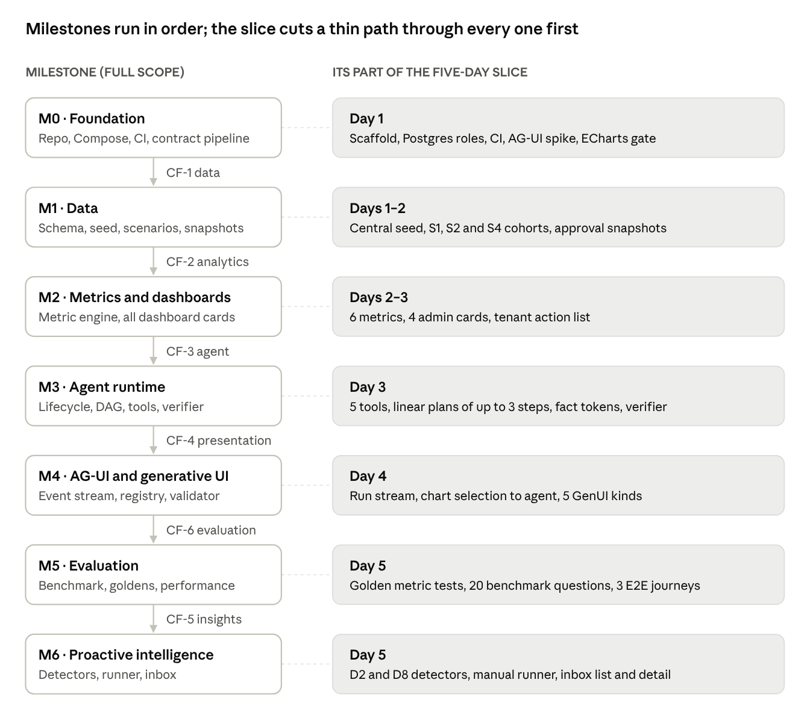

# 1 · Milestone dependency plan

## Dependency graph

The seven milestones form one chain of hard dependencies. Each arrow is passable only when two things hold: the previous milestone's gate has passed, and the contract freeze named beside the arrow is approved. The five-day slice builds a thin version of each milestone first, then the full scope extends the same code.

| Milestone | Hard dependencies | Gate (exit) | Slice part |
| --- | --- | --- | --- |
| M0 Foundation | Approved M0 specs, CF-0 | `make up` and CI green; contract drift check proven; AG-UI spike report; ECharts verification run recorded | Day 1 |
| M1 Data | M0 gate, CF-1 | Seed reproducible by hash; GI invariants 51/51; canonical figures match; snapshots equal parity at as\_of | Days 1–2, Central region only |
| M2 Metrics and dashboards | M1 gate, CF-2 | Golden metric tests pass; card totals = records totals; 12 admin cards and tenant groups; ECharts gate passed or fallback applied | Days 2–3, 6 metrics and 4 cards |
| M3 Agent runtime | M2 gate, CF-3, model configuration (GDQ-12) | Verifier rejects ungrounded numbers; J1–J10 pass with the replay provider; budgets enforced | Day 3, linear plans only |
| M4 AG-UI and generative UI | M3 runtime, CF-4 | Event fixtures validate against AG-UI 1.0 SDKs; every kind has schema, fallback and fixture; DX5 journeys pass | Day 4, 5 kinds |
| M5 Evaluation | M3 and M4 gates, CF-6, DR-036 | 150+ benchmark cases scored; thresholds met; latency measured (NFR-01) | Day 5, 20 questions |
| M6 Proactive intelligence | M5 gate (DR-010), CF-5 | Replay hash stable; S1–S9 fire and N1–N11 stay quiet; R1–R13 pass; K1–K12 pass | Day 5, D2 and D8 |

The slice's M6 part depends only on M2 snapshots and M4 insight rendering, so DR-010 still holds for the complete M6.

## Concurrency and contract blocking

Work can run in parallel once the contract it consumes is frozen. Before that point, parallel work produces rework. A contract freeze (CF) is the approval of the specification files that define it; the generated schemas are then committed and CI drift-checked.

| Freeze | Frozen by (spec PR) | Contracts it fixes | Unblocks |
| --- | --- | --- | --- |
| CF-0 Toolchain | M0 | Repo layout, error envelope, AccessScope interface (deny by default), codegen pipeline, CI jobs | All implementation |
| CF-1 Data | M1 | Tables, enums, roles and schemas; metric semantics (YAML); permission matrix; scenario manifest; canonical figures | Seed generator, SQL templates, fixture principals |
| CF-2 Analytics | M2 | metric query, analysis\_result.v1, card view-models, records paging, selection\_ref.v1, design tokens | Dashboard UI against fixtures, metric engine, tools |
| CF-3 Agent | M3 | AnalysisPlan, tool input/output schemas, AnswerDraft, fact tokens, evidence envelope, LLM adapter interface, evaluation case schema v1 | Agent runtime, evaluation harness |
| CF-4 Presentation | M4 | cenomi.presentation.v1 and per-kind schemas, composition policy, AG-UI event mapping and state shape | GenUI renderer, AG-UI client, server composer |
| CF-5 Insights | M6 | insight.v1, detector configuration schema, runner protocol, inbox API | Detectors, runner, inbox UI |
| CF-6 Evaluation | M5 | Full benchmark composition and scoring rules (needs DR-036) | Benchmark authoring, scoring runs |

CF-5 is frozen before CF-6 because the slice needs the insight contract but not the scoring rules. The slice’s 20 benchmark questions use the case schema frozen in CF-3.

### What may run concurrently

| Stream A | Stream B | Allowed after | Shared contract that blocks it |
| --- | --- | --- | --- |
| Specification writing for milestone n+1 | Your review of milestone n | Milestone n PR opened | None: review comments may revise n+1 drafts |
| Seed generator (M1) | Dashboard shell and card components on fixture view-models (M2 UI) | CF-2 | Card view-models, design tokens |
| Metric SQL templates (M2) | Micro-fixture authoring (tests/fixtures) | CF-1 | Metric semantics YAML |
| Agent runtime (M3) | GenUI renderer and registry on presentation fixtures (M4 UI) | CF-4 | Presentation schemas |
| Agent runtime (M3) | Evaluation harness and replay provider (M5 tooling) | CF-3 | AnalysisPlan, AnswerDraft, tool schemas |
| Detectors D1–D8 (M6) | Inbox UI on insight fixtures (M6 UI) | CF-5 | insight.v1, inbox API |
| AG-UI spike (M0) | ECharts verification run (M0) | M0 start | None |

### What must stay sequential

- No SQL template before CF-1. Metric semantics and the scope fragment rule must exist first.
- No agent tool before the metric engine passes its golden tests (M2 gate). Tools wrap that engine; they never get their own SQL.
- No AG-UI integration before the run lifecycle and the event mapping are both fixed (M3 runtime plus CF-4).
- No proactive runner before the as-of snapshots reconcile with the parity metrics (GDQ-03). The runner replays those snapshots.
- No change to a frozen contract without a CR and a schema version bump. Breaking changes create a new v2 schema; v1 keeps its consumers until they migrate.

With one developer, these streams interleave within a day rather than running side by side. They matter most for Composer sessions, which can be scoped to one stream, and for Option C (a second developer).
