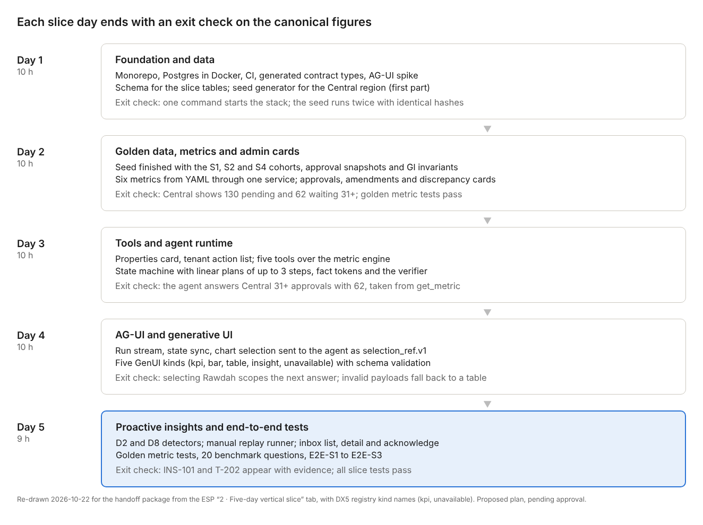

# 2 · Five-day vertical slice

The slice is one integrated path through every layer, built in five working days (about 49 focused hours). It proves the claims the design rests on: one metric service feeds the charts, the agent and the detectors; the LLM never computes a number; generative UI payloads are validated; a chart selection scopes the conversation; and a proactive insight carries its evidence. The complete DX1–DX6 scope follows in the full-scope milestones (tab 3).

## Scope in

| Layer | Exactly this | Source of truth |
| --- | --- | --- |
| Personas | Portfolio admin, Central manager, tenant user on lease T-31206 (Lumen Home, Sandstone Galleria) | specs/authorization, tests/fixtures/principals |
| Data | Full schema for the slice tables; deterministic seed for the Central region; golden cohorts S1, S2, S4 and T-31206; weekly approval snapshots 21 Jul → 20 Oct | DATABASE\_SCHEMA, scenario manifest |
| Metrics | approvals.pending\_by\_delay v1, approvals.pending\_by\_delay.asof v1, amendments.pending\_by\_age\_band v1, unit\_discrepancy.units v1, units.vacant v1, tenant\_action\_items.open v1 | specs/metrics |
| Admin cards | Pending approvals (half gauges), Pending amendments (heatmap), Unit discrepancy (diverging bars), Properties | DX2, DX3 |
| Tenant | Action required list for T-31206 only | DX2 Tenant |
| Tools | describe\_metric, get\_metric, compare, get\_underlying\_records, derive | AGENT\_TOOLS |
| Agent | Lifecycle states, linear plans of up to 3 steps (no parallel branches, no re-plan), fact tokens, verifier with one retry, budgets | AGENT\_ARCHITECTURE |
| AG-UI | Run lifecycle, text stream, sanitized tool events, state sync of dashboard context, selection\_ref.v1 from a chart to the agent, CUSTOM presentation events | AGUI\_INTEGRATION |
| Generative UI | kpi, bar, table, insight, unavailable (DX5 registry kind names); server and client validation; table fallback | GENERATIVE\_UI |
| Proactive | detectors-1.1 D2 and D8 only; replay runner triggered by a command; idempotent publish; inbox list, detail with evidence, acknowledge | PROACTIVE\_INTELLIGENCE |
| Tests | Golden metric tests for the 6 metrics; GI invariants for Central; 20 benchmark questions on the replay provider; E2E-S1 to E2E-S3 in Playwright; isolation tests for the tenant | EVALUATION\_PLAN |

## Scope out (kept for full scope)

- 8 admin cards and the rest of the tenant dashboard; Western and Eastern regions in the seed.
- Parallel DAG branches, re-planning, clarification, history and resume; the analytical workspace screen.
- get\_breakdown, get\_trend, get\_data\_coverage, get\_related\_metrics, reuse\_dataset, get\_linked\_cohort.
- 10 more GenUI kinds and the GDQ-02 variants; View as; the inspector's Execution tab.
- D1, D3–D7, the event-triggered runner, notifications outbox and badge, investigate, dismiss, snooze, digest, shared summaries, feedback ordering (GDQ-05).
- The full 150-question benchmark, live-model evaluation, performance runs.

In the full replay INS-101 merges into INS-107 when D6 runs. The slice has no D6, so INS-101 stays standalone. The slice golden replay is a separate fixture with its own hash.

## Day plan

*(Re-drawn 22 Oct 2026 with DX5 registry kind names.)*

If day 2's exit check fails, work stops until the seed or metric definitions are fixed. Every later day depends on those numbers.

## Demo journeys

| ID | Persona | Steps | Expected result |
| --- | --- | --- | --- |
| E2E-S1 | Central manager | Open the admin dashboard; select Rawdah on Pending approvals; ask “How many of these are waiting 31+ days, and what share of Central is that?” | Card shows Central 130 pending and 62 waiting 31+. Answer: 41 waiting 31+, 66.1% of Central’s 62. Rendered as kpi plus bar. Evidence shows the get\_metric calls and the derive calculation. Filters inherited: Central, Rawdah Point Mall. The word “overdue” does not appear |
| E2E-S2 | Central manager | Run the slice replay to 20 Oct; open the inbox; open INS-101; acknowledge | INS-101 (D2, approvals waiting 31+ days rising at Rawdah Point Mall) is listed with its weekly series and threshold facts from detectors-1.1. Acknowledge is stored once, even if repeated |
| E2E-S3 | Tenant on T-31206 | Open the tenant dashboard; open the inbox; ask “What do I need to do?”; then ask about another tenant’s sales; then ask for payments | Action required shows 2 items. T-202 (D8, 2 items, oldest waiting 8 days, P2) is visible to this lease only. The answer is scoped to the lease. The cross-tenant question gets the uniform refusal. Payments return an unavailable card |

## Preconditions and gate

- **Before day 1:** specification PRs for M0–M4 and the M6 slice part merged; the slice plan approved; a model provider, primary and fallback models and an API key configured (GDQ-12); the replay provider's recorded responses for the 20 benchmark questions created on day 3 from the live model.
- **Day 1 mandatory gate (GDQ-06):** the DX3 gallery self-test runs on real ECharts 5.6.0 in CI. If the gauge or heatmap fails its thresholds, the DXD-23 fallback for that chart applies before day 2.
- **Slice done when:** every daily exit check has passed; E2E-S1 to E2E-S3 pass in CI; no test is skipped; STATUS.md records the slice result and any defects as CRs or issues.
