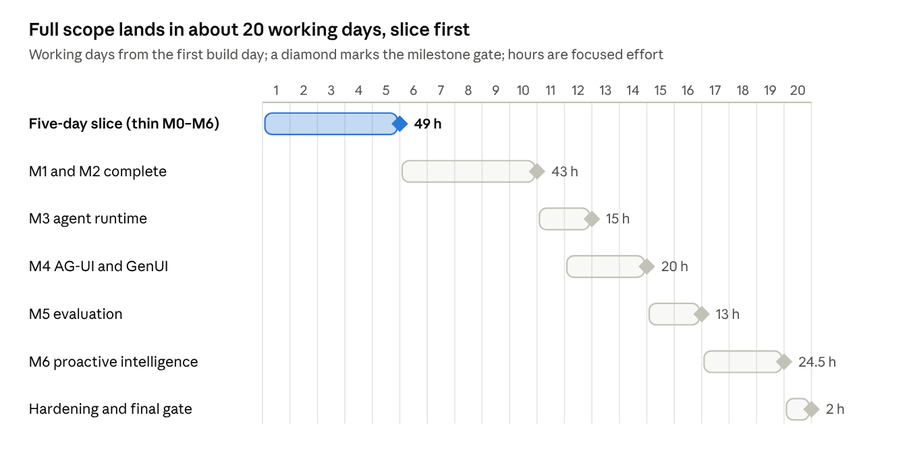

# 3 · Full-scope implementation roadmap

The full scope is about 166.5 focused hours: 49 in the slice and 117.5 after it. With one developer that is about 20 working days. Each milestone below lists what it delivers, the interfaces it provides and consumes, its acceptance criteria, its tests and the gate that closes it. Specification writing happens before day 1 and is not on this timeline (tab 4).

M3 and M4 overlap on day 12: the GenUI renderer is built against presentation fixtures once CF-4 is frozen. The hours after the slice come from the GD feasibility table, minus the slice hours.

## M0 · Foundation

| Aspect | Specification |
| --- | --- |
| Deliverables | Repository scaffold (tab 5); uv and pnpm workspaces; Docker Compose with db, api, web and one-shot migrate and seed services; Postgres init with roles and schemas; FastAPI skeleton (settings, structured logs, OpenTelemetry, /health, error envelope); Next.js shell with rail, layout and synthetic-data banner; contract pipeline proven on one sample schema; CI workflows; .cursor/rules and AGENTS.md; dev sign-in with fixture principals; AccessScope interface, deny by default; AG-UI spike report; ECharts verification harness |
| Provides | ErrorEnvelope; Principal; AccessScope.authorize(principal, scope) → ScopeDecision (interface); make targets; environment variable catalogue; required CI checks |
| Consumes | Approved M0 specifications; ED-01 to ED-09 |
| Acceptance | From a clean clone, `make up` serves the shell on :3000 with the synthetic banner; /health reports database and role checks; `make codegen` is idempotent; CI fails when a committed generated file differs; a principal without grants gets an empty scope; no secret in the repository |
| Tests | Unit: settings, error envelope. Integration: role grants (reader cannot write; app role cannot write business schema). Contract drift test. Playwright smoke of the shell. ECharts gallery self-test on 5.6.0 |
| Gate | All acceptance met; ADR-0001 to ADR-0006 accepted; spike report reviewed; ECharts result in STATUS.md |

## M1 · Data

| Aspect | Specification |
| --- | --- |
| Deliverables | SQLAlchemy Core metadata and Alembic migrations for the business, snapshot, seed\_meta, agent and insights schemas; deterministic seed generator (latent model, lifecycles, S1–S9, N1–N11, TA §5.3 mapping, golden cohorts, missing and inconsistent data as specified); materialized as-of snapshots for approvals.pending\_by\_delay.asof, amendments.pending\_by\_age\_band.asof and units.vacant.asof (GDQ-03); `make db-reset`; seed hash |
| Provides | Tables and enums; dataset sd-2026.10.20-01 with its hash; snapshot tables; fixture principals with grants |
| Consumes | CF-1 |
| Acceptance | Two resets produce the same hash; GI invariants 51/51; every canonical figure matches exactly; each snapshot at as\_of equals the parity metric for every mall and region; the agent role cannot read seed\_meta; no orphan foreign keys; reset time measured and recorded |
| Tests | Property tests on lifecycle generators; invariant and scenario assertion tests; grant tests; snapshot reconciliation tests |
| Gate | Acceptance met; DATABASE\_SCHEMA generated reference committed; STATUS updated |

## M2 · Metrics and dashboards

| Aspect | Specification |
| --- | --- |
| Deliverables | Metric registry loader with startup validation and scope lint; one SQL template per metric with the scope fragment and the as\_of parameter; analytics executor (binding, coverage, calculation records, content-addressed datasets); REST API for metric queries, card view-models, filter options and cursor-paged records; 12 admin cards and the tenant groups (DX2, DX3); card focus with Chart, Table, Records and Definition tabs; viz primitives (ECharts wrappers, HTML visuals, squarified treemap per GDQ-07) |
| Provides | MetricQuery; analysis\_result.v1; card view-models; records API; selection\_ref.v1 emitted by every selectable chart |
| Consumes | CF-1, CF-2; M1 data |
| Acceptance | Golden metric tests pass (micro fixtures and macro expected outputs); for every card the card total equals the records total under the same filters; an empty scope returns an empty result, not an error; a tenant cannot widen scope through parameters; each parity caveat has an exposing row and a test; ECharts gate passed or DXD-23 fallback applied; no serious axe-core violation |
| Tests | Metric contract tests; API integration; scope-tampering security tests; Vitest component tests; Playwright smoke per card; axe-core |
| Gate | Acceptance met; parity table in KPI\_CATALOG regenerated |

## M3 · Agent runtime

| Aspect | Specification |
| --- | --- |
| Deliverables | LLM adapter (provider configuration, primary and fallback, structured output, replay provider); state machine; planner emitting AnalysisPlan; plan validator; DAG executor with budgets and at most one re-plan; all designed tools including get\_linked\_cohort (GDQ-09); fact extraction; synthesizer with fact tokens; verifier; clarification policy; analytical state store; immutable answer versions, history and resume; unavailable-concept handling; run ledger and traces |
| Provides | AnswerDraft; evidence envelope; run identity (threadId, runId, requestId, seq); internal run events for the AG-UI layer |
| Consumes | CF-3; metric engine; AccessScope; model configuration (GDQ-12) |
| Acceptance | J1–J10 pass on the replay provider; any narrative number not traceable to a fact is rejected; budgets end runs with a defined outcome; re-plan happens at most once; nothing the model writes is executed as SQL or arithmetic; J8 and J10 isolation pass; banned-term lint passes |
| Tests | Table-driven transition tests; tool golden examples; adversarial verifier suite; replay-based integration; prompt-injection-as-data tests |
| Gate | Acceptance met; replay fixtures for J1–J10 committed |

## M4 · AG-UI and generative UI

| Aspect | Specification |
| --- | --- |
| Deliverables | AG-UI 1.0 run endpoint mapping internal events to AG-UI events (DR-017); dashboard context state snapshot and delta; frontend tool propose\_dashboard\_filters with confirm and undo; React client hooks on @ag-ui/client (no CopilotKit); presentation composer (policy P1–P6), server validator, client zod validation; registry of 15 kinds plus GDQ-02 variants; shared EvidencePanel, StatementList and RecordsTable; View as; inspector; reconnect and cancellation; agent panel and analytical workspace |
| Provides | cenomi.presentation.v1 rendering; AG-UI event stream; frontend tool results |
| Consumes | CF-4; M3 runtime |
| Acceptance | Recorded event streams validate against the AG-UI 1.0 TypeScript and Python SDKs; every kind has a schema, a fallback, a fixture and an accessible alternative; an invalid payload falls back to the deterministic table; DX4 J1, J3, J9 and the DX5 journeys pass; reconnect resumes by seq without duplicates; no model-written HTML or URL is rendered |
| Tests | Event-fixture contract tests; Vitest renderer tests per kind; Playwright journeys; XSS payload tests |
| Gate | Acceptance met; DESIGN\_SYSTEM component states verified |

## M5 · Evaluation

| Aspect | Specification |
| --- | --- |
| Deliverables | Benchmark of at least 150 cases across the EVAL categories; harness for replay and live providers; scoring per DR-036; reports; UI schema checks; performance runs for NFR-01; a CI regression job on the replay provider |
| Provides | Scores per category; latency figures; regression gate |
| Consumes | CF-6; DR-036; M3 and M4 |
| Acceptance | Deterministic checks (KPI values, grounding, filters, isolation, schema validity) at 100%; judged criteria at the thresholds EVALUATION\_PLAN sets; p95 latency measured against NFR-01 |
| Tests | The benchmark itself; harness unit tests |
| Gate | Report reviewed by you; thresholds met or exceptions recorded as CRs |

## M6 · Proactive intelligence

| Aspect | Specification |
| --- | --- |
| Deliverables | Detectors D1–D8 per detectors-1.1; scoring and priority bands; deduplication and candidate log; lifecycle including Watch promotion; runner protocol (run\_key, claims, staging, atomic publish, outbox); event-triggered runs; in-app notifications with the bell opening the inbox filtered to new (GDQ-08); inbox, detail and versions; investigate into a private thread; shared summaries; feedback ordering (GDQ-05); snooze; digest |
| Provides | insight.v1; inbox API; notification badge counts |
| Consumes | CF-5; snapshots (M1); metric engine (M2); evidence and verifier (M3); insight kinds (M4); M5 gate (DR-010) |
| Acceptance | Full replay hash equals the golden hash; S1–S9 fire and N1–N11 stay quiet; runner tests R1–R13 pass; K1–K12 pass; privacy tests pass; each notification is delivered once per insight version and recipient |
| Tests | Detector unit tests on micro series; replay golden test; runner crash-injection tests; Playwright K journeys; privacy and role-change tests |
| Gate | Acceptance met; POC final gate review |
